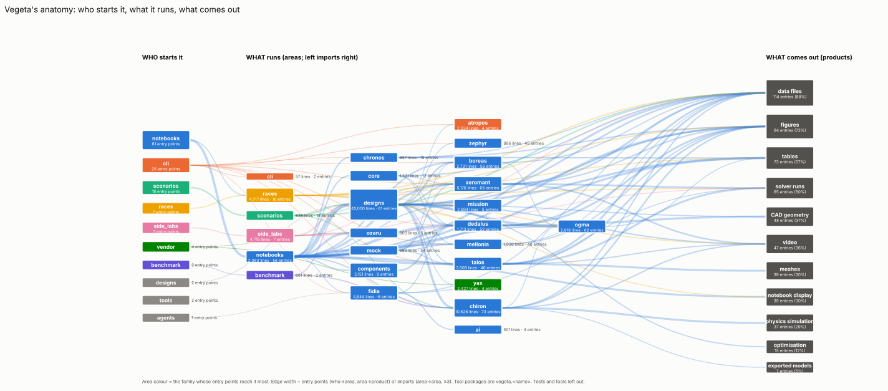

# Vegeta's anatomy: what it serves, what it is for, how it does it

Measured from its own syntax tree, not from its docs. Regenerate with:

```bash
python tools/dump_ast.py          # every .py and every notebook's code → out/vegeta_ast.xml.gz (~20 s, 7 MB)
python tools/ast_report.py        # lines, imports, funnels, orphans, duplicates → stats.json, funnels.svg, areas.dot
python tools/graph_metrics.py     # networkx: dependency + call graphs, the three questions → graph_metrics.json/.txt, anatomy.svg
```

Revision 4c241f8 + the tools (2026-10-21). Every number below is in `stats.json` or `graph_metrics.json`. The full
printed report is `graph_metrics.txt`.

## After the labs (2026-10-21, `libs/` + `labs/<lab>/<stage>/`)

The split predicted the graph effects below; regenerating this report after it measured them:

| metric | before | after |
|---|---|---|
| imports crossing labs | 7 production + ~25 tests/registries | **0** (enforced: `tools/labs.py check`, in smoke) |
| libraries importing lab code | 15 | **0** |
| modularity (labs + each library package) | 0.419 (29 directories) | **0.455** (25 groups) |
| who reaches a lab (entropy over labs) | `designs` served everyone | **0.0** for every lab: each lab is reached by itself only |
| who reaches a library (entropy over labs) | — | 0.57–0.99: the shared core (Chiron 0.767, Ogma 0.567, labkit 0.886) |
| instability | `designs` 0.72 | labs 0.98–1.0 (pure consumers), labkit 0.13, the tools 0.0–0.05 |
| duplicated components | 2.5k lines (components ↔ designs) | 0 (`components/` folded into `designs/`) |
| orphan modules | 15 | 17, all expected: the labs' `machines.py` (loaded by the registry), assemblies (loaded by spec), `exp/` limbo, CLI examples |

Import cycles after the refactor (2026-10-21): `vegeta.core` (workspace ↔ revision ↔ design) and dedalus
(`__init__` ↔ `yax_export`) are broken (`check_name` → `core/_io`, `__version__` → `dedalus/_version`); the atropos and
mellonia `cli` ↔ `__main__` pairs were a dump artefact (the string `"__main__"`). Three stay, by design and only at call
time: zephyr `polar` ↔ `export` (a polar saves itself; loading builds polars), `merlin_flight` ↔ `propulsor_maps` (the
library builds MERLIN's units; MERLIN reads the library), and the side-lab book registry (books read the campaigns'
fingerprints, campaigns read their chapters).

Every machine's stage is now where its files are (`python tools/lab.py list`, the lab READMEs).



## The size of it

| | |
|---|---|
| files | 704: 643 `.py`, 61 notebooks |
| lines | 131,333, of which **101,520 are code** (the rest are docstrings, comments and blank lines) |
| code by kind | library 63.5k · notebooks 15.3k · tests 14.3k · scripts 5.1k · vendored (Yax, Ozaru) 3.3k |
| biggest areas (code) | `designs` 36.5k · `notebooks` 15.0k · `vegeta.chiron` 7.7k · `vegeta.aeromant` 4.8k · `races` 4.4k · `vegeta.fidia` 3.7k · `side_labs` 3.6k · `components` 2.9k · `vegeta.talos` 2.9k |
| entry points | 61 notebooks · 25 CLI commands and `python -m` tools · 18 scenario scripts · 7 race scripts · 7 side labs · 2 benchmarks · 1 agent (Fidia) · 182 test files |
| graphs | 2,455 import edges between modules (115 dynamic) · 7,686 functions · 14,282 call edges (3,950 matched only by method name) |

## 1. What does it serve?

**People working in notebooks.** "Who reaches this code" (the serve set) puts the notebook family on top for almost every area:

| area | lines in functions | entry points reaching it | owner | purpose entropy |
|---|---:|---:|---|---:|
| `designs` | 45,000 | 61 | notebooks (38), scenarios (15) | 0.65 |
| `vegeta.chiron` | 10,526 | 73 | notebooks (54), scenarios (11) | 0.50 |
| `vegeta.aeromant` | 5,176 | 65 | notebooks (49) | 0.58 |
| `ogma` | 2,918 | 62 | notebooks (38), scenarios (10), races (6) | 0.68 |
| `vegeta.boreas` | 2,731 | 56 | notebooks (47) | 0.43 |
| `vegeta.dedalus` | 1,713 | 52 | notebooks (45), cli (3) | 0.35 |
| `vegeta.talos` · `vegeta.mellonia` · `vegeta.zephyr` | 3.5k · 1.0k · 0.9k | 46 · 46 · 45 | notebooks | 0.35–0.46 |
| `components` | 5,151 | 9 | notebooks only | 0.00 |
| `side_labs` | 4,715 | 7 | side labs only | 0.00 |
| `vegeta.fidia` · `vegeta.ai` | 4.6k · 0.5k | 6 · 4 | notebooks, cli, the agent | — |
| `assemblies` | 243 | 0 | **tests only** | — |

- **The CLI is a side door.** Each tool (`dedalus`, `talos`, `aeromant`, `mellonia`, …) has its own command, but those
  commands make up 3 of the 46–65 entry points that reach it. The tools live in practice as libraries called from notebooks.
- **The shared core** is the areas with high entropy and wide reach: `ogma` (the parts laws), `designs`, `vegeta.chiron`
  and `vegeta.aeromant`. Every kind of user goes through them.
- **Single-user islands** (entropy 0): `components` (9 notebooks), `side_labs` (its own 7 scripts), `scenarios`,
  `benchmark`.
- **Serves nothing outside its tests:**
  - 7.7k library lines (in functions) are reached only by tests.
  - 20.4k of 85.4k are reached by no entry point's calls. This is an upper bound: calls made through objects held in
    variables and registries escape the static analysis.
  - 15 modules (1.1k code lines) are imported by nothing at all.

## 2. What is its purpose?

**Engineering evidence for robot and drone designs.** The test is what the entry points' calls end up producing, rather
than what the docstrings say:

| product | entry points (non-test) | made mostly in | with |
|---|---:|---|---|
| data files (JSON, CSV, run directories) | 114 (88 %) | `vegeta.talos`, `vegeta.aeromant`, `designs` | json, pathlib, shutil |
| figures | 94 (73 %) | notebooks, `designs`, `races`, `vegeta.chiron` | pyvista, matplotlib |
| tables | 73 (57 %) | notebooks, `designs`, `races` | pandas |
| external solver runs | 65 (50 %) | `vegeta.talos` (CalculiX), `vegeta.aeromant` (OpenFOAM), `vegeta.mellonia` (PrusaSlicer), `side_labs` | subprocess |
| CAD geometry | 48 (37 %) | `designs` (65 % of paths), `vegeta.dedalus` | cadquery |
| video | 47 (36 %) | `designs`, `vegeta.aeromant`, `races`, `scenarios` | cv2, PIL |
| meshes | 39 (30 %) | `vegeta.talos` (61 %) | gmsh, trimesh |
| physics simulation | 37 (29 %) | `vegeta.chiron` (42 %), `designs` | mujoco |
| optimisation | 15 (12 %) | `designs`, `races`, `vegeta.chiron` | scipy, cma |
| exported models (for Piccolo) | 7 (5 %) | `yax` (74 %), `vegeta.chiron` | pxr (USD) |
| LLM answers | 0 found | `vegeta.ai` | anthropic: the agent picks its provider at run time, so static analysis does not see the call |

In one sentence: **Vegeta is a notebook-driven design lab.**
- About 60 notebooks each take one machine (a drone, a rover, a walker, a boat).
- Each notebook builds that machine from a parametric design in `designs/` on Ogma's part laws.
- It sends the design through standalone engineering tools: CAD (Dedalus), FEA (Talos), CFD (Aeromant), rotors (Boreas),
  airfoils (Zephyr), printing (Mellonia), dynamics (Chiron/MuJoCo).
- The output is evidence for a design decision: numbers, tables, plots and films.

Exported models for the robots' life after Vegeta (Piccolo) are new and small (5 %).

The declared purposes (the docstring of each area's most imported module) agree with this observed purpose tool by tool:
"standalone parametric CAD on CadQuery", "linear static structural analysis (Gmsh + CalculiX)", "external
aerodynamics on OpenFOAM", "legged-robot dynamics, a wrapper on MuJoCo", and so on.

## 3. How is it achieved?

The *mechanism funnels*: the share of entry-point→product call paths that go through each area, and how deep they run:

- **Figures, tables, data:** shallow (depth 0.3–0.5). Most are made right in the notebook or one call down, in
  `designs`. The visualisation helpers in the tools (`talos/viz.py`, `dedalus/viz.py`) are the main shared funnels.
- **CAD:** notebook → `designs` (65 % of paths) → `vegeta.dedalus` → cadquery. The designs hold the geometry; Dedalus is the
  thin framework (`Design.generate`, called 47 times).
- **FEA and meshes:** the deepest path (depth 4.0). Notebook → `vegeta.talos` (61 %) → `StructuralModel.mesh` (called
  50 times) → gmsh, then CalculiX through subprocess.
- **CFD:** notebook → `vegeta.aeromant` → `CFDCase.prepare` (50 calls) → OpenFOAM through subprocess.
- **Dynamics:** notebook or scenario → `designs/<machine>_robot.py` → `vegeta.chiron` (42 %) → `ChironLab.run` (the most
  called function in Vegeta, 67 callers, and the biggest orchestration hotspot) → mujoco.
- **Models for Piccolo:** `designs/export.py` → `yax` (74 %) → USD.
- **The debug harness is the biggest import funnel:** `vegeta.mock` is imported first by 54 notebooks
  (`VEGETA_DEBUG`).

Change blast radius (modules that import it, transitively): `ogma/mass.py` 354, `ogma/mujoco.py` 350,
`chiron/terrain.py` and `chiron/robot.py` about 320, Dedalus's core (`design`, `parameters`, `geometry`, `result`) about 305.
These are the modules to change most carefully.

Layering (area instability, 0 = only depended on):
- The engineering tools are clean leaves (0.0): Talos, Aeromant, Zephyr, Mellonia, Atropos, Chronos, Mission, Ogma.
- The machine layers depend on them: `designs` 0.72, `components` 0.62.
- Entry layers sit on top: notebooks, scenarios and benchmark at 1.0.

## Clean-up candidates (findings only, nothing changed)

1. **Byte-identical duplicates** (2.5k lines of copies):
   - `designs/` ↔ `components/`: `pekari_rover`, `myropod`, `velutina`, `fixed_wing`, `submarine`, `rover`,
     `survey_boat`, `quad_frame`. `apheloria`, `robot_dog` and `onager` differ by a few lines.
   - Helpers copied between the tools: `result.py` ×9 (every tool plus Fidia), `_process.py` ×3, `cache.py`,
     `_progress.py` and `_watermark.py` ×2.
2. **`components/` and `assemblies/`** serve 9 notebooks and the tests. `assemblies/` is reached only by tests, and
   15 of the 21 `components/` modules are orphans, reached only by tests, or copies of a `designs/` module.
3. **Orphan modules** (imported by nothing, started by nothing):
   - `assemblies/{quadcopter,submarine,survey_boat}.py`
   - `components/motor.py`
   - `designs/{rover,submarine,survey_boat,velutina}.py`
   - `designs/exp/mini_races.py` (599 lines)
   - `side_labs/flow.py`
   - `examples/cli/*`
4. **Code reached only by tests:**
   - `components/onager*.py` and `designs/robot_dog*.py`
   - `designs/turbojet.py`
   - `vegeta-core/.../cli.py` (the workbench CLI has no entry point in a pyproject)
   - `vegeta-ai/.../cli.py`
5. **Import cycles:**
   - `vegeta.core` (workspace ↔ design ↔ revision)
   - `zephyr` (polar ↔ export)
   - `dedalus` (`__init__` ↔ `yax_export`)
   - `designs` (`propulsor_maps` ↔ `merlin_flight`)
   - Between areas, in both directions: `designs` ↔ `side_labs`, and `vegeta.chiron`/`dedalus`/`core`/`cli` ↔ `yax`.
6. **Dependencies not declared anywhere:** `yaml` (side_labs) and `PIL` (races, Fidia; it currently arrives only through
   matplotlib). `terramechanics` is stale: it appears only in Ogma's hand-run re-record script, and the module is now
   `ogma.soil`.
7. **Unreferenced definitions:** 15 small ones (119 lines). Examples are `kestrel_study.envelope_vs_tools`, the cache
   `enable`/`disable` pairs in Aeromant and Talos, and `mini_races.tournament`.

## How the metrics are defined

- **entry point:** a notebook, a `[project.scripts]` command, a module with `__main__` (or a `__main__.py`), a test file.
- **family:** who starts the code. One of notebooks, cli, scenarios, races, side_labs, benchmark, agents, tests, …
- **serve set S(x):** the entry points whose call closure reaches x.
  - *breadth* = |S| / non-test entries
  - *owner* = the family most of S belongs to
  - *purpose entropy* = normalised Shannon entropy of S over families: 0 means one kind of user, 1 means everyone's
    infrastructure
  - *test-only*: S holds tests and nothing else
- **products:** what a function's third-party calls make (`PRODUCTS` in `tools/graph_metrics.py`). An entry point's
  profile is the set of products its call closure reaches.
- **mechanism funnel:** subset betweenness from one virtual node per entry point to every function that makes the
  product, normalised per product.
  - *depth* = mean call distance from an entry point to its nearest producer
  - *mechanism* = the libraries the producers call
- **calls:** resolved from the full AST:
  - local functions and classes, and names imported from Vegeta
  - `self.m()` inside a class
  - `obj.m()` matched by method name to methods in the caller's module and the modules it imports (marked `dispatch`)

  Calls through registries and `getattr` are not seen, so "unreached" is an upper bound.
- **funnel (imports):** entry betweenness on the module import graph (`funnels.svg`).
