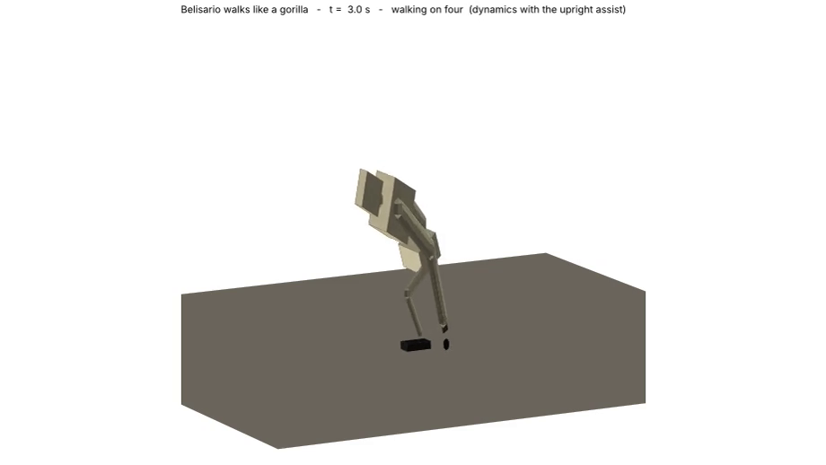

# Kerchak — the gorilla-human hybrid robot

Kerchak is the legged lab's gorilla: a robot skeleton with a gorilla's build on a human's spine. He knuckle-walks
on all fours, stands up when he needs to, climbs, opens doors, climbs through windows for bananas, and rides his
own electric quad. He is the bare frame of the space game units (`docs/space_units.md`): the same skeleton the
Marines, the Centurion, the Breacher and the Heavy wear their armour on, here without armour or weapons.

Design stage: everything below is CAD, sizing and MuJoCo simulation; nothing has been built.

## The body

A gorilla's long, wide barrel ribcage down to the pelvis, long thick arms with the hands at the knees, short
powerful legs and broad flaring iliac wings — on a human's S-curved spine (thoracic kyphosis, lumbar lordosis) so
that he can stand. Massive, stable, not fast. Against a human: 1.15× the height (1.73 m standing), 1.45× the
shoulders, 1.6× the chest depth, 1.4× the arms, 0.8× the legs.

Measured on the model (`space_unit_robots.bare(casing="plastic")`):

| | |
|---|---|
| mass | 384.5 kg (with the 3 mm polycarbonate casing) |
| shoulder width | 0.82 m (shoulder joints at ±0.41 m) |
| pelvis | 0.56 m wide, 0.27 m deep |
| arms | upper arm 0.54 m, forearm 0.50 m, hand ~0.2 m — the hands reach his knees standing |
| legs | thigh 0.36 m, shin 0.34 m |
| feet | 0.34 × 0.18 m |
| on all fours | pelvis 0.62 m up, pitched 0.45 rad nose-down, the back sloping ~35° |
| seated (on his quad) | centre of mass 0.99 m above the ground |

Every joint is a rotary actuator module (no linear actuators: the feet step over bars, they do not push on
pistons). The electronics sit in a chest bay inside the ribcage and a belly bay in front of the lumbar spine — the
ribcage is what protects them. `casing` chooses what covers the frame: `"none"` (the skeleton alone), `"plastic"`
(the translucent polycarbonate casing the sims draw) or `"lorica"` (the game units' armour).

### Joints — 57 actuated

| group | joints |
|---|---|
| spine | waist yaw; lumbar pitch and roll; thoracic pitch and roll |
| each arm | shoulder pitch, roll, yaw; elbow; wrist pitch and pronation |
| each hand | four fingers × three joints (knuckle, middle, tip); thumb opposition and flexion |
| each leg | hip yaw, roll, pitch; knee; ankle pitch and roll |

A gorilla's ranges: the ankles fold to −1.4 rad, the knees to 2.5 rad, the shoulders adduct 0.8 rad across the
chest.

### Hands

Real hands, the same in the robot, the CAD and the drawings: a 95 × 36 × 105 mm palm on a two-module wrist; four
fingers at human proportions (190 mm middle finger, three phalanges each), every phalanx on its own hinge — the
knuckle joints on self-locking harmonic drives with brakes, so a hang holds unpowered; a thumb that opposes and
folds across the fingers. One curl number drives a whole hand: 0 open, 1.4 the knuckle-walking fist, 2 a closed
fist. He walks on the backs of his middle fingers' middle phalanges, the way gorillas do.

## How he moves (`labs/legged/designs/gorilla_motions.py`)

- **Knuckle walk** — the lateral-sequence walk of every quadruped at a walk (left hind, left fore, right hind,
  right fore, a quarter cycle apart), duty 0.72, 0.26 m strides at 0.35 m/s, the wrists extended and the forearms
  leaning on the knuckles. With three contacts down most of the cycle and the heavy trunk low between them, this is
  the gait his proportions are for; a biped march on the same body only shuffled.
- **Rise / stand / drop** — up onto two legs and back in 3 s, the pelvis levelling as he rises.

## What he can do — the scenes (`gorilla_scenarios.py`, `gorilla_tasks.py`, `sims/space_gorilla_scenes.py`)

| scene | what he does |
|---|---|
| wall | climbs a rung wall, feet first then hands |
| tree | climbs a trunk with branches |
| hull | climbs the ribs of a 62° ship's hull |
| rope | climbs a rope hand over hand, the feet pinching it |
| window | pulls himself onto a sill, leaps in and walks to the table with the banana |
| obstacles | crouches and leaps over bars |
| door | walks up, closes his fist on the lever, turns it, shoves the door open and walks through |

`python labs/legged/sims/space_gorilla_scenes.py --scene door` plays one in MuJoCo and writes the movie and stills to
`labs/legged/sims/output/`. The climbs are kinematic references (keyframes); in physics they need a whole-body
controller he does not have yet.

## His quad (`gorilla_quad.py`, `sims/gorilla_quad_ride.py`)

A single-seat electric four-wheeler sized round him:

- **Fitted to him** — the seat as wide as his pelvis, footboards as long as his feet, a 1 m motorbike handlebar
  whose grips (50 mm, fist-sized) sit where his long arms reach with the elbows bent. His seated pose is solved by
  IK: fists on the grips and soles on the footboards within 5 mm across the full ±34° of steering.
- **Stable** — 1.80 m track, 1.70 m wheelbase; with him aboard it tips only past ~1.07 g of sideways acceleration.
  The battery and the motors sit low.
- **Four motors** — one per wheel, 6 kW peak each, on the frame (light wheels ride better), 268 N·m at each wheel:
  a 35 % slope with acceleration to spare, 45 km/h top speed, 7.2 kWh, ~64 km at 30 km/h.
- **Suspension, so he doesn't cry** — double wishbones and springs at all four corners (1.1 Hz), anti-roll bars,
  and a sprung seat (1.3 Hz). Over 10–12 cm bumps at 11 km/h his chest sees 0.93 m/s² (ISO 2631 weighted) against
  10.5 m/s² with the suspension locked.
- **Open trunk** — a tray over the rear axle with a wrench, a hammer and a toolbox.

In the simulation he rides it over bumps, through a cone slalom, and stops by the table with the banana. CAD (STEP
and STL for the whole quad and every part) is in `exports/gorilla_quad_cad/`.

**In progress:** the same quad made autonomous (lidars, steer-by-wire, a planner, emergency braking) and drivable by
a human or by Kerchak, with handover both ways (`gorilla_quad_autonomy.py`, `gorilla_quad_riders.py`,
`sims/gorilla_quad_auto.py`).

## Learning to walk (`training/`, `TRAINING.md`)

A PPO pipeline (PyTorch) with a curriculum over flat ground, rough ground, steps and his climbing scenes, domain
randomization and ONNX export, so a learned policy can replace the keyframes. Written but not yet run.

## Where things are

| what | file |
|---|---|
| the robot model | `labs/legged/designs/space_unit_robots.py` (`bare`) |
| dimensions | `labs/legged/designs/space_unit_specs.py` |
| the CAD for the sims | `labs/legged/designs/kerchak_mesh.py` |
| the renderer | `labs/legged/sims/kerchak_render.py` |
| gaits | `labs/legged/designs/gorilla_motions.py` |
| scenes and tasks | `labs/legged/designs/gorilla_scenarios.py`, `gorilla_tasks.py` |
| the quad | `labs/legged/designs/gorilla_quad.py`, `labs/legged/sims/gorilla_quad_ride.py` |
| training | `training/kerchak_rl/`, `TRAINING.md` |
| tests | `labs/legged/tests/test_gorilla_quad.py`, `test_designs_stage.py`, `test_motions.py`; `training/tests/` |

## Not done

- **No balance controller.** He walks in MuJoCo on an upright assist, not on his own feet; a stepping controller or
  the learned policy is next.
- **The climbs are kinematic.** In physics the grips need the fingers' self-locking drives and a whole-body
  controller.
- **On the quad** his pelvis is welded to the seat, and the steering motor turns the bar while his arms follow it;
  he does not balance on the seat or push the bar himself.
- **Training** has not been run.
