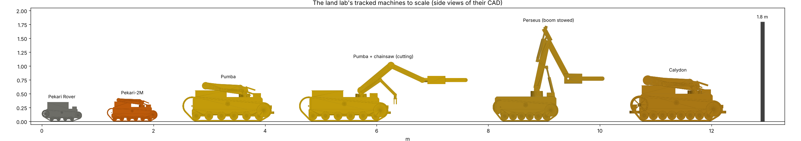

# Land lab comparison — Pekari Rover, Pekari-2M, Pumba, Perseus, Calydon

The land lab's tracked machines side by side. All five share the Pekari Rover's track architecture
(`pekari_rover_robot`), so their chassis numbers come from one model.
- **Pekari-2M, Pumba and Calydon** add arms through `pekari_family`.
- **Perseus** adds its boom through `perseus_robot`.

The table is generated by `labs/land/designs/land_comparison.py`; `python3 labs/land/sims/land_comparison.py --docs`
rewrites it here, with the figure. One rule applies to every machine for each row:
- **Envelope:** measured on the CAD with the arms folded, or Perseus's boom stowed.
- **Drive:** `ogma.tracks` on gravel with the nominal payload.
- **Driving endurance:** 0.8 m/s on flat gravel, 85 % of the battery usable.
- **Lift:** peak torque ÷ 1.5.
- **Saw margin:** stall ÷ torque, cutting outstretched with the cutting loads × 1.5. This is Perseus's own
  `arm_torques` measure.
- **Tip angle:** static, loaded, arms folded, level ground.

None of it is measured. The masses, actuators and prices are the models' class values, and their assumptions are
listed in each module.

<!-- table:begin -->
| | Pekari Rover | Pekari-2M | Pumba | Pumba + chainsaw | Perseus | Calydon |
|---|---|---|---|---|---|---|
| role | small tracked carrier (notebook 30), no arm | light dual-arm response platform | WILK-class dual-arm platform, the grab | Pumba with Perseus's saw on the main arm | branch-cutting rover (notebook 37), a saw boom | heavy-lift dual-arm platform (the first Pumba) |
| mass empty [kg] | 19 | 55 | 236 | 237 | 181 | 444 |
|   without arms / tools / stabilizers [kg] | 19 | 41 | 167 | 167 | 129 | 294 |
| deck payload | 5 kg | 20–40 kg | 100–200 kg | 100–200 kg | — (no deck) | 100–200 kg |
| mass with nominal payload [kg] | 24 | 85 | 386 | 387 | 181 | 594 |
| length [m] (arms folded / boom stowed) | 0.72 | 0.90 | 1.64 | 1.81 | 2.00 | 1.73 |
| width [m] | 0.49 | 0.58 | 1.08 | 1.08 | 0.87 | 1.15 |
| height [m] | 0.35 | 0.42 | 0.71 | 0.71 | 1.73 | 0.83 |
| tracks | 80 mm, 4 wheels/side, PA6 links | 100 mm, 6 wheels/side, PA6 links | 180 mm, 6 wheels/side, rubber band | 180 mm, 6 wheels/side, rubber band | 150 mm, 6 wheels/side, PA6 links | 200 mm, 8 wheels/side, PA6 links |
| track drives (x2) | pekari drive 16:1 planetary | perseus mini drive 20:1 planetary | pumba track drive 2.5 kW, 48 V | pumba track drive 2.5 kW, 48 V | perseus track drive 1.5 kW, 48 V | calydon track drive 4 kW, 48 V |
| top speed [km/h] | 5.6 | 5.2 | 7.9 | 7.9 | 6.8 | 8.2 |
| 20° grade loaded (peak, traction) | yes | yes | yes | yes | yes | yes |
| steepest grade held continuously (drive rating, traction) [°] | 27 | 16 | 19 | 19 | 28 | 18 |
| ground pressure loaded [kPa] | 3.4 | 5.9 | 8.3 | 8.3 | 6.6 | 11.1 |
| battery [Wh] | 240 | 960 | 2880 | 2880 | 1900 | 4800 |
| driving endurance, 0.8 m/s flat gravel [h] | 5.0 | 7.4 | 6.9 | 6.9 | 9.1 | 8.0 |
| arms | 0 | 2 | 2 | 2 | 1 | 2 |
| main arm DOF | 0 | 5 | 6 | 6 | 4 | 6 |
| main arm reach to TCP [m] | 0.00 | 0.97 | 1.58 | 1.93 | 2.15 | 1.92 |
| main arm lift rating (peak / 1.5) | — | 5 kg at 0.5 m | 30 kg at 1 m | — (a saw) | — (a saw) | 60 kg at 1.2 m |
| tools fitted | basket | parallel gripper + parallel gripper | two-jaw grab + parallel gripper | chainsaw 2 kW + parallel gripper | chainsaw 2 kW, 36 V (fixed) | two-jaw heavy grab + parallel gripper |
| saw (stall SF cutting outstretched, loads x1.5) | — | — | — | 2 kW, 40 cm bar (≤ 40 cm a pass); wrist SF 1.28, elbow 1.34 | 2 kW, 40 cm bar (≤ 40 cm a pass); wrist SF 1.56, elbow 1.35 | — |
| stabilizer legs | 0 | 0 | 2 | 2 | 0 | 4 |
| static tip angle, loaded, folded [°] | 50 | 49 | 52 | 52 | 42 | 53 |
| parts cost (class estimate) | not estimated | 20–47 k | 46–101 k | 45–98 k | not estimated | 68–143 k |
<!-- table:end -->

## Reading it

* **Pekari Rover → Pekari-2M:** one size up (55 kg, 0.58 m wide) to carry 20–40 kg and two 5-DOF arms. It still
  fits through a 0.8 m door and under a 0.5 m pipe rack.
* **Pumba against Perseus** (the two WILK-weight machines). Both are the Pekari architecture at roughly
  WILK's 180 kg class: Perseus 181 kg all in, Pumba 167 kg without its arms and 236 kg with them. Where they differ:
  - **Configuration:** Perseus is a single-purpose branch cutter: one 4-joint boom on two electric cylinders, with
    the saw fixed to it. Pumba is a carrier and manipulator: a 100–200 kg deck, two arms (6 + 5 DOF on joint
    modules) and interchangeable tools on the main arm's quick coupler. Its two-jaw grab lifts 30 kg at 1.0 m.
  - **With Perseus's saw on Pumba's coupler** ("Pumba + chainsaw"): Pumba reaches 1.93 m to mid-bar against
    Perseus's 2.15 m. Cutting outstretched with the loads × 1.5, its wrist keeps a stall safety factor of 1.28
    against Perseus's 1.56, and its elbow 1.34 against 1.35. Pumba cuts what Perseus cuts (≤ 40 cm a pass),
    slightly closer in and with a thinner wrist margin. The 400 N m cycloidal wrist module (+3.3 kg) would
    raise Pumba's wrist factor to about 3.4.
  - **Size and stowing:** Perseus stows its boom upright (1.73 m tall, 2.0 m long with the saw over the nose).
    Pumba folds its arms flat (0.71 m tall) and is wider (1.08 against 0.87 m) for its deck.
  - **Driving:** Perseus is lighter loaded (181 against 386 kg). It holds a steeper grade continuously (28° against
    19°), presses the ground less (6.6 against 8.3 kPa) and drives longer per charge on the same profile. Pumba is
    faster (7.9 against 6.8 km/h) and carries the deck load.
* **Calydon:** the heavy-lift option. Twice Pumba's arm rating (60 kg at 1.2 m), four stabilizers, 444 kg.
* **Tools:**
  - Pumba's main arm takes the grab or the 2 kW chainsaw on its quick coupler (`pumba_robot.TOOL_KIT`,
    `pekari_family.with_tool`, CAD parameter `tool`). Calydon's main arm can take the saw too.
  - The light arms' ISO flange takes grippers. Perseus Mini's 0.6 kW pruning saw fits that flange, but
    `pekari_arms.cut_check` shows the light arm cannot hold its cutting loads (stall safety factor 0.4–1.0), so
    it is not in the kit.
