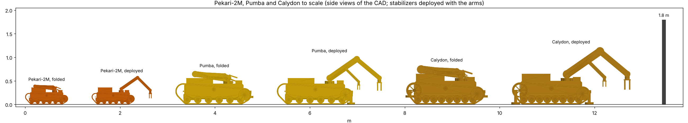
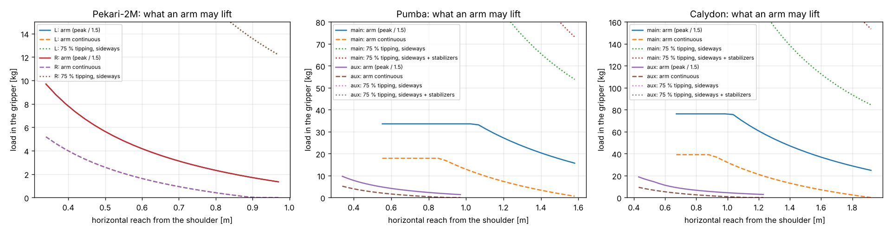
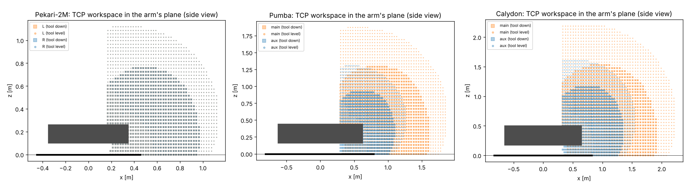
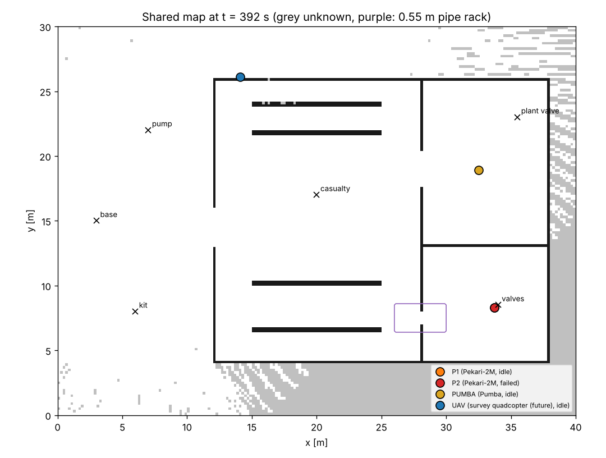

# Pekari-2M, Pumba and Calydon — the Pekari family of civilian response platforms

Two interoperable tracked platforms on the Pekari Rover's architecture, for confined-space inspection, industrial
handling, debris removal, logistics and emergency response — and a deterministic heterogeneous-fleet layer for them.
No weapon mounts. The colours are rescue/industrial: safety orange (Pekari-2M), signal yellow (Pumba) and ochre
(Calydon) arms on graphite hulls. Pumba is the light heavy platform (WILK-class mass). Calydon is the first,
heavier Pumba design, kept for lifts Pumba cannot make.

| | **Pekari-2M** (light, dual-arm) | **Pumba** (WILK class, dual-arm) | **Calydon** (heavy lift, dual-arm) |
|---|---|---|---|
| module / CAD | `pekari_2m_robot.py` / `pekari_2m.Pekari2M` | `pumba_robot.py` / `pumba.Pumba` | `calydon_robot.py` / `calydon.Calydon` |
| mass empty (without arms and stabilizers) | 55 kg (41 kg) | **236 kg (167 kg)** | 444 kg (294 kg) |
| mass with nominal deck load | 85 kg (30 kg) | 386 kg (150 kg) | 594 kg (150 kg) |
| envelope, arms folded (L × W × H) | 0.90 × 0.58 × 0.42–0.45 m | 1.60–1.64 × 1.08 × 0.71–0.77 m | 1.65–1.73 × 1.15 × 0.83–0.90 m |
| deck payload (target) | 30 kg (20–40 kg) | 150 kg (100–200 kg) | 150 kg (100–200 kg) |
| main arm | 2 × 5-DOF, 0.97 m, 5 kg at 0.5 m | 6-DOF, 1.58 m, **30 kg at 1.0 m** | 6-DOF, 1.92 m, 60 kg at 1.2 m |
| second arm | (the other 5-DOF arm) | Pekari-2M's arm (0.97 m, 5 kg at 0.5 m) | 5-DOF, 1.23 m, 8 kg at 0.7 m |
| stabilizers | none | 2 front legs, 8 kg each | 4 legs, 14 kg each |
| tracks | 100 mm PA6 links, 6 road wheels a side | 180 mm rubber band, 6 road wheels a side | 200 mm PA6 links, 8 road wheels a side |
| top speed (flat) | 1.4 m/s (5 km/h, design) | 2.2 m/s (8 km/h) | 2.2 m/s (8 km/h) |
| battery / endurance (mixed profile) | 48 V 0.96 kWh / ~4.8 h | 48 V 2.9 kWh / ~3.1 h | 48 V 4.8 kWh / ~3.4 h |
| 20° grade loaded | yes (peak), ~16° continuous | yes (peak), ~19° continuous | yes (peak), ~18° continuous |
| parts cost (class estimate) | €20–47 k | €46–101 k | €68–143 k |

The ranges in the envelope row are the CAD's measurement and the conservative estimate in `capabilities()`.
Every number above comes from code in this repository, and `python3 labs/land/sims/pekari_family_checks.py`
regenerates it (see §8 for the open validations).

---

## 1. Architecture assessment (what existed, what is reused)

**Implemented before this work** (inspected on branch `dev_pumba`, forked from the newest branch tip):

* **Pekari Rover** (`pekari_rover.py`, `pekari_rover_robot.py`, `pekari_controller.py`, notebook 30). It is a ~20 kg
  tracked rover with a 5 kg payload: 560 × 300 × 140 mm hull, 80 mm tracks of hinged PA6 links, a rear drive
  sprocket, a front idler and 4 road wheels on 2 bogies, two 100 W 16:1 track drives, a stereo camera and a 2D
  lidar. It has a parametric Dedalus/CadQuery design, a mass budget and CG from CAD × density, track, gear and
  terrain calculations from Ogma (`ogma.tracks`, `ogma.gears`, `ogma.soil`), and a Chiron (MuJoCo) model with
  tracks as rows of velocity-servoed rollers. Its track-drive controller (`TrackDrive`) runs missions over uneven
  terrain, hills and mud. It is registered for export (YX2/USD/MJCF through Yax). **It has no manipulator**: the
  basket on the roof is its payload deck.
* **The variant pattern on top of Pekari.** `prr.pekari(...)` takes keyword overrides: parameters, CAD numbers,
  parts, drive, extra children under the hull, extra masses and their moment in the battery placement, and the
  payload position. **Perseus** (`perseus_robot.py`, ~180 kg branch cutter) and **Perseus Mini** already build on
  it, so a heavier Pekari derivative with a boom was a solved pattern.
* **Manipulators.** The Onager Manus (`onager_manus_robot.py`) has two 4-joint arms with pincers: analytic IK/FK,
  catalogue joint modules and Chiron links. Perseus has a boom driven by electric cylinders, with static torques,
  workspace, tip-over and track-load checks. The conventions (yaw on a pedestal, pitch joints about y, elevation
  = −q) are reused unchanged.
* **Standard parts** in `libs/ogma` (actuator catalogue, tracks, motors, batteries), **Chiron** (MuJoCo
  robots, labs, terrains, episode logs), **Dedalus** (parametric CAD), **Yax export** (`designs/machines.py`), and
  `tools/lab.py`.

**Not present (confirmed by searching the repository):** any multi-robot, fleet, task-allocation, shared-map,
communication or supervision layer. No WOTAN, MIMIR, Wagenburg or similar subsystem exists. Chiron simulates
**one** robot per MuJoCo world. There was no aerial-drone ground-fleet integration and no ROS interface in this
repository (Piccolo, the ROS-side project, is separate and receives standard files only).

**Reused, not replaced:**
* `pekari_rover_robot` for both chassis: geometry, mass budget, battery placement, roller-track model, Chiron
  builder.
* `PekariRover` CAD as the base class of both CAD models.
* `pekari_controller.TrackDrive` drives both new machines unchanged.
* The Manus arm conventions.
* `ogma.actuators` (four entries added), `ogma.tracks`, Chiron, Dedalus and the Yax export.

The Pekari Rover's own files are untouched; the test `test_pekari_rover_is_untouched` checks its numbers.

**Added:**

| file | what |
|---|---|
| `designs/pekari_arms.py` | one arm description for the family: kinematics (5–7 DOF), statics, rated load vs reach, workspace, power, the Chiron link tree |
| `designs/pekari_family.py` | `Platform` (chassis + mounts + stabilizers + parts), mass/CG in 3-D, support polygon and tip-over, lift capacity, drive check, power/endurance, capabilities, BOM, the Chiron robot, a MuJoCo stand test |
| `designs/pekari_2m_robot.py`, `pumba_robot.py`, `calydon_robot.py` | the three platforms (parameters, stored CAD numbers, parts, assumptions) |
| `designs/pekari_2m.py`, `pumba.py`, `calydon.py` | their CAD (Dedalus): arms in named poses, stabilizers stowed / deployed |
| `designs/fleet.py` | heterogeneous fleet coordination (deterministic) |
| `designs/fleet_scenario.py` | the mixed-fleet civilian response scenario |
| `sims/pekari_family_checks.py`, `sims/fleet_response.py` | runners: numbers, figures, MuJoCo stand tests, the scenario |
| `tests/test_pekari_family.py`, `tests/test_fleet.py` | 62 tests on mocks (MuJoCo and CadQuery ones skip without them) |
| `libs/ogma/src/ogma/actuators.py` | `harmonic 12 Nm, brake`, `harmonic 30 Nm, brake`, `cycloidal 1600 Nm, brake`, `pumba track drive 2.5 kW, 48 V`, `calydon track drive 4 kW, 48 V` (class values, `assumed`) |

## 2. The reference: Stohid Technology WILK

Manufacturer-reported values, treated as such and not verified here:

| | value |
|---|---|
| mass empty | ~180 kg |
| payload | 200 kg |
| top speed | 8 km/h |
| size (L × W × H) | 1700 × 1170 × 700 mm |

They are in `pumba_robot.WILK_REFERENCE`.

Public sources found for this work are trade-press articles in Polish (defence24.pl, MSPO coverage). They describe
WILK as a light, modular, battery-electric UGV for carrying ammunition, equipment or water forward. It is a
Polish-built development of a system used in Ukraine, with a "China-free" component set.

**The sources disagree about its running gear.** One article describes it as wheeled. Another, about the newer
RYŚ, contrasts RYŚ as "developed as a wheeled vehicle, unlike WILK". The brief treats WILK as tracked. I could not
check photographs or a datasheet in this session, so the analysis below is about principles, not WILK's geometry.

Principles taken (no proprietary geometry copied):

* **A low, wide chassis.** WILK's width is 0.69 × its length and its height 0.41 × its length: a low CG over a wide
  track gauge. Pumba is 1.08 / 1.60 = 0.68 with a hull roof at 0.44 m. Its CG is 0.32 m empty and 0.40 m loaded,
  and the folded tip angle with 200 kg on the deck is 50°.
* **The battery low between the tracks**, placed to balance the machine. Pumba's is placed by `prr.masses` to
  put the empty, folded machine's CG over the road wheels' centre. It is one swappable 60 Ah module.
* **A flat equipment deck with standard fixing points**, the payload over the contact patch's centre. Pumba's
  560 × 340 mm deck sits behind the arms' pedestals.
* **Sensors high at the front, protected:** a sensor box on the nose, plus cameras at the wrists.
* **Maintenance access from the top:** roof hatches over the battery and electronics, and a swappable battery
  module. The track tensioner is on the idler slide, as on Pekari.
* **A light running gear.** WILK's mass implies a light band track rather than hinged links. Pumba uses a
  moulded rubber band track.

**Mass against WILK.** Pumba's chassis (everything but the arms and stabilizers) is 167 kg, under WILK's reported
~180 kg empty. With its two arms (54 kg) and two front stabilizers (16 kg) it is 236 kg. WILK carries no arm, so
the chassis is the like-for-like number. Calydon, the first design, is 294 kg of chassis and 444 kg in all.

## 3. Pekari-2M — the light response platform

Pekari-2M is the dual-arm version of Pekari; this work does not build a single-arm Pekari version. Pekari itself
(20 kg, 80 mm tracks, 100 W drives) is the wrong size for 20–40 kg plus two arms:
* Its 300 mm-wide roof has no room for two pedestals beside a deck.
* Loaded to ~64 kg, its two 16:1 drives reach their continuous rating at about 11° (`ogma.tracks.resistance`,
  gravel).
* The ground pressure under its 80 mm tracks rises to ~9 kPa.

So Pekari-2M is Pekari's architecture one size up, with the parameters in `pekari_2m_robot.CHASSIS`:
* 700 × 340 × 160 mm hull
* 100 mm tracks with 36 mm pitch
* 6 road wheels on 3 bogies a side
* the Perseus Mini's 20:1 track drives

* **Arms** (`pekari_arms.PEKARI_ARM`, two). Each has 5 DOF: yaw, shoulder, elbow, wrist pitch and wrist roll,
  on strain-wave modules with brakes (60 / 30 / 30 / 30 / 12 N m). The gripper is a parallel-jaw gripper on an
  ISO 9409 quick-change flange; other tools (hook, suction cup, probe, cutter) fit the same flange.
  - Reach is 0.97 m; each arm weighs 7.1 kg.
  - **5.6 kg at 0.5 m** at peak torque / 1.5 (rated 5 kg) and 2.3 kg at 0.8 m. Continuously (the rated torque,
    moving) it carries about half of that; holding still, the brakes carry the load.
  - Folded, the upper arm points back along the deck side and the forearm folds forward on top of it, grippers
    forward: 0.42 m high (CAD).
* **Sensors:** RGB-D at the front and at each wrist. A 3D lidar and a thermal camera are options (their mass is
  budgeted either way). The IMU is in the electronics.
* **Payload:** 30 kg on the deck. The drives hold it on a 20° grade at peak torque; continuously the limit is
  about 16°.
* **Confined spaces:** 0.58 m wide (a 0.8 m door) and 0.45 m high folded (a 0.55 m pipe rack). It turns on the
  spot (skid steer), and the ground pressure is 5.9 kPa loaded.
* **Interfaces kept:** the Pekari joint names (`L_sprocket` … `R_ramp_front`, bogies), `pekari_controller`, the
  CAD part names and the export path. Arm joints are `L_yaw … L_grip_a/b` and `R_…`.

## 4. Pumba — the heavy derivative at WILK-class mass, and Calydon

Pumba uses the same software, 48 V bus, arm conventions, joint naming, controllers, CAD base and export as
Pekari-2M (the test `test_shared_interfaces`). Its second arm *is* Pekari-2M's arm: one arm module serves the
family. The chassis (`pumba_robot.CHASSIS`):
* 1250 × 640 × 280 mm hull, 2 mm Al
* a welded Al 6082 frame with pedestal plates
* 180 mm moulded rubber band tracks (72 mm pitch) on 6 road wheels and 3 bogies a side
* 13-tooth sprockets (r = 150 mm)

Two 2.5 kW track drives (class values) give 8 km/h.

**Arms** (two by default):
* **main** (`PUMBA_MAIN_ARM`): 6 DOF (yaw, shoulder, elbow, wrist pitch, **wrist yaw**, wrist roll) on cycloidal
  and strain-wave modules (400 / 800 / 400 / 150 / 60 / 60 N m), with a two-jaw grab on a quick coupler.
  - Reach is 1.58 m; the arm weighs 46.5 kg.
  - **30 kg at 1.0 m** (34 kg up to 0.95 m) at peak / 1.5; 20 kg at 1.4 m and 16 kg at full reach.
  - The joint torques at the rating are 468 N m at the shoulder (stall 800), 221 at the elbow (400) and 91 at
    the wrist (150).
* **aux:** Pekari-2M's 5-DOF arm (0.97 m, 5 kg at 0.5 m, 7.1 kg). It holds, steadies or cuts while the main arm
  lifts.
* The arms sit at the front corners and fold back along the deck's sides.

**Stabilizers:** two front swing-out legs with 8 kN electric cylinders, pads at (0.75, ±0.72) m, 8 kg each.

### Where the mass went (Pumba against Calydon)

| | Calydon | Pumba | change |
|---|---|---|---|
| tracks: links + pins / rubber band | 39.3 + 21.7 kg | 35.0 kg (2 × 3.50 m at 5 kg/m) | −26 kg |
| wheels, sprockets, idlers | 36.9 kg (8 wheels a side, 35 % fill) | 17.0 kg (6 a side, 25 % fill) | −20 kg |
| hull shell | 25.4 kg (3 mm, bigger hull) | 14.4 kg (2 mm) | −11 kg |
| hull frame | 38 kg (steel subframe) | 20 kg (welded Al) | −18 kg |
| track frames, bogies | 32 kg | 18 kg | −14 kg |
| track drives | 2 × 18 kg (4 kW) | 2 × 11 kg (2.5 kW) | −14 kg |
| battery | 44 kg (4.8 kWh) | 26 kg (2.9 kWh) | −18 kg |
| electronics, sensors, wiring, deck | 20.4 kg | 14.2 kg (no radar) | −6 kg |
| **chassis** | **294 kg** | **167 kg** | **−127 kg** |
| arms | 80.4 + 13.9 kg | 46.5 + 7.1 kg | −41 kg |
| stabilizers | 4 × 14 kg | 2 × 8 kg | −40 kg |
| **empty** | **444 kg** | **236 kg** | **−208 kg** |

**What Pumba gives up.**
* **Lift:** 30 kg at 1.0 m against Calydon's 60 kg at 1.2 m, and 1.58 m reach against 1.92 m.
* **Endurance:** a smaller battery, 3.1 h against 3.4 h.
* **The radar.**
* **Stabilizers:** two legs instead of four.

The deck payload (100–200 kg) and 8 km/h are unchanged, and the 20° climb loaded still holds.

**Calydon** (`calydon_robot.py`, `calydon.Calydon`, the first Pumba design, unchanged in its numbers):
* hull 1300 × 700 × 330 mm in 3 mm Al, 200 mm PA6 link tracks on 8 road wheels a side, a steel subframe
* two 4 kW drives and 4.8 kWh
* `CALYDON_MAIN_ARM`: 6 DOF, 1.92 m, 60 kg at 1.2 m, 80 kg
* `CALYDON_AUX_ARM`: 5 DOF, 1.23 m, 8 kg at 0.7 m
* four 12 kN stabilizers

It is the machine for heavy lifts at reach.

### Calculations

**Unvalidated assumptions.**
* Masses come from tube lengths, catalogue entries and an assumed rubber-track mass (5 kg/m), not weighed CAD or
  real products.
* The actuator entries added here are class values.
* The stability analysis is static, on level ground.

Each assumption is listed in `Platform.assumptions` and `ArmSpec.assumptions`.

| quantity | Pumba | Calydon | how |
|---|---|---|---|
| mass | 236 kg empty, 386 kg with 150 kg | 444 / 594 kg | `pf.mass_budget` |
| CG (x, y, z), loaded | (−0.12, 0.02, 0.40) m | (−0.08, 0.03, 0.41) m | `pf.cg`; y ≠ 0: the main arm is heavier than the aux |
| support | contact 1.28 × 1.08 m; with pads to x = 0.75, y = ±0.72 | 1.32 × 1.15 m; pads to a 1.55 × 1.60 m polygon | `pf.support_polygon` |
| stability folded, 200 kg on the deck | margin 0.52 m, tip 50° | margin 0.55 m, tip 52° | `pf.stability` |
| lift, main arm sideways, 1.0 m (Calydon 1.2 m) | arm 34 kg; tips at 152 kg (222 kg with pads) | arm 61 kg; tips at 235 kg (474 kg) | `pf.lift_capacity`; capacity = min(arm, 0.75 × tipping) |
| lift, main arm sideways, 1.4 m (Calydon 1.6 m) | arm 20 kg; tips at 87 kg (120 kg) | arm 37 kg; tips at 150 kg (279 kg) | the arm limits at every reach on both |
| drive, 20° loaded | 1530 N needed, 3680 N peak, 2120 N traction; continuous 1460 N (≈ 19°) | 2350 / 5410 / 3260 N; ≈ 18° | `pf.drive_check` (gravel) |
| ground pressure | 8.3 kPa loaded | 11 kPa | `ogma.tracks.ground_pressure` |
| power, mixed profile | 790 W average (250 W driving at 0.8 m/s, ~1.9 kW both arms working, 100 W electronics) | 1.2 kW | `pf.power` (50 % driving, 30 % manipulating, 20 % idle) |
| endurance | ~3.1 h on 2.9 kWh | ~3.4 h on 4.8 kWh | `pf.endurance` (85 % usable) |

## 5. Heterogeneous fleet (`designs/fleet.py`)

There was nothing to reuse, so `fleet.py` is new. It is small and **deterministic**: the same inputs give the same
allocation, events and result, so the scenario is a regression test. Learned multi-agent policies are not used;
they would be measured against this baseline.

* **Capability-based task allocation.** Agents carry a `Profile`: capability tags, deck payload, arm lift, width,
  folded height, speed, endurance and sensor range. Pekari-2M and Pumba profiles come straight from
  `pekari_family.capabilities`. A task names its tags, payload, lift, dependencies (`after`) and whether it needs
  approval. Allocation is a sequential single-item auction: the cheapest eligible (agent, task) pair is assigned
  first, the cost is travel time plus work time divided by priority, and ties break on ids. The path is planned
  lazily only for the winning pair.
* **Width- and height-aware planning.** A* runs on a 0.2 m grid. A robot passes where the free width (from a
  Euclidean distance transform) is at least its width + 5 cm and the headroom is at least its height + 5 cm. That
  is how "only Pekari-2M fits under the pipe rack" and "only Pumba lifts the debris" (30 kg pieces) come out of the numbers, not
  rules.
* **Shared mapping and situational awareness.** Each agent maps with range sensing (rays stop at walls; the drone
  maps outdoors from above). The coordinator merges connected agents' maps cell by cell, the newest observation
  winning (time stamps), so cleared debris propagates. Exploration targets frontier clusters, and frontiers no live
  agent can reach are given up and retried when a route opens.
* **Coordinated exploration and logistics:** explore tasks are generated from the shared map. Transports go pickup
  → work → deliver. A clear-debris task is raised when debris is seen, and dependent tasks wait for it.
* **Dynamic reassignment:**
  - A failed agent's task is released after `T_RELEASE` (90 s) of silence and re-auctioned.
  - A blocked path makes the agent replan, then release the task.
  - A task an agent dropped out of contact is freed when it reconnects.
* **Communication-loss recovery:**
  - The mesh has a link when distance + 6 m per wall cell is within 40 m, and agents relay.
  - An agent out of contact finishes its task and keeps the result. After `T_RETURN` (60 s) idle it goes back to
    its last connected point, then home.
  - On reconnection it reports work done offline. If the coordinator had handed that task to someone else, the
    duplicate is cancelled.
* **Human supervision and emergency override:** the `Supervisor` commands are applied before anything else each
  tick:
  - emergency stop (all or one agent; latched until reset)
  - hold / release
  - approvals, including pre-approval of a task not yet reported
  - add or cancel a task

  The e-stop travels on a **separate safety radio**, modelled as independent of the mesh, as industrial radio
  e-stops are.
* **Future agents:**
  - `drone_profile()` is a survey quadcopter that maps and inspects from above, outdoors only.
  - `third_party_profile()` maps another maker's capability vocabulary onto the fleet's tags; unknown names are
    dropped, never invented.
  - The coordinator does not care what kind of agent it is.

## 6. Simulation and visualisation

* **Chiron (MuJoCo) models of the three platforms** (`pf.robot`): the Pekari roller tracks with the platform's drives
  and bogies, the arms as servoed joint trees with jaw grippers, and the stabilizers as slides with pads. Arm
  poses are `folded` / `deployed` / `reach`. Collision geometry: hull boxes, roller cylinders (tracks), arm tube
  boxes, palm and jaws (the pedestals and beams are visual). Each model's mass equals its budget (tested).
* **Stand tests** (`pf.stand_test`, MuJoCo, 1–1.5 s):

  | case | tilt | weight on the tracks | arm joint error |
  |---|---|---|---|
  | Pekari-2M, folded | 0.004° | 100 % | 0.6° |
  | Pekari-2M, deployed, 5 kg in each gripper | 0.007° | 100 % | 1.4° |
  | Pumba, folded | 0.002° | 100 % | 0.6° |
  | Pumba, deployed, 30 kg + 5 kg | 0.002° | 100 % | 1.4° |
  | Pumba, as above, pads down | 0.001° | 82 % (the pads take the rest) | 1.4° |
  | Calydon, folded | 0.001° | 100 % | 0.3° |
  | Calydon, deployed, 60 kg + 8 kg | 0.002° | 100 % | 0.9° |
  | Calydon, as above, pads down | 0.002° | 73 % | 0.9° |

  The arm errors are without gravity feed-forward.
* **Driving:** all three drive straight at 0.8 m/s with Pekari's `TrackDrive`, unchanged (tested). The roller
  gain is scaled with each machine's mass.
* **CAD** (Dedalus): `Pekari2M`, `Pumba` and `Calydon` with `arm_pose` (folded / deployed / reach) and `stabilizers` (none /
  stowed / deployed). The figure at the top shows them to scale from the CAD.
* **Mixed-fleet civilian response scenario** (`fleet_scenario.py`, `sims/fleet_response.py`). The fleet is two
  Pekari-2M, one Pumba and a survey drone at a collapsed industrial hall. The run takes 392 s and covers 100 % of
  the building:
  - Pekari-2M **P1** delivers 25 kg of first aid and water to a casualty (48 s).
  - The drone surveys the roof and yard (127 s).
  - Pekari-2M **P2** goes under the 0.55 m pipe rack into the control room for the thermal inspection, and has a
    drive fault at 40 s. After 90 s of silence its task is released, and P1 is assigned it as soon as it is back
    in contact (221 s); P1 finishes at 329 s.
  - The operator pre-approves the debris removal (60 s). Pumba clears the collapsed doorway (133 s), closes the
    plant-room valve with two arms out of radio range (done offline at 202 s, reported at 221 s), then carries the
    120 kg pump in (391 s).
  - The operator's emergency stop (240–270 s) freezes every agent (tested).
  - Without the drone the ground fleet still finishes.

**What the simulation does not do yet:**
* The fleet scenario is kinematic (1 s ticks on a grid). It is not one MuJoCo world with all robots, because
  Chiron simulates a single robot per world.
* Failed robots do not block passages.
* Grasping in MuJoCo is not exercised; the loads are point masses in the palms.

## 7. Incremental development plan

Each step keeps the previous ones working and adds tests; ✔ = done in this work.

1. **Pekari-2M manipulator integration**
   - ✔ Shared arm module: IK/FK, statics, rated load, workspace, Chiron links.
   - ✔ Two arms on the 2M, CAD poses, MuJoCo stand and hold tests.
   - Next: gravity feed-forward in an arm controller (the Manus/Perseus controllers' `qfrc_bias`); a pick-and-place
     mission with real MuJoCo contacts (grasping a box from the deck); wrist-camera models.
2. **Pumba (and Calydon) mechanical and simulation model**
   - ✔ Chassis, arms, stabilizers, mass/CG/stability/lift/drive/power, CAD, MuJoCo stand and drive tests.
   - ✔ Pumba redesigned to WILK-class mass (chassis 167 kg) with a rubber band track; the first design kept as
     Calydon.
   - Next:
     - a rubber-track supplier sheet in place of the assumed 5 kg/m, and the band's sprocket engagement
     - the deflection of the main arms and the frames (Talos FEA)
     - a MuJoCo tip test on a side slope with the arm at reach
     - brake-holding under power loss
3. **Shared robot interfaces**
   - ✔ One 48 V bus.
   - ✔ The same joint naming and arm conventions.
   - ✔ `capabilities()` as the fleet contract.
   - ✔ The export of both through Yax.
   - Next: message schemas (status, assignment, map tile, e-stop) as dataclasses with a ROS 2 mapping when
     Piccolo takes the machines; a tool-flange ID for interchangeable grippers.
4. **Multi-robot coordination**
   - ✔ Deterministic allocation, shared map, exploration, reassignment, comms recovery, supervision, drone and
     third-party profiles.
   - Next:
     - battery-aware scheduling with charging
     - multi-robot tasks (two robots on one load)
     - robots as obstacles (deconfliction)
     - a learned policy only as a challenger to this baseline
5. **Simulation scenarios and automated tests**
   - ✔ The response scenario and its variants.
   - ✔ 62 tests on mocks (`python tools/lab.py test land`).
   - Next:
     - a notebook (Pekari-2M / Pumba / Calydon, like notebook 30 / 37)
     - scenario sweeps (fault times, comm ranges)
     - the grasping and tip scenarios in MuJoCo
6. **Hardware feasibility, BOM and costs**
   - ✔ `pf.bom`: €20–47 k for a Pekari-2M, €46–101 k for a Pumba and €68–143 k for a Calydon (class prices, parts
     only, no labour).
   - Next: quotes for the strain-wave and cycloidal modules (60 % of the arm cost), the track drive, the battery;
     a bench test of one arm joint at its rated torque.

## 8. Validation status and open items

**Checked here.**
* Code consistency is tested: CAD ↔ parameters, the stored CAD ↔ a rebuild, the budget ↔ the MuJoCo masses, IK ↔
  FK, ratings ↔ drive limits, the support polygon ↔ hand geometry.
* The physics is consistent with Ogma's track, soil and drive models.
* MuJoCo statics and driving are in the tables above.

**Not validated.** Nothing is measured. Each item below is unvalidated:
* the new actuator entries (class values)
* the arm tube masses (no weighed CAD)
* the deflection and strength of the arms and of Pumba's and Calydon's frames
* the rubber band track's mass (5 kg/m assumed) and life on Pumba; track wear and pins at Calydon's load
* the internal track loss (Pekari's own open item)
* the power profile and the 85 % usable battery
* the WILK figures (manufacturer-reported)
* the BOM prices (estimates)

**Pumba against WILK.** Pumba's chassis (167 kg) is under WILK's reported ~180 kg. The figures it rests on that
most need checking are the track mass, the Al frame (no FEA yet) and the wheels at 25 % fill. With its arms and
stabilizers Pumba is 236 kg. Calydon (444 kg) stays the heavy-lift option.
