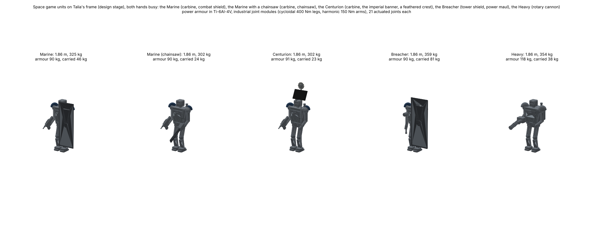

# Space game units — bulky armoured humanoids (design stage)

The legged lab's roster of game units: power-armoured humanoid robots on Talia's frame (`labs/legged/designs/humanoid.py`),
the way the ork and the ghoul are (`docs/exploration.md`, the fantasy humanoids). Four units, every one with both
hands busy, each a CAD design, a Chiron robot model with its masses from the CAD, keyframed motions, and a Yax export
(`exports/space_*.yx2`). Five units.

`space_squad_draw3d.py` sets a squad down in a wedge: the Centurion at the point with the banner, two Marines with
shields on its flanks, two with chainsaws behind them, the Breacher and the Heavy at the rear.

| unit | what it is | carries | mass | motions |
|---|---|---|---|---|
| **Marine** (`space_marine`) | the line unit: Talia's frame at the ork's bulk on longer legs, 1.86 m | a carbine in the right fist, along the forearm (the low ready at rest, level when the forearm comes up); a body shield on the left forearm covering it from the shins to the helmet | ~320 kg (armour 90, carbine 9, shield 30) | `march`, `aim`, `fire` |
| **Marine with a chainsaw** (`space_marine_saw`) | the Marine | the carbine; a chainsaw in the left fist, along the forearm | 303 kg (chainsaw 14) | `march`, `aim`, `slash` |
| **Centurion** (`space_centurion`) | the Marine with a feathered crest along the helmet | the carbine; the imperial banner in the left fist: a pole with a skull in a gear as the finial and the squad's flat phased-array antenna under it | ~300 kg (banner 8) | `march`, `aim`, `rally` |
| **Breacher** (`space_breacher`) | the Marine with the elbows nearly straight | a tower shield along the left forearm (upright, facing ahead, the whole body behind it), a power maul in the right fist | ~355 kg (shield 50, maul 26) | `march`, `shield_up`, `swing` |
| **Heavy** (`space_heavy`) | the Marine on a wider frame, the bigger backpack | a rotary cannon along the right forearm, fed from the backpack | 354 kg (cannon 38) | `march`, `suppress` |

## The design (`space_units.py`, numbers in `space_unit_specs.py`)

The armour is built on `Humanoid`'s body in its build pose: shoulder domes (pauldrons, Ø300, a 45 mm shell on a post
over the shoulder boss), a breastplate proud of the torso, a power pack behind it with two exhaust stacks, a waist belt
with a buckle plate, greaves over the shins with knee domes, boots over the feet, and a visor slit cut into the square
helmet. The weapons are built in the bent forearm's frame (`forearm_frame`: the hand at the origin, the forearm up +z,
its outer side +x, turned by the elbow's bend and set on the hand) so they move with the arm in the robot model:

- the **carbine**: a receiver on the forearm's outer side above the fist, the barrel forward along the forearm, a
  stock back along it, a sight, a magazine hanging from the receiver;
- the **body shield** (the Marine, 600 × 1600 mm) and the **tower shield** (the Breacher, 680 × 1750 mm), each covering
  the body from the shins to the helmet, with a vision slit: a plate with a rim and a boss on the forearm's outer side, a strap block round
  the forearm; the **chainsaw**: the motor body on the fist with a rear handle and a front hoop, the bar forward with a
  chain of teeth round its edge; the **imperial banner**: a pole standing vertical through the fist, a gear with a skull in
  it as the finial, and under it on a bracket the squad's uplink, a large flat phased-array antenna panel (a Starlink-class
  dish) facing forward and tipped back - no cloth; the Centurion's
  **crest**: a comb on the helmet with a row of feather fins leaning back; the **power maul**: a shaft through the fist, a steel head crosswise at the top, a pommel;
- the **rotary cannon**: a mount block on the forearm, a cluster of six barrels round a core, breech and muzzle rings,
  the feed tube from the backpack.

`part` builds the whole unit, the trunk, a thigh, a shin, a foot (as `Humanoid`), the `armour` alone or the `weapon`
alone; `armour_parts` / `weapon_parts` give the pieces by name. Every unit builds as one valid solid.

## The robot models (`space_unit_robots.py`)

Talia's model (`humanoid_robot.talia`) at each unit's numbers, re-actuated for the weight with industrial joint modules
from the catalogue (`cycloidal 400 Nm, brake` in the legs and the waist, `harmonic 150 Nm, brake` in the arms, the
actuator point masses scaled with them), the armour and the weapons as geoms on the links. Their masses are the CAD
volumes (`CAD_MM3`, the test rebuilds them) × a fill factor (the plates are shells on padding, the pack a casing)
× the materials' densities (`MATERIALS`: Ti-6Al-4V plates, 4140 steel barrels and heads, 7075 aluminium receivers
and casings, a polycarbonate visor). 21 actuated joints each; the elbows stand at their stance (`nominal_qpos`).

## The motions (`space_unit_motions.py`)

Talia's walk machinery (`humanoid_motions.walk` → `motion_kit.legged_gait`) at the units' weight: `march` at 0.55 m/s
(the Heavy 0.4), a 0.34 m stance, duty 0.64, ±60 mm sway, the weapon arm held at its stance and the other swinging.
Then each unit's own: the Marine's `aim` (the forearm brought level, which points the carbine ahead - exact in joint
space since the carbine lies along the forearm) and `fire` (the recoil kick on the aim pose, 8 Hz), the chainsaw Marine's
`slash` (the saw raised out and swung across, the knees giving at the cut), the Centurion's `rally` (the banner raised
straight up and swept side to side); the Breacher's
`shield_up` (the guard in joint space, the maul cocked) and `swing` (the maul overhead and down, the knees giving at the
blow); the Heavy's `suppress` (the cannon swept ±0.4 rad by the waist, the stance braced wide). Every motion passes the
lab's checks (joint limits, stance feet on the ground, IK within 5 mm where IK is used).

## Tests, exports

`labs/legged/tests/test_designs_stage.py` (the robots' joints and masses, the CAD builds, the carried masses, the barrel
level in the aim, the shield upright in the guard, the CAD volumes rebuilt) and `test_motions.py` (the motions' checks
and the exported block). `python tools/publish.py space_marine space_marine_saw space_centurion space_breacher space_heavy` writes the exports.

## Not done

No simulation: like the other design-stage machines these have no balance controller, and a 300 kg biped on these
modules has not been checked for standing torques (the hip modules' 400 N m against a 350 kg machine in a 0.34 m
stance is the first number to run). The weapons do nothing (no projectile model); the cannon's barrels do not spin.
