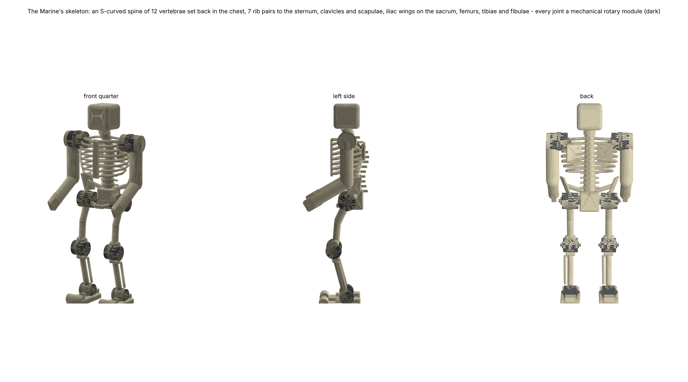
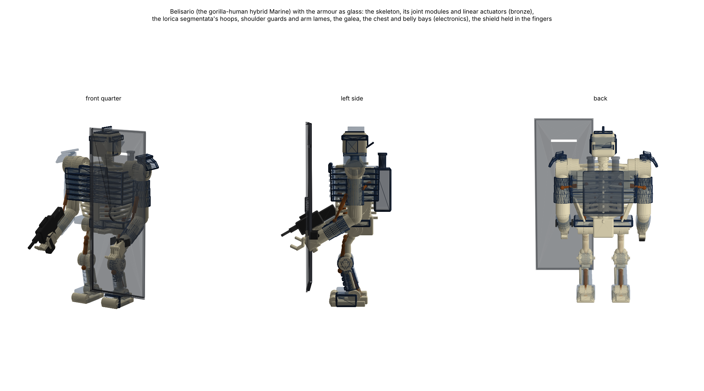
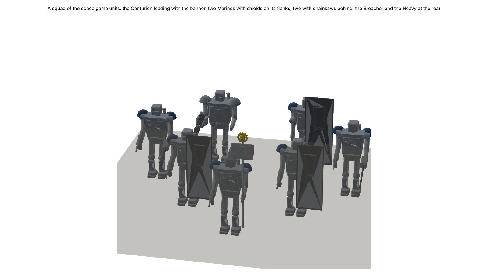
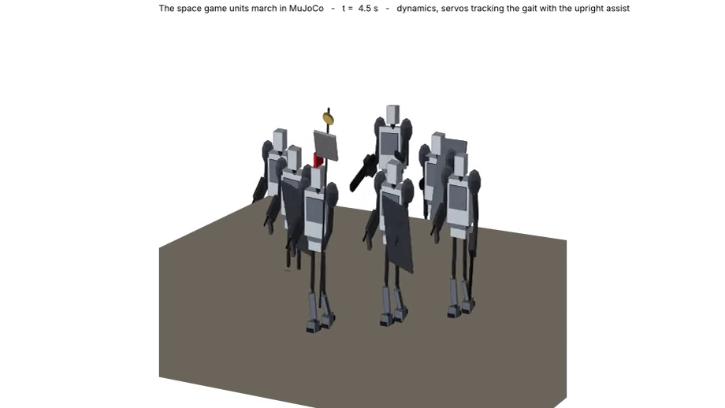
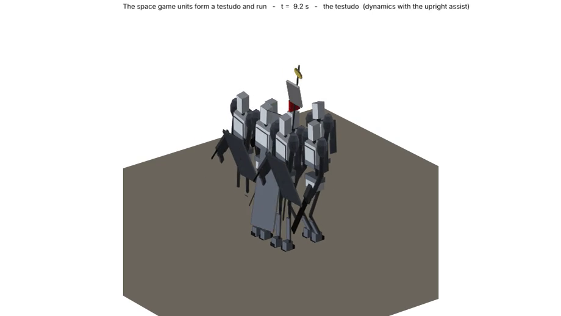

# Space game units — Belisario, the gorilla-human hybrid in lorica segmentata (design stage)

The legged lab's roster of game units: power-armoured humanoid robots on Talia's frame (`labs/legged/designs/humanoid.py`),
the way the ork and the ghoul are (`docs/exploration.md`, the fantasy humanoids) - rebuilt on **Belisario**, a
gorilla-human hybrid skeleton: a gorilla's long, wide barrel ribcage down to the pelvis, long thick arms with the
hands at the knees, short powerful legs and broad flaring iliac wings, on a human's S-curved spine (thoracic
kyphosis, lumbar lordosis) for standing upright - massive, stable, not fast. Against a human: height 1.15×
(1.73 m), shoulders 1.45×, chest depth 1.6×, arms 1.4×, legs 0.8×. Every joint is a mechanical rotary module with
linear actuators (pistons) working across it, the electronics sit in a chest bay inside the ribcage and a belly bay
in front of the lumbar spine, and the armour is a **lorica segmentata** on top: articulated hoops round the ribs,
layered shoulder guards, arm lames, banded greaves, a galea helmet. The shields are held in the fingers.

`space_squad_draw3d.py` sets a squad down in a wedge: the Centurion at the point with the banner, two Marines with
shields on its flanks, two with chainsaws behind them, the Breacher and the Heavy at the rear. `space_skeleton_draw3d.py`
draws the bare frame, `space_xray_draw3d.py` the Marine with the armour transparent (the actuators bronze).

| unit | what it is | carries | mass | motions |
|---|---|---|---|---|
| **Marine** (`space_marine`) | the line unit: Talia's frame at the ork's bulk on longer legs, 1.86 m, the hips 360 mm apart (the Heavy 400) | a carbine in the right fist, along the forearm (the low ready at rest, level when the forearm comes up); a body shield on the left forearm covering it from the shins to the helmet | 468 kg (armour 94, carbine 9, shield 30; the leg, waist and spine modules 251) | `march`, `run`, `aim`, `fire` |
| **Marine with a chainsaw** (`space_marine_saw`) | the Marine | the carbine; a chainsaw in the left fist, along the forearm | 445 kg (chainsaw 14) | `march`, `run`, `aim`, `slash` |
| **Centurion** (`space_centurion`) | the Marine with a feathered crest along the helmet | the carbine; the imperial banner in the left fist: a pole with a skull in a gear as the finial and the squad's flat phased-array antenna under it | 445 kg (banner 8) | `march`, `run`, `aim`, `rally` |
| **Breacher** (`space_breacher`) | the Marine with the elbows nearly straight | a tower shield along the left forearm (upright, facing ahead, the whole body behind it), a power maul in the right fist | 502 kg (shield 50, maul 26) | `march`, `run`, `shield_up`, `swing` |
| **Heavy** (`space_heavy`) | the Marine on a wider frame, the bigger backpack | a rotary cannon along the right forearm, fed from the backpack | 490 kg (cannon 38) | `march`, `run`, `suppress` |

## The design (`space_units.py`, numbers in `space_unit_specs.py`)

**The skeleton** replaces Talia's shells (`part="skeleton"` builds it bare; `skeleton_trunk`, `femur`, `tibia`,
`foot_bones`, `joint_module`). The spine: `spine_segments` (12) robust vertebral bodies with discs, spinous and
transverse processes on the S curve `spine_x` (set back `spine_set_back` of the torso depth in the chest, lumbar
forward, thoracic back, the top coming forward under the neck, three cervical discs up the neck). The barrel
ribcage: `rib_count` (10) rib pairs from the vertebrae round to the sternum, sloping down to the front, reaching the
pelvis. The shoulder girdle: clavicles from the sternum's top to the shoulder modules, long scapulae behind the upper
ribs. The pelvis: a sacrum block between two broad iliac wings, the hip modules under them, a pubic bar in front. The
legs: a femur (a neck from the hip module's boss, the trochanter, the shaft bowing forward, the condyles holding the
knee module), a tibia with the fibula beside it down to the ankle module, a foot with the roll stage, a heel block,
the sole plate and a toe bar. The arms are Talia's, long, ending in a **gripping hand** (`gripper`: a palm block,
four fingers of three phalanges on knuckle modules, curled round what the fist holds, a thumb pad). Every joint is a
**mechanical rotary module** (`joint_module`: the actuator housing as a cylinder with a flange and pin bosses).

**The linear actuators** (`actuators`, `part="actuators"`): the pistons that work the joints beside their rotary
modules (the modules give a joint its bearing and brake, the pistons the heavy lifting), laid across the skeleton
where muscles would go - hip struts from the iliac wings to the femurs, knee struts down the thighs to the tibiae's
plateaus, ankle struts to the heels, shoulder struts from the scapulae, elbow struts to the forearms, spine struts
from the pelvis to the ribcage's front. Their masses ride the links (`ACTUATOR_MM3`, the test rebuilds them).

**The armour, a lorica segmentata** (`armour_parts`), built on the skeleton in its build pose so the trunk and the
limbs can bend: the **lorica** (`lorica_bands` girth hoops round the ribs, each a thin band overlapping the one below,
with its front clasp; the breast band on top), the **shoulder guards** (three layered plates stepping down over each
shoulder on a post), the **arm lames** (three hinged bands round each upper arm and forearm), the **galea** (a brow band, cheek guards hinged beside the face, a
nape guard, a comb for the plume; the Centurion's feathered crest rides on it), the **belt** round the wings, the
**greaves** (four bands down each shin on a hinge spine, with the knee domes), the **boots**, the **backpack** with
its exhausts, the **chest bay** (the electronics' casing inside the ribcage, bolted to the thoracic spine) and the
**belly bay** (the power electronics in front of the lumbar spine, under the lowest hoop). Nothing hangs below the
belt: a robot has nothing there to protect, and the hips stay free to swing.
The weapons are built in the bent forearm's frame (`forearm_frame`) so they move with the arm in the robot model:

- the **carbine**: a receiver on the forearm's outer side above the fist, the barrel forward along the forearm, a
  stock back along it, a sight, a magazine hanging from the receiver;
- the **body shield** (the Marine, 600 × 1600 mm) and the **tower shield** (the Breacher, 680 × 1750 mm), each held in
  the left hand - a handle bar across the fist that the gripper's fingers close round, a bracket to the plate's back -
  standing vertical ahead of the fist and covering the body from the shins to the helmet, with a rim, a boss and a vision slit; the **chainsaw**: the motor body on the fist with a rear handle and a front hoop, the bar forward with a
  chain of teeth round its edge; the **imperial banner**: a pole standing vertical through the fist, a gear with a skull in
  it as the finial, and under it on a bracket the squad's uplink, a large flat phased-array antenna panel (a Starlink-class
  dish) facing forward and tipped back - no cloth; the Centurion's
  **crest**: a comb on the helmet with a row of feather fins leaning back; the **power maul**: a shaft through the fist, a steel head crosswise at the top, a pommel;
- the **rotary cannon**: a mount block on the forearm, a cluster of six barrels round a core, breech and muzzle rings,
  the feed tube from the backpack.

`part` builds the whole unit, the skeleton, the actuators, the trunk, a thigh, a shin, a foot (as `Humanoid`), the
`armour` alone or the `weapon` alone; `armour_parts` / `weapon_parts` / `actuator_parts` give the pieces by name. Every
unit builds as one valid solid.

## The robot models (`space_unit_robots.py`)

Talia's model (`humanoid_robot.talia`) at each unit's numbers, its one torso link split into a **two-segment
spine** (`_spine`: the lumbar link with the waist yaw and a lumbar pitch/roll module at the sacrum, the thorax with a
thoracic pitch/roll module carrying the ribcage, the yoke, the head and the arms; `cycloidal 800 Nm, brake` modules
held stiff and well damped by their PD, so the upper body can lean into a step without the pelvis tilting with it),
re-actuated for the weight with industrial joint modules
from the catalogue (`cycloidal 1600 Nm, brake` at the hips and the knees, `cycloidal 800 Nm, brake` at the ankles and
the waist, `harmonic 150 Nm, brake` in the arms, the actuator point masses scaled with them: the leg and waist
modules are 207 kg of each unit, sized by the march below), the armour and the weapons as geoms on the links. Their masses are the CAD
volumes (`CAD_MM3`, the test rebuilds them) × a fill factor (the plates are shells on padding, the pack a casing)
× the materials' densities (`MATERIALS`: Ti-6Al-4V plates, 4140 steel barrels and heads, 7075 aluminium receivers
and casings, a polycarbonate visor). 25 actuated joints each (Talia's 21 and the spine's four); the elbows stand at their stance (`nominal_qpos`).

## The motions (`space_unit_motions.py`)

Talia's walk machinery (`humanoid_motions.walk` → `motion_kit.legged_gait`) at the units' weight: `march` at 0.55 m/s
(the Heavy 0.4), a 0.34 m stance, duty 0.64, a 20 mm crouch, ±60 mm of weight shift (`weight_shift`: the pelvis over
the stance foot through single support, carried across in the double supports - `shift="step"`; Talia's sine is
`"sine"`), the weapon arm held at its stance and the other swinging.
`run` is the double-time march every unit shares (0.85 m/s, a 0.45 m stance, duty 0.58, a 30 mm crouch, ±50 mm sway:
a fast walk, no flight phase), the pace the block holds in the testudo drill.
Then each unit's own: the Marine's `aim` (the forearm brought level, which points the carbine ahead - exact in joint
space since the carbine lies along the forearm) and `fire` (the recoil kick on the aim pose, 8 Hz), the chainsaw Marine's
`slash` (the saw raised out and swung across, the knees giving at the cut), the Centurion's `rally` (the banner raised
straight up and swept side to side); the Breacher's
`shield_up` (the guard in joint space, the maul cocked) and `swing` (the maul overhead and down, the knees giving at the
blow); the Heavy's `suppress` (the cannon swept ±0.4 rad by the waist, the stance braced wide). Every motion passes the
lab's checks (joint limits, stance feet on the ground, IK within 5 mm where IK is used).

## The march in MuJoCo (`labs/legged/sims/space_squad_march.py`)

The squad walks its `march` across flat ground in MuJoCo's dynamics (`sims/output/space_squad_march.mp4`, 8 s): the
robots from `space_unit_robots` with the contacts, gravity and the modules' torque limits, a PD loop on every servo
tracking the gait's keyframes (`kp` of the module, the stall torque as the clip). The keyframes were solved with no
balance controller, so the pelvis gets an **upright assist**: an external torque towards level (a virtual gyro) and a
spring holding its lane and heading - the training wheels a game engine would also give these units. With it every
unit walks the 8 s without falling (the Marines 8.3 m, the Breacher 8.1 m, the Heavy 4.3 m at its 0.4 m/s), the
pelvis 1.03-1.06 m up, tilting at most 6-8°; without it (`--no-assist`) a Marine falls at 2 s. The sim sized the
leg modules: on the first design's 400 N m modules (6.5 kg each; `--modules light` puts their torque and gain back)
a 320 kg Marine sagged on its stance knee (the pelvis down to 0.13 m) and fell in 3.6 s even with the assist, hence the 1600 N m hips and knees, the 800 N m ankles
and waist, and the gait's 20 mm crouch (near-straight knees) in place of 50 mm. The servos still touch their stall
torque at the peaks (`servo_saturation_max` 1.0 in the report, `sims/output/space_squad_march.json`).

`--mode kinematic` plays the keyframes through `mj_kinematics` instead (what the motion looks like, no physics);
`--units marine,heavy` marches a row of named units. No OpenGL is needed: the frames are drawn from the geoms with
matplotlib and ffmpeg makes the mp4. `tools/lab.py run legged sims` runs it short (one Marine, 1 s, no movie).

**The hips and the assist.** The hips were widened for stability (260 → 360 mm between the leg planes, the Heavy
400, the pelvis 500 / 540 mm wide). On the keyframed gait alone that made things worse: at 320 mm and beyond the
Marine stumbled in pitch whatever the sway (0.02-0.18 m, sine or step: a wider stance needs a bigger lateral weight
shift each step, and the shift's inertia on a 450 kg body is what a keyframed gait cannot balance without a
controller). What walks the wide hips is the spine plus twice the upright assist (`--assist 2`, the default now: the
virtual gyro's authority is what a balance controller would spend on the roll): every unit marches 8 s without
falling, tilting at most 4.4°. The Breacher and the Heavy, the two heaviest (the 50 kg tower shield, the cannon and
the big pack), get a further 2× (`ASSIST`).

## The testudo drill (`labs/legged/sims/space_squad_testudo.py`)

From a standing formation (the block's files, the ranks strung out) the squad marches in to a tight block: the
Breacher's tower shield between the two Marines' body shields in the front rank, the Centurion between the chainsaw
Marines behind them, the Heavy at the back. The front rank brings the shields to the guard (the shield arm up and in,
the plate square ahead of the body), the ranks behind crouch 220 mm under them (an IK pose on the sole points), then
the block runs together, the shields still in the guard (`sims/output/space_squad_testudo.mp4`, 16 s: standing 1 s,
closing ranks until each unit is at its place - the Heavy last, at 7 s - the testudo until 10 s, then the run). The
standing formation is the block's own files strung out: the keyframed gait cannot side-step, and dragging a walker
sideways on its lane spring trips it.

Each unit is a `Script` on the march sim's `Unit`: the march starts at the gait's mid-stance phase (one foot under
the hips, the other mid-swing: the nearest frame to standing, so no foot has to slide), the halt is decided on the
base's actual position at a half-period boundary (in physics these weights walk faster than the keyframes' nominal
speed), and the assist does what a game engine's formation logic would: parks the base at its place while halted
(a spring on x) and holds the formation's pace while marching or running (a damper on the base's forward speed
towards the gait's, `V_HOLD_C`). Without the pace hold a unit started from standing into the run walks backwards:
the keyframed gait's direction depends on its start, which is the clearest sign that a balance controller, not the
keyframes, should drive these feet. With it every unit does the whole drill without falling (the Marines' tilt
peaks at 18° in the run); the run is a heavy shuffle at 0.8-1.3 m/s rather than a clean sprint.

## Kerchak: the gait on four (`labs/legged/designs/kerchak_motions.py`, `sims/space_kerchak_walk.py`)

Belisario bare (`space_unit_robots.bare`, the machine `belisario`: the skeleton alone by default - the frame's geoms,
the modules' and the struts' masses, no armour, no weapons; `casing="plastic"` adds a 3 mm polycarbonate casing,
`"lorica"` the armour - with real hands, the ankles and knees folding further, the shoulders adducting 0.8 rad
across the chest) walks like a gorilla: on all fours on its knuckles, and only sometimes stands. The proportions
follow the animal: the arms are 540 + 500 mm (the hands at the knees when standing), the legs 360 + 340.

`quad_pose` is the stance on four (IK on the soles' points, the knuckles and the wrists): the pelvis 0.62 m up and
pitched nose-down 0.45 rad, so the back slopes ~35° with the spine's modules only a little forward; the legs crouched
with the knees far forward; the long arms down to the knuckles 0.3 m ahead of the shoulders with the elbows bent
~50°, the wrist held behind and above each knuckle so the forearm leans on the backs of the curled fingers' middle
phalanges ([knuckle-walking](https://en.wikipedia.org/wiki/Knuckle-walking): the weight on the knuckles, the wrist
extended). `knuckle_walk` is the lateral-sequence walk every quadruped uses at a walk (left hind, left fore, right
hind, right fore, a quarter cycle apart; duty 0.72, a 0.26 m stride at 0.35 m/s, the swing 60 mm up): `legged_gait`
on the four contacts with the quad pose as its reference, its strides and lifts along the ground although the base
rides pitched (`base_rot`), its IK damped for the long arms near full stretch. `rise` and `drop` go up to the design
pose on two and back in 3 s (the pelvis levelling as it rises), `stand` holds it.

In MuJoCo (`space_kerchak_walk.py`, `sims/output/space_kerchak_walk.mp4`: walk 8 s, rise, stand 3 s, drop, walk on)
the upright assist holds the pelvis at the phase's pitch; the skeleton walks on its knuckles, rears up, stands,
drops and walks on without falling. The knuckle walk is the first gait that suits this body: three contacts are
down most of the cycle and the trunk's mass is low and between them, which is what the long arms and short legs
are for - where the biped march on these proportions only shuffled.

## The hands (`space_unit_specs.hand_layout`, `space_unit_robots._hands`)

A real hand each side, the same in the robot, the CAD (`space_units.gripper`) and the drawings: a palm 95 × 36 ×
105 mm hanging from a two-module wrist (pitch and pronation, `qdd 60 Nm`); four fingers at human proportions
(index, middle, ring, little at 0.88, 1, 0.92, 0.74 of `finger_length` = 190 mm, three phalanges each at 0.44 /
0.31 / 0.25 of the finger), every phalanx on its own hinge curling in towards the palm's face - the knuckle joint
on a self-locking `harmonic 12 Nm, brake` (a hang holds unpowered), the two finger joints on `smart servo 6 Nm`;
a thumb on an opposition joint (`harmonic 12 Nm, brake`, about the palm's long axis) and a flexion joint (`smart
servo 12 Nm`) that lays it across the fingers. 57 actuated joints in all, 365 kg. One curl command per hand
drives every joint (`curl_values`: 0 open, `KNUCKLE_CURL` 1.4 the walking fist, 2 a closed fist), so the gaits set
a hand with one number; a policy may drive the joints singly. The knuckle-walking contact is the back of the middle
finger's middle phalanx (`{side}_knuckle`), the other fingers' backs beside it.

## Grips, climbs and the scenarios (`kerchak_scenarios.py`, `kerchak_tasks.py`, `sims/space_kerchak_scenes.py`)

A hold is a **bar** (a rung, a rib, a branch, a rope, a sill's edge: its axis, the surface's outward normal, its
radius) or a plain **point** (a knuckle on a sill's top, a sole on a wall). The hand on a bar is four points of IK:
the grip centre - where a bar's axis sits in the hand once the fingers close on it, the centre of the circle the
closed middle finger's joints lie on (`hand_grip`, ~45 mm ahead of the palm's face) - the wrist, and a point along
the hand's y (the bar's axis), with the fingers closing in the motion's `extra` and opening through each swing. On
a rung the wrist hangs below and behind the grip and the palm's face turns up under the bar, the fingers hooked
over its far side (what the arm reaches naturally); on a vertical bar the palm faces it and the wrist goes out to
the hand's own side, the frame's roll about the bar chosen per hand by a static search (`_pick_frames`). The foot
on a bar stands with the sole's point between ball and heel on the bar's outer top, toes up 0.5 rad into the surface.

The climbing frame has the trunk parallel to the surface (`CLIMB_PITCH` −0.15 rad, the shoulders leaning out a
little), the pelvis 0.45 m off it and 0.55 m above the feet's holds. `mount` goes from the quad pose onto the
surface: the hands' grip points rise on arcs to their holds and the whole hand frame settles on the bar, the
pelvis rising on the planted feet as far as the legs stand, then the feet step up one after the other as the
pelvis moves in (on a slope it moves in low first and rises after the feet). `climb_cycle` moves the four limbs
one at a time to the next holds (feet first - the legs push - then the hands) while the pelvis rides up; the IK is
well damped (`IK_REG` 3e-3): a lighter damping jumps between the two solutions a four-point grip allows.

| scenario | holds | IK error (mount / cycles) |
|---|---|---|
| wall | rungs 0.35 m apart; the hands four rungs above the feet | 3 cm / 9 mm |
| tree | the trunk's flanks (vertical holds 35° round from the near face) and branches each side every 0.45 m | 14 cm transient / 4 cm |
| hull | the ribs across a 62° plate, the hands two ribs above the feet, the trunk along the plate | 16 cm transient / 2 cm |
| rope | the rope as a vertical bar, one hand above the other, the feet pinching it with level soles | 8 cm / 4 cm |
| window | the hands on the sill's edge, the feet up the wall and onto the sill (a pull-up), a leap off it onto four | 25 cm transient / 0 |
| obstacles | a crouch, a leap on a parabola with the limbs tucked, a landing on four | joint track |
| door | `kerchak_tasks.door_sequence`: reach, grasp (the fingers close on the lever), turn, push, release | ≤ 5 mm |
| window_hammer | the hammer picked off the ground (the fist closes on its handle from above), carried, a wind-up and a blow through the pane (the glass goes to shards at the blow, the hammer falls and lies where it lands), the fist opens, then the window's entry | 6 mm / 19 cm transient in the swing |

The mounts' numbers are single-frame transients where a planted foot or a settling hand lags; the cycles' are
their steady worst. The window's leap is honest: the legs (0.7 m) are shorter than the sill (0.96 m) is high, so
no pose reaches the ground beyond from the sill. `python sims/space_kerchak_scenes.py --scene wall` plays a
sequence in MuJoCo - the keyframes by default, `--mode physics` with the assist - and writes
`sims/output/space_kerchak_<scene>.mp4` and stills.

## Solid limbs on solid obstacles (`solidity.py`)

The scenarios are kinematic, so nothing stopped a shin from passing through a rung or a foot through a sill until
`solidity.Solid` did: it wraps the scene's own MuJoCo model (the frame with its props, every drawn piece of the frame
made to collide, the fingers left out because they close round the bars) and reports each limb's penetration into a
prop, or into another limb, as a push-out target (the point and where it must go to be 2 cm clear).
`kerchak_tasks.contact_motion` re-solves every frame with those targets (one per limb, at a lower weight than the
holds, dropped if they would cost a hold more than 3 cm), ten frames a second so the player's interpolation stays
close, and each motion's check carries `penetration_raw_m` (before) and `penetration_max_m` (after, with the limb and
the prop). The soles' contact points are on the sole's bottom face (`humanoid_motions.sole_points`, from the foot
box), so a foot stands on a hold rather than in it; the walk's pelvis height is where its lowest sole point touches
the ground (`gait_height`). The door's hinge and the broken pane are known to the check. What is left, at the video's
frame rate: the wall, the door and the window with the hammer are within 2.5 cm on both frames (a shin against the
rung above as a foot lands, a foot's edge in the ground in a deep squat; Kerchak's feet 3.6 cm into the sill at the
crouch and his head 4.7 cm into the wall above as he dives), the tree within 3 cm standing and 9 cm on four, the
rope within 2.6 cm, the hull within 2.5 cm standing and 11 cm on four: the hull plate now stands on the ground at its
slope (it was tilted and floating), and Kerchak's leg geometry on it is not solved yet.

## The upright humanoid (`space_unit_robots.humanoid`, `space_unit_specs.HUMANOID`, `--machine humanoid`)

The same skeleton, spine, modules and hands at a tall human's size: `HUMANOID` is a human's proportions (a narrower
pelvis, the hips closer, longer legs for the trunk; `_HUMANOID_207`) scaled by `HUMANOID_SCALE` 0.87 to 1.80 m (the
thigh 0.41 m, the shin 0.38 m, the upper arm 0.29 m, the forearm 0.26 m); `kerchak_motions.scale()` scales the
upright scenarios' stops, crouches and climbing frames with it. It stands at rest with the arms hanging and the knees a little bent (`humanoid_motions.stand_pose`:
a straight knee is a singular start for the IK, the leg cannot shorten to first order). It walks upright on Talia's
gait machinery at 1 m/s (`humanoid_motions.walk`, four times Kerchak's knuckle walk) and does Kerchak's tasks from
standing: `kerchak_motions.STANCE` (the pelvis height and pitch of the rest pose, and whether the frame is upright)
is what the scenarios read instead of Kerchak's quad numbers, and `set_stance` switches it, so the same scenario code
serves both. Where a human's reach differs from a gorilla's, the scenarios branch on `STANCE["upright"]`:

- the climbs stop closer to the surface (the arms being shorter for the height of the shoulder), the pelvis comes in
  over the planted feet while the hands reach, then the hands move up first each cycle and the legs push with the
  pelvis rising (the trailing leg must still reach its rung); the pelvis rides well out from the wall and the feet
  swing wide, keeping the knees behind the rungs (a straight knee is the wrong branch of the leg's IK, so the climbs
  are regularised to a bent-knee crouch, `climb_ref`); the hands take a rung three above the feet; on the tree the
  chest is near the bark and the feet out on the branches clear of the trunk, on the hull the pelvis is well off the
  plate with the hands three ribs above the feet and the feet along the plate;
- the door is taken from 2.4 m, leaning (the pelvis 0.2 m down, pitched 0.3 rad), the push leaning further and lower
  (the legs cannot stretch to the swung lever otherwise);
- the hammer lies 0.75 m from the wall so that the blow lands at arm's length; the pick is a deep squat with the
  spine's modules bent forward 0.6 rad (`PICK_SPINE`), the left arm simply hanging from the shoulder;
- the window: the hip's range does not allow a foot stepped up onto a sill at the hip's height, so the humanoid takes
  the jambs high (the fingers round the frame's outer corners, the roll about them chosen by the static search),
  springs off its feet and pulls up outside the wall's face (no lintel there), the feet come straight up and in over
  the sill one after the other, then it moves in to a crouch in the opening (`SILL_CROUCH`, the head under the 2.2 m
  lintel) and hops down inside with the legs folded until it is past the wall (`_window_entry_upright`). The upright
  frame's hip pitch range is widened to (−2.4, 0.8) rad for the crouches (`bare(upright=True)`); Kerchak keeps the
  module's (−2.0, 0.8).

| scenario (humanoid, 1.80 m) | IK error (mount / cycles, or per motion), with the solid check on |
|---|---|
| wall | 2 cm / 7 cm transient |
| tree | 5 cm / 5 cm |
| hull | 8 cm / 12 cm transient |
| rope | 5 cm / 5 cm |
| door | reach 3 cm, turn 2 cm, push 5 cm, release 8 cm transient |
| window_hammer | pick 3 cm, up 4 cm, swing 12 cm transient, drop 13 cm transient (the arm settling), onto the sill 6 cm, hop (joint track) |

`python sims/space_kerchak_scenes.py --scene door --machine humanoid` renders `sims/output/space_humanoid_<scene>.mp4`.
It is lighter and quicker than Kerchak and walks four times as fast; it has not Kerchak's strength (the same modules
move longer, lighter limbs: the hands' and feet's loads on a hold are the same, the arms' leverage less) and its
climbs are kinematic like Kerchak's - the physics mode's assist holds either up.

## Drawing the frame in the sims (`belisario_mesh.py`, `sims/belisario_render.py`)

The sims draw the CAD, not the collision shapes: `belisario_mesh` tessellates every piece of the skeleton (the
pelvis rebuilt with the hip modules at the frame's hips, each vertebra on the lumbar or the thorax, the ribcage with
the sternum ending at the lowest rib, the girdle, the neck, the head; the femurs, tibiae, foot bones; the arms, the
palms, every phalanx), a joint module at every joint (cut out of the bones, drawn dark), the electronics' bays in
the chest and the belly (what the ribcage protects), the limbs' casing plates (half shells), and the linear
actuators as anchor pairs drawn between their two links every frame - each piece in the frame of the chiron link
that carries it, cached under `sims/output/mesh_cache`. `belisario_render` is a small software renderer (numpy,
PIL: a perspective camera, flat shading, the painter's order; MuJoCo's own needs a GL this machine lacks) that
draws the pieces on the MuJoCo bodies, the scene's props and the ground in well under a second a frame.

## Learning the gaits (`training/`, `TRAINING.md`)

A PPO pipeline (PyTorch, in-house: no RL library is installed and RSL-RL's API could not be verified offline) with a
Gymnasium-style environment round the frame, command-conditioned (vx, vy, yaw rate, height, stop), an eight-stage
curriculum, sessions of weighted scenes (flat, rough, steps, door, window, wall, tree, hull, obstacles, rope - the
climbs on the scenarios' own props), domain randomization, checkpoints, TensorBoard, ONNX export, a comparison
against the programmed gaits and a keyboard/joystick drive. Written and inspected only: nothing in `training/` has
been run. `TRAINING.md` has the setup, the commands per stage and the first experiment.

## Tests, exports

`labs/legged/tests/test_designs_stage.py` (the robots' joints and masses, the CAD builds, the carried masses, the barrel
level in the aim, the shield upright in the guard, the CAD volumes rebuilt) and `test_motions.py` (the motions' checks
and the exported block). `python tools/publish.py space_marine space_marine_saw space_centurion space_breacher space_heavy` writes the exports.

## Not done

No balance controller: the units walk in MuJoCo on the upright assist (above), not on their own feet - a ZMP or
capture-point stepping controller on these keyframes is the next thing (the drill's pace hold and parking spring go
with it), or the learned policy of `training/`. The keyframed gait cannot side-step or turn, so a formation change
is a straight march. The climbs are kinematic references: in physics the grips need the fingers' self-locking
drives and a whole-body controller the assist does not give. The design sheets' fists hold the weapons at the
old grip offsets, not re-placed for the new hand. The weapons do nothing (no projectile model); the cannon's
barrels do not spin.
