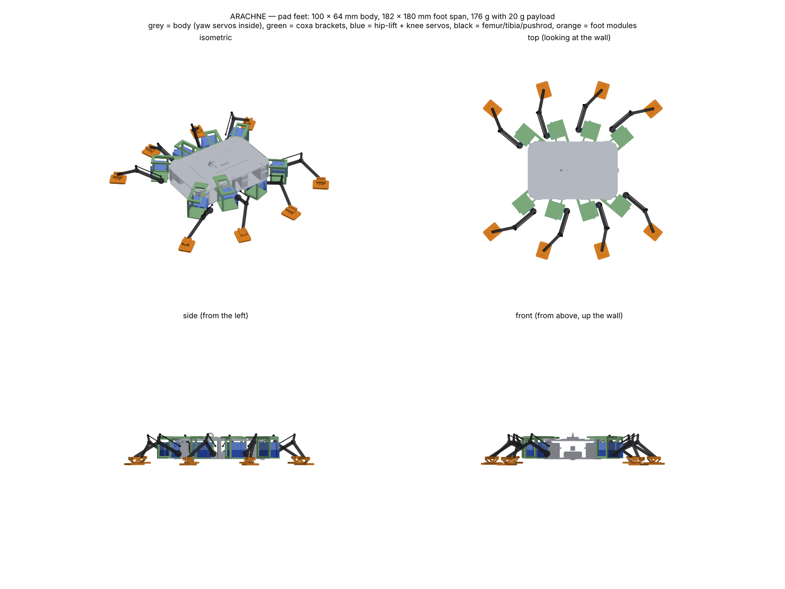
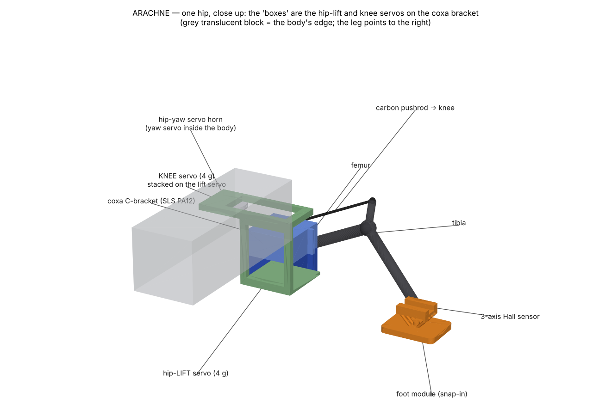
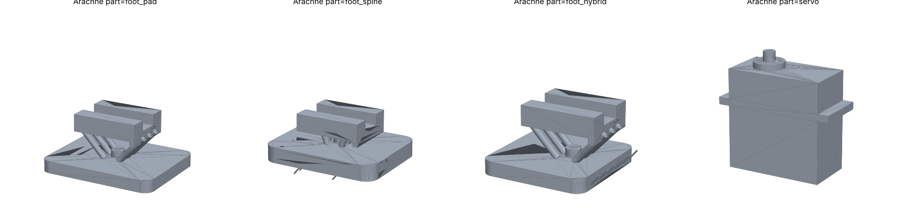
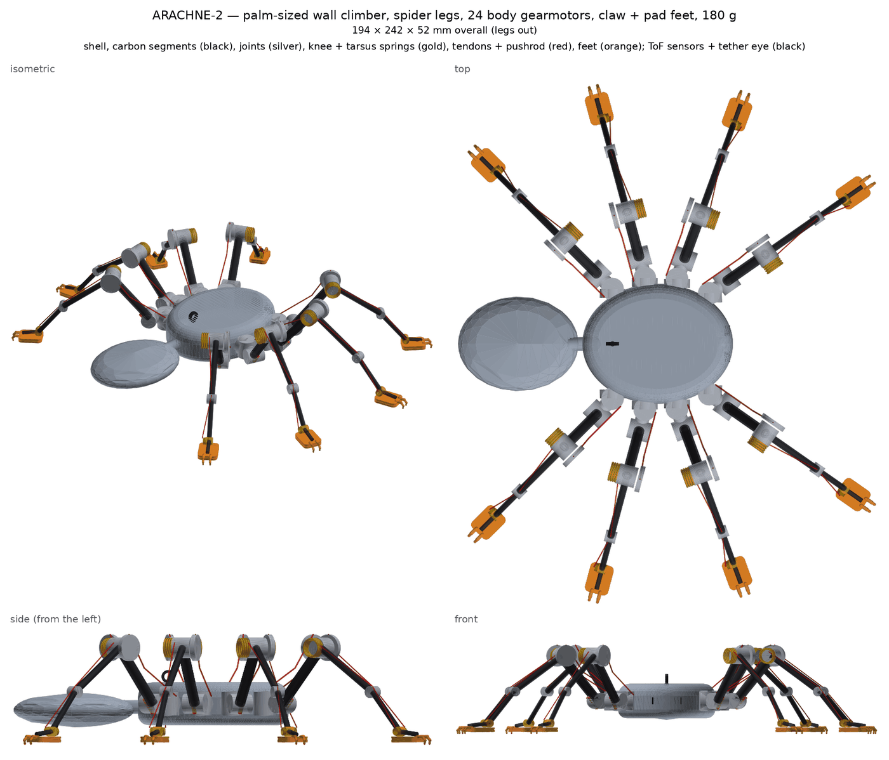
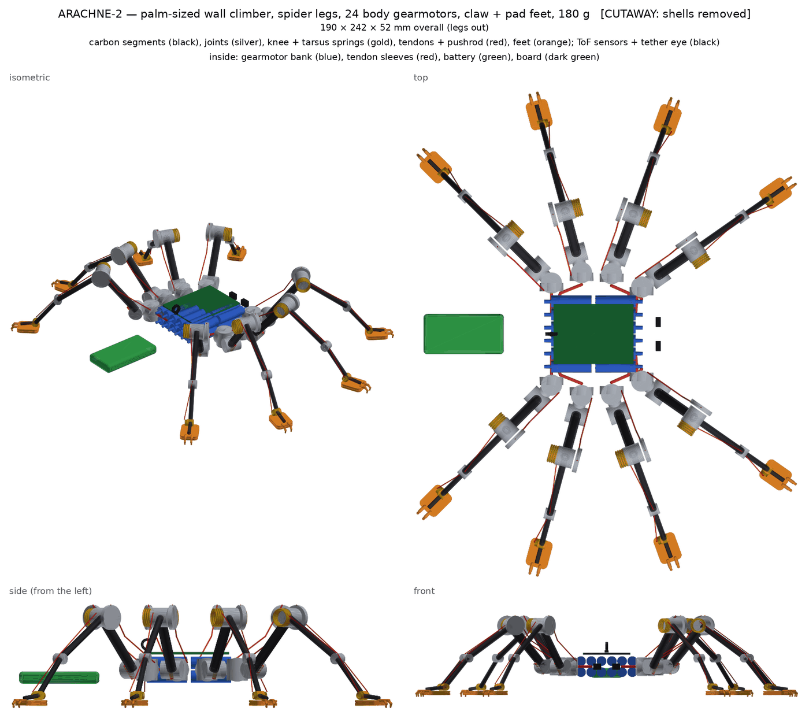
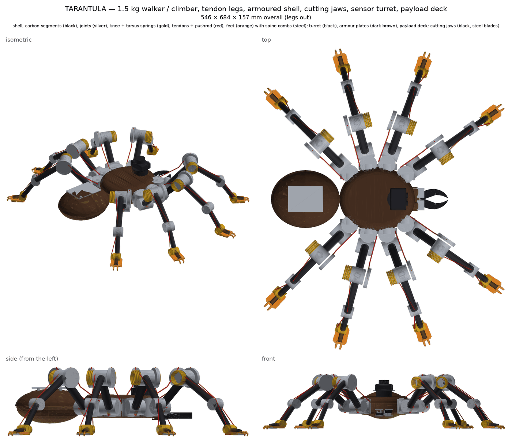
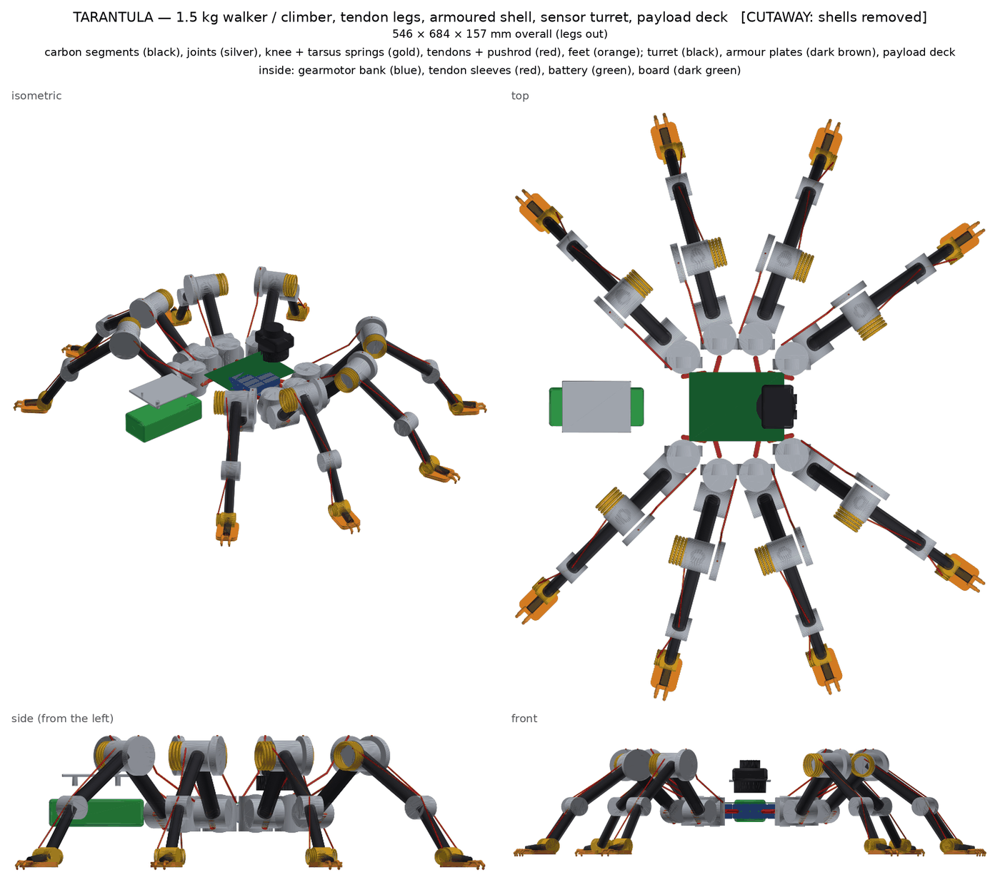
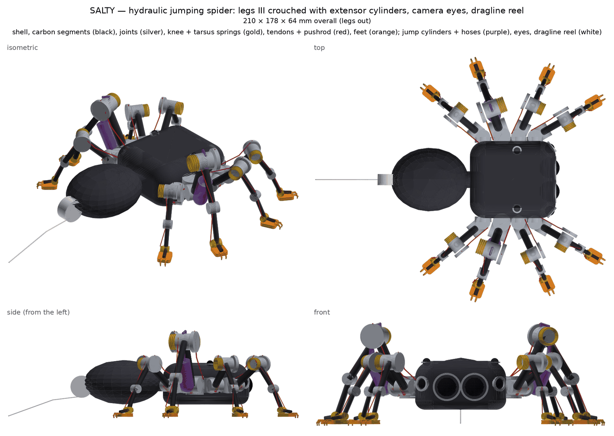
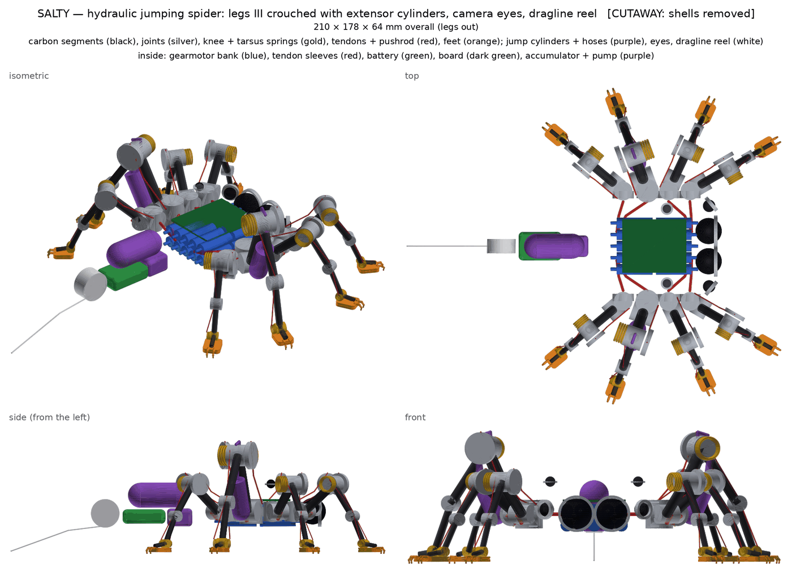
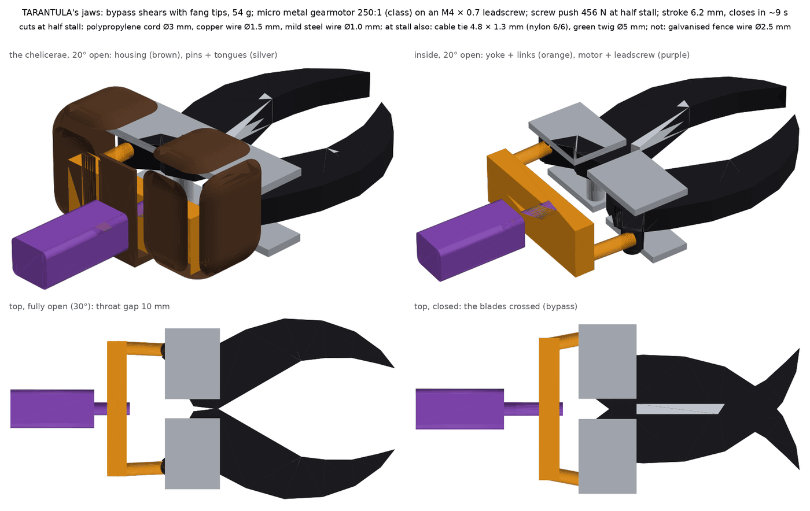

# The spiders: ARACHNE, ARACHNE-2, TARANTULA, SALTY

Legged lab (`labs/legged`), branch `dev_arachne`. Robots built for one job, not biological replicas: copy what
spiders do well where it makes a robot more reliable, and nothing else. Every number below comes from code you can
re-run — `designs/arachne_*.py`, `designs/spider_actuation.py`, `sims/` — or from a datasheet cited there.

| robot | job | status |
|---|---|---|
| **ARACHNE** (v1) | palm-sized wall climber: glass, acrylic, varnished wood; bark kit | designed: budget, CAD (STEP/STL), robot model, statics, gaits, MuJoCo climbing sim |
| **ARACHNE-2** | the same job, spider-like legs | **decided** (§3); CAD (§9) |
| **TARANTULA** | a bigger walker and climber, 1.5 kg with 0.3 kg payload | actuation analysed (§5): fluid joints not needed unless tendons must run in sleeves (§5.1); CAD (§9) with cutting jaws (§9.1) |
| **SALTY** | a jumping spider, hydraulic | catapult sized and simulated (§6); CAD (§9) |

Run the simulations on your machine: `./spider.sh run all -j 8` (§8).

---

## 1. How real spiders work — and what a robot should copy

* **Legs.** Seven segments (coxa, trochanter, femur, patella, tibia, metatarsus, tarsus), nearly all simple hinges.
  Sprawled posture: knees high, body slung low, the centre of mass close to the surface.
* **Muscles pull, fluid pushes.** The femur–patella and tibia–metatarsus joints have **no extensor muscles**: flexor
  muscles bend them and hemolymph pressure from the body extends them — 4–8 kPa when walking, 60 and up to 130 kPa in
  jumps and runs (Göttler et al., Soft Matter 2021, and references there). Muscle mass sits in the body and the
  proximal segments; the distal leg is light.
* **Two grips on one foot.** Claws for rough surfaces and, on many spiders, claw tufts of setae splitting into
  spatulae (a dry adhesive like a gecko's) for smooth ones; the spider chooses by the angle and drag of its tarsus;
  the tufts release by peeling.
* **Load sensing** at every joint (slit sensilla, strain gauges in the exoskeleton). **A safety line** (dragline).
  **Redundancy**: spiders walk on seven or six legs.

What is worth copying for a robot built for one job — and what is not:

| spider feature | copy? | why |
|---|---|---|
| body low, knees high | **yes** | it cuts the peel moment on the top feet: the biggest lever on adhesion margin in §4 |
| actuators in the body, light distal legs | **yes** | faster, cheaper swings; no boxes on the legs |
| muscles only pull, something else pushes back | **yes, simplified** | tendon/pushrod + spring (ARACHNE-2) or a shared pressure (§5); the spring holds feet to the wall if power fails |
| a distal joint that turns the foot onto a new surface | **yes** | ARACHNE v1's three-joint leg cannot make the floor-to-wall transition: the pad stays 62–68° off the wall (§4.4) |
| claw and pad on one foot, chosen by foot angle | **yes** | nature's answer to "no single foot grips every surface"; fewer module swaps |
| load sensing per leg | **yes** (Hall sensor per foot) | test an attachment before trusting it |
| safety line | **yes**, as a tether | power, data, fall arrest |
| seven segments, hydraulics everywhere, artificial muscles | **no** | more joints = more failure points; leaks at this scale; SMA is slow and hot, electrohydraulic needs kV |

## 2. ARACHNE (v1) — the palm-sized climber as designed



**Budget first** (`designs/arachne_specs.py`): the gross mass sets the adhesion each foot must hold, the torque each
servo must give and the battery it must carry. Waalbot II — 85 g untethered, up to 100 g payload on smooth vertical
surfaces, 5 cm/s (Murphy et al., IJRR 30(1) 2011) — sets the class. The result: **156.5 g empty, 176.5 g with a 20 g
payload**; a **100 × 64 mm body** (palm-sized), a **182 × 180 mm foot span**, centre of mass 16.7 mm off the wall.

* **Legs**: three servos each (hip yaw, hip lift, knee) — a two-servo leg cannot keep a planted foot still while
  the body moves (its foot only follows an arc round the hip: 0.9–7 mm of forced slide per 20 mm stride). The knee
  servo sits beside the lift servo on the yaw horn and drives the tibia by a carbon pushrod (a parallelogram).
* **Packaging** sets the size: a lift + knee servo pair is ~17 mm wide across the leg, so the hips are 26 mm apart;
  the yaw servos stand inside the body, the battery lies between their rows against the wall side.
* **Feet** (snap-in modules, `designs/arachne.py`): an 18 × 14 mm fibrillar pad on foam on a crossed-flexure ankle
  whose virtual pivot is 0.6 mm above the adhesive (shear then puts almost no peel moment on the pad's edge: margin
  3.55 instead of 2.19 with a 1.9 mm pivot); a 16-spine module for bark and brick; a hybrid. A magnet in each foot,
  a 3-axis Hall sensor in the tibia tip: the foot's tilt, compression and shear.

 

### 2.1 Bill of materials

Classes: **commercial** (catalogue), **custom** (printed / cut / moulded from our files, or by a service),
**specialist** (the fibrillar adhesive: a supplier or a clean-room master).

| item | qty | g each | g | source |
|---|---:|---:|---:|---|
| micro servo, 4 g class (hip yaw, hip lift, knee ×8) | 24 | 4.1 | 98.4 | commercial — EMAX ES9051 class; one type everywhere, buy 6 spares |
| chassis: belly + top plates, servo pockets, side walls | 1 | 12 | 12.0 | custom — SLS PA12 (service) or FDM PETG-CF |
| coxa C-bracket on the yaw horn, carrying the lift + knee servos | 8 | 0.6 | 4.8 | custom — SLS PA12 |
| femur (with pushrod guide) and tibia (with ankle socket) | 8 | 0.75 | 6.0 | custom — SLS PA12; FDM nylon first |
| knee pushrod Ø0.8 mm carbon, 30 mm, with two ball links | 8 | 0.12 | 1.0 | commercial |
| foot module — adhesive pad (18 × 14 mm) | 8 | 1 | 8.0 | custom — clip + silicone ankle + FR4 plate + foam |
| fibrillar dry-adhesive film for pads | 8 | 0.07 | 0.6 | **specialist** — Setex-class tape, or cast mushroom fibres |
| foot module — microspine (16 spines), set of 8 (bark kit) | — | 1.4 | — | custom — fitted instead of the pads |
| passive tail (bark kit) | — | 2.5 | — | custom |
| NdFeB magnet Ø2 × 1 mm (one per foot) | 8 | 0.03 | 0.2 | commercial |
| TMAG5273 3-axis Hall sensor on the tibia tip | 8 | 0.05 | 0.4 | commercial |
| main board: ESP32-S3-MINI-1, 2 × PCA9685, BMI270, MAX17048, INA219 | 1 | 4.5 | 4.5 | custom PCB, assembled by a PCBA service |
| VL53L4CD time-of-flight sensor | 2 | 0.3 | 0.6 | commercial — wall ahead, edge below |
| 1S LiPo 600 mAh, 50 × 20 × 7 mm (702050) | 1 | 13.5 | 13.5 | commercial |
| wiring | 1 | 4 | 4.0 | custom |
| fasteners | 1 | 2 | 2.0 | commercial |
| tether eye and belay clip | 1 | 0.5 | 0.5 | commercial |
| **empty** | | | **156.5** | |
| payload | | | 20 | |
| **gross** | | | **176.5** | |

### 2.2 Which foot where

| surface | module | why |
|---|---|---|
| glass | pad | smooth and stiff: full fibre contact; spines find nothing |
| acrylic | pad | smooth, softer; static collects dust — clean the pads |
| varnished wood | pad | a smooth film over the grain: holds, with less margin |
| sanded wood | hybrid | several µm of roughness and open pores defeat the pad; toe spines catch the grain — **margin 0.6 or less: not reliable in v1** |
| painted wall | hybrid | texture: **not reliable in v1** (margin ~0.6) |
| bark | spine + tail | deep, soft, dusty roughness: no pad contact; spines hook fibres and plate edges |
| brick | spine + tail | hard coarse asperities: Spinybot's home ground |

Spines only grip along their direction (they face down the body): **on bark ARACHNE keeps its heading up, crab-steps
sideways and descends tail first.**

## 3. ARACHNE-2 — decided

The same job with spider-like legs; to be designed next:

* **Legs**: four joints, three driven — hip yaw, hip lift, knee — and a spider-like **metatarsus–tarsus** joint
  coupled to the knee by a tendon with a spring-loaded stop, so the foot turns onto a new surface (the transition v1
  cannot make). Knees high, body low.
* **Actuation**: 24 worm-geared micro gearmotors with magnetic joint encoders, **all in the body**, driving the joints
  by pushrods and tendons; **springs extend** (the spider's fluid pressure, simplified). Slender legs; posture held at
  ~zero power (v1's servos burn ~1 A holding); the springs keep the feet pressed on power loss. §5 confirms this is the
  lightest choice at 0.18 kg (88 g of actuation against 98 g of servos).
* **Feet**: claw + pad on one foot, selected by the tarsus angle (shallow: the pad loads; steep: the claw hooks);
  swappable modules stay possible.
* **Kept**: per-foot Hall load sensing, the tether as safety line and power/data, 7- and 6-leg fallback gaits.

## 4. ARACHNE's analysis

### 4.1 Load sharing, peel moments, margins (`designs/arachne_statics.py`)

Each attached foot is a spring; the body's small rigid displacement balances the weight at the off-wall centre of
mass, so stiffer or better-placed feet take more. A pad's edge stress is the pull-off plus the peel moment of shear
acting above the interface; utilisation √((S/τA)² + (σ_edge/σ)²) against design allowables (`ADHESIVE`, `SPINES`) set
far below tape ratings (Setex DA tapes: 100–400 kPa shear after a firm press; ARACHNE's pads: 10 kPa shear, 3 kPa
normal on glass at a 0.3 N preload). **Design rule: margin ≥ 2 on those allowables.**

### 4.2 Gaits (`designs/arachne_gaits.py`)

A step: peel (heel first, onto the ankle's 25° stop) → swing → approach and preload (0.375 mm = 0.3 N into the foam)
→ drag 1.5 mm along gravity (3 mm on spines: loads the fibres in shear, engages the spines) → **test** (pull half the
expected load through the foot, watch the Hall sensor) → only then attached.

| gait | surface | feet attached (min) | adhesion margin | ankle tilt [°] | speed | power [W] | runtime [min] |
|---|---|---:|---:|---:|---|---:|---:|
| climb (wave, pairs) | glass (pad) | 6 | 4.00 | 16.6 | 13.3 mm/s | 4.83 | 22.1 |
| climb_fast (tetrapod) | glass (pad) | 4 | 2.97 | 16.6 | 33.3 mm/s | 5.98 | 17.8 |
| climb_careful (one foot) | varnished wood (pad) | 7 | 2.27 | 16.6 | 5.7 mm/s | 4.24 | 25.2 |
| climb_careful | bark (spine + tail) | 7 | **1.56** | 16.6 | 5.7 mm/s | 4.22 | 25.3 |
| climb_careful | brick (spine + tail) | 7 | 2.08 | 16.6 | 5.7 mm/s | 4.22 | 25.3 |
| turn (10°/cycle) | glass (pad) | 6 | 3.71 | 1.8 | 6.7 °/s | 4.85 | 22.0 |
| crab (sideways) | bark (spine + tail) | 7 | **1.52** | 14.5 | 4.3 mm/s | 4.23 | 25.2 |

Bark is below the rule on a conservative 0.15 N per engaged spine; it reaches 2 at ~0.2 N per spine — the first
thing the bark tests must measure.

### 4.3 Dynamics (`sims/arachne_climb.py`, `./spider.sh run arachne-climb`)

MuJoCo: gravity along the wall, the pads as compliant bodies (a foam spring and two ankle hinges with ±18° stops) with
**adhesion actuators** switched by the step's phases, the servos as PD loops clipped to their torque–speed line
(full torque braking). First results (quick grid, one cycle): the wave climb on glass holds at 12.3 mm/s (92 % of
plan), 3.5 mm worst slip, no detachment; it **survives a failed front foot** (11.7 mm/s); the careful gait on
varnished wood holds; the **fast tetrapod slips** (26 mm/s, 593 detached steps) though its statics margin is 2.97 —
dynamics matter, as the Myropod stability protocol (`docs/myropod_stability.md`) insists. The contact model is an
uncertainty: MuJoCo's no-slip iterations change the creep (0 → 9.7 mm slip, 4 → 3.5 mm, 10 → 7.2 mm); spines are
modelled isotropic (optimistic sideways).

### 4.4 Surface transitions

The floor-to-wall (inside corner) transition was explored with IK and a body pitched in stages: the front feet
reach the wall, but **their pads stay 62–68° from facing it** — beyond the ±18° ankle. v1 does flat surfaces; the
transition needs ARACHNE-2's distal joint.

### 4.5 Control architecture

| layer | rate | does |
|---|---|---|
| joints | 50–333 Hz PWM (servo's own loop) | position targets |
| foot | 200 Hz | state machine: swing → approach → preload → drag → **test** → loaded → unload → peel; the Hall sensor gives tilt, compression, shear |
| gait | 50 Hz | picks the next foot only if the rest keep margin ≥ 2 (statics model on board); 8 → 7 → 6 attached rules |
| body | 50 Hz | IK for the body's motion; posture, lean into the wall |
| supervisor | 20 Hz | slip detection (Hall shear rate, IMU, servo error); recovery; battery; tether link |

**Recovery**: a foot fails its test → retract, move 3 mm, preload harder, drag, test again; three failures → mark the
foot dead and switch to the 7-leg gait. A stance foot slips → freeze, every other foot preloads, re-place the slipping
foot; two slipping → clamp posture (body down, all feet pressed), wait, call for the tether. A load-feedback (Tegotae)
phase oscillator per leg — already in Cleopatra's controller (`myropod_controller`) — slows a loaded leg and is the
natural next step.

Electronics: ESP32-S3-MINI-1 (Wi-Fi/BLE telemetry), 2 × PCA9685 (24 PWM), BMI270 IMU, 8 × TMAG5273 (two I²C buses),
2 × VL53L4CD, MAX17048 fuel gauge, INA219 on the servo rail; servos straight from 1S (torque at 79 % of the 4.8 V
rating — a 5 V boost is the fallback if the tests show it short).

### 4.6 Fabrication

SLS PA12 chassis, brackets and links (a print service; FDM nylon/PETG-CF for the first prototypes); carbon pushrods and
micro ball links; foot modules: a printed clip, a silicone ankle cast in a printed mould, FR4 or PET backing, foam, the
adhesive film cut to size. Adhesive: **specialist** — buy a mushroom-fibre tape (Setex-class) first; casting fibres
needs a photolithographic master. Spines: 0.2 mm stainless insect pins (sharp, cheap) in a TPU toe.

### 4.7 Staged prototype plan

1. **Foot on a tester** — one foot module on a 3-axis force rig: adhesion vs preload, drag, angle; peel force.
2. **One leg on a wall** — a leg on a fixed body: place–preload–drag–test–peel cycles; the Hall force estimate
   calibrated against the rig.
3. **Tethered robot on glass** — wave gait, slip and recovery, power; the tether carries power at first.
4. **Varnished wood, acrylic, turning, parking** — on battery.
5. **Bark kit** — spines + tail on boards of bark; heading-up and crab gaits.
6. **ARACHNE-2** — the distal joint, transitions.

### 4.8 Tethered tests

| # | test | measures | passes when |
|---|---|---|---|
| T1 | adhesion vs preload (rig) | normal and shear capacity per surface, preload 0.1–0.6 N | design allowables confirmed or replaced |
| T2 | adhesion vs drag and angle (rig) | the frictional-adhesion curve; peel force at the 25° stop | peel < 20 % of hold |
| T3 | repeated attachment | capacity over 10⁴ cycles | < 20 % loss |
| T4 | contamination | dust, fingerprints, humidity; cleaning by pressing on tape | recovery after cleaning |
| T5 | wear | fibre damage after T3 (microscope) | — |
| T6 | spines on bark | force per engaged spine, engaged fraction, by species | ≥ 0.2 N per spine (margin 2) |
| T7 | one leg on a wall | the Hall force estimate vs the rig; attachment test false-positive rate | < 1 % false positives |
| T8 | robot on glass, tethered | speed, slip, detachments, power vs `arachne-climb` | sim within 20 % |
| T9 | foot failure | one foot's adhesion removed mid-step | no fall; recovery completes |
| T10 | surface transitions (ARACHNE-2) | floor-to-wall, wall-to-floor | ≥ 9 of 10 |

### 4.9 Assumptions and uncertainties

The adhesive allowables (one tenth to one hundredth of tape ratings) and the spine allowable (0.15 N) — T1, T6; the
servos at 1S (torque ∝ voltage; 0.35 A stall) — datasheet class, measure; foot stiffness 400/800 N/m; electronics
0.35 W; the contact model in the dynamic sim; sanded wood and painted walls are not solved by v1.

## 5. Fluid-pressure joints: cheap and light? And does TARANTULA need them?

Five ways to drive a joint (`designs/spider_actuation.py`): **servo** at the joint; **tendon** (motors in the body,
springs extend — ARACHNE-2); **spider** (one shared low-pressure circuit extends every joint through a TPU bellows,
no valves — one pump, one accumulator — electric flexor tendons control each joint against it); **valved** (pump +
accumulator at 20–30 bar, a cylinder and two on/off valves per joint); **hydrostatic** (a motor-driven master
cylinder per joint, a rolling-diaphragm slave at the joint). Each architecture picks the lightest parts that meet the
joint's torque and speed; "works" = it does, with actuation under 60 % of the robot.

**ARACHNE-2** (0.18 kg, reach 75 mm): hold 22 mN·m, peak 44 mN·m, swing 0.30 s

| architecture | actuation mass | share | holding power | walking power | fluid seals | works |
|---|---:|---:|---:|---:|---:|---|
| servo | 98 g | 55 % | 5.7 W | 5.9 W | 0 | yes |
| **tendon** | **88 g** | **49 %** | 0 | **0.3 W** | 0 | **yes** |
| spider | 156 g | 87 % | 0 | 0.7 W | 27 | no |
| valved | 269 g | 150 % | 0 | 1.1 W | 102 | no |
| hydrostatic | 148 g | 82 % | 0 | 0.3 W | 48 | no |

**TARANTULA** (1.5 kg, reach 250 mm): hold 613 mN·m, peak 1.23 N·m, swing 0.55 s

| architecture | actuation mass | share | holding power | walking power | fluid seals | works |
|---|---:|---:|---:|---:|---:|---|
| servo | — | — | 42 W | 48 W | 0 | no (no servo holds it continuously) |
| **tendon** | **394 g** | **26 %** | 0 | 7.4 W | 0 | **yes** (Pololu 1000:1 ×1.5 pulleys) |
| spider | 513 g | 34 % | 0 | **4.3 W** | 27 | yes (195 kPa carries the full hold) |
| valved | 704 g | 47 % | 0 | 29.4 W | 102 | yes |
| hydrostatic | 547 g | 36 % | 0 | 8.4 W | 48 | yes |

**SALTY** (0.25 kg, reach 70 mm): tendon 75 g (lightest); spider 135 g; hydrostatic 133 g; servo and valved no.

**Verdict.**

* **Cheap and light fluid joints exist only in one form**: the spider's — one shared low-pressure circuit (printed TPU
  bellows sealed with latex, water–glycol, a small pump and a bladder accumulator; Spröwitz, Göttler et al., ICRA 2017:
  water extends, cables flex, 125° of travel) with the control done by electric flexors. Valved hydraulics are heavy
  and waste power throttling (29 W walking for TARANTULA); per-joint hydrostatic pairs are heavier than tendons.
* **ARACHNE-2: springs, not fluid** — a 2 g piezo pump only reaches ~0.6 bar; the tendon/spring leg is 68 g lighter.
* **TARANTULA does not need fluid-pressure joints.** Tendons and body gearmotors are lightest (394 g, 26 %) with no
  seals and zero holding power. The spider hybrid costs **+120 g and 27 seals** and buys **~40 % less walking
  power** and adjustable leg stiffness (pressure up = stiffer legs, the spider's own trick). Recommendation: build
  TARANTULA on tendons; keep the hybrid as a variant if long walks on rough ground make power or compliance the
  binding constraint.
* **SALTY should be hydraulic** where it pays — the jump (§6); and since it carries the pump and accumulator for the
  jump anyway, the spider hybrid for its legs costs only the bellows.

The sweep over mass (`./spider.sh run spider-actuation`) shows where the hybrid's power saving starts (~0.75 kg) and
that below ~0.15 kg nothing with 24 actuated joints fits.

### 5.1 Does hydrostatic give us anything? (`spider_actuation.tendon_routing`)

The comparison above leaves out one loss that decides it: **how the tendon reaches its joint.** Over idler pulleys on
the joint axes it loses ~9 % (0.97 per pulley, three pulleys) and its length does not change when the hip moves. In a
sleeve (Bowden) it loses e^(−μθ) to friction over the sleeve's total bend θ, and the motor and the power grow to
match. A hydrostatic line bends freely; its pair is assumed at 88 % of the motor's output, so it walks on less power
whenever the tendon's routing keeps less than **88 %**.

**TARANTULA** (hydrostatic: 547 g, 8.4 W, 48 rolling-diaphragm seals):

| tendon routing | η | tendon actuation | walking power |
|---|---:|---:|---:|
| idler pulleys on the joint axes | 0.91 | **394 g** | **8.1 W** |
| sleeve, μ 0.1, 150° | 0.77 | 394 g | 9.6 W |
| sleeve, μ 0.1, 270° | 0.62 | 646 g (two motors a joint) | 11.8 W |
| sleeve, μ 0.2, 150° | 0.59 | 646 g | 12.4 W |
| sleeve, μ 0.2, 270° | 0.39 | 646 g | 18.9 W |

* **ARACHNE-2 and SALTY: no.** Hydrostatic is 82 % and 53 % of their mass. What they need instead is low-friction
  tendon routing: in the worst sleeve case ARACHNE-2's tendon drive grows to 256 g and stops working.
* **TARANTULA: yes, where tendons would rub.**
  * Pulleys on the joint axes: tendons stay 153 g lighter on about the same power.
  * Gentle sleeves (η 0.77): tendons are still 153 g lighter, for 12 % more power.
  * Sleeves that rub (η ≤ 0.62): hydrostatic is ~100 g lighter and needs 29–56 % less power.
* **What hydrostatic adds that the table doesn't show:**
  * **Joint torque sensing for free**: a ~0.5 g pressure sensor on each line measures its joint's load, which helps
    contact detection, load sharing and slip.
  * **Sealed legs**: no tendon sleeves to take in dust, water or mud, which matters for a field robot.
  * **Shock relief**: a relief valve on a line protects the worm gears in a fall.
  * **Independent joints**: no coupling between a joint and the hip's motion.
* **What it costs:**
  * Line compliance, which softens position control.
  * A leak kills that joint.
  * The worm-geared masters are not backdrivable either, so the "transparency" Disney's transmissions are known for
    is lost here. It is kept only by giving up zero-power holding.
* **Decision rule:** build one TARANTULA leg with tendons and measure the routing efficiency. Go hydrostatic if it is
  below ~0.85, or if the robot must work in dirt or wet.

## 6. SALTY's hydraulic catapult

A 1 m jump at 45° on level ground for 0.25 kg needs 3.1 m/s, 1.2 J, in ~30 ms: **~40 W** — only stored energy
delivers that. The spider way (``spider_actuation.salty_catapult``, ``sims/salty_jump.py``): the pump charges a gas
accumulator permanently connected to the third-leg pair's extensor cylinders (the peacock spider jumps with legs III,
Macquarie University 2025) while a flexor latch holds the legs folded; the trigger releases the latch — **no fast valve**.

Simulated (gas expansion, Hagen–Poiseuille + fitting losses in the release line, the leg lever, gravity):

| charge | distance | take-off | efficiency (gas → jump) | peak power | recharge (3 W pump) |
|---|---:|---:|---:|---:|---:|
| 10 bar | 0.63 m | 38 ms | 82 % | 31 W | 0.9 s |
| 14 bar | 0.91 m | 31 ms | 86 % | 55 W | 1.2 s |
| **16 bar** | **1.05 m** | **29 ms** | **87 %** | **68 W** | **1.4 s** |
| 18 bar | 1.20 m | 27 ms | 88 % | 83 W | 1.6 s |
| 22 bar | 1.48 m | 25 ms | 89 % | 114 W | 1.9 s |

(10 mm bores, lever 7.5, 3 mm release line, 4 cm³ gas.) The **release line** matters most after pressure: 1.5 mm
halves the jump (0.47 m), 2 mm gives 0.82 m, 4 mm 1.10 m. Mass: ~58 g (plunger pump 18, accumulator 12, cylinders 16,
fluid and lines 6, latch 4, sensor 2) against ~24 g for a spring and latch storing the same energy — the hydraulic
catapult is heavier but tunable in flight distance (set the pressure), recharges in ~1.5 s, can aim by splitting the
pressure left/right, and the same circuit damps the landing and extends the walking legs.

## 7. Lessons from Apheloria and the Myropods

* **Stability needs dynamics** (`docs/myropod_stability.md`): prescribed kinematics cannot show it — hence
  `arachne-climb` alongside the kinematic checks, and the fast tetrapod's slip there.
* **Load-feedback gaits** (Cleopatra's Tegotae controller, `myropod_controller`): a per-leg phase that waits for its
  load — the spiders' foot Hall sensors provide exactly that signal.
* **A protective posture** (Apheloria's tuck and curl into an armoured ball, tergite plates cut from one sphere): for
  TARANTULA and SALTY, a fall/landing posture that folds the legs under a dorsal shell.
* **Modularity** (identical segments with their own electronics): identical, swappable leg modules for repair in the field.

## 8. Running the simulations

```
./spider.sh list
./spider.sh run all -j 8 --quick          # a few minutes: check the setup
./spider.sh run all -j 8                  # the full grids
./spider.sh run arachne-climb -j 12 --out runs/spider/climb1
```

`-j` = CPU cores (default all but one). Each simulation writes `<out>/<name>.yaml` (a summary, then every case) and
`<out>/index.yaml`; the default output is `runs/spider/<date-time>/`. Needs the project's virtual environment (or any
Python 3.10+) with `numpy` and `mujoco`.

| simulation | cases (full / --quick) | what | about |
|---|---:|---|---|
| `arachne-climb` | 104 / 5 | MuJoCo climbing: gait × surface × payload × adhesion scatter × a failed foot; contact-model sensitivity | 5–15 s each |
| `arachne-statics` | 195 / 104 | Monte Carlo load sharing (stiffness ±30 %, placement ±2 mm, payload ±5 mm): 5th-percentile margins | ~1 s each |
| `arachne-gaits` | 30 / 9 | the kinematic gait checks × payload 0/20/40 g | < 1 s each |
| `spider-actuation` | 22 / 10 | the five architectures over 0.1–3 kg, climbers and walkers | instant |
| `salty-jump` | 1728 / 6 | charge × bore × lever × line × gas volume × isothermal/adiabatic | instant |

## 9. CAD of ARACHNE-2, TARANTULA and SALTY (`designs/spiders.py`, numbers in `designs/spider_specs.py`)

One leg design for all three, the spider's segments simplified: **coxa** on a yaw knuckle standing on a boss just
outside the carapace's rim → **femur** rising to a high **knee** → **tibia** → **metatarsus** → **tarsus** with a
**claw + pad** foot. The hip yaw, hip lift and knee are driven from the body: a pushrod lifts the femur, a tendon in a
sleeve along the femur bends the knee against a **torsion spring** that extends it, and a second tendon couples the
tarsus to the knee through a spring-loaded stop. The bodies are a **carapace** (prosoma: the motor bank and the board)
and a round **abdomen** (opisthosoma: the battery) on a narrow waist. The CAD is checked for fit: every motor, battery,
board and SALTY's hydraulics lie inside the shells, and no leg or hip boss touches them (`tests/test_spiders.py`).

| | ARACHNE-2 | TARANTULA | SALTY |
|---|---|---|---|
| footprint (legs out) × height | 190 × 242 × 52 mm | 546 × 684 × 157 mm | 210 × 178 × 64 mm |
| carapace | oval puck 70 × 56 × 20 | oval puck 165 × 140 × 48, five armour plates | square box 62 × 56 × 30, a flat face |
| abdomen | 56 × 44 × 16, low (the centre of mass near the wall) | 150 × 125 × 75, four tergite plates, payload deck | 56 × 46 × 32 |
| hip height / knee height / reach from hip | 18 / 44 / 87 mm | 63 / 130 / 253 mm | 23 / 38 / 53 mm (legs III: 23 / 54 / 56) |
| motor bank | 24 × Ø6 × 20 mm gearmotors, 2 rows × 2 layers × 6 | 24 × 12 × 10 × 26 mm micro metal gearmotors, 2 × 2 × 6 | 20 × Ø6 × 20 mm, 2 × 2 × 5, behind the eyes |
| also | 1S 40 × 20 × 6 battery, two time-of-flight sensors, tether eye | 110 × 45 × 32 battery, camera + lidar turret, cutting jaws (§9.1) | legs III 1.45× long, latched in a crouch, Ø10 extensor cylinders; accumulator Ø14 × 34, pump, battery; four camera eyes (two Ø15 principal, two Ø7 looking out at 40°) + two on top; dragline reel |








Files: `exports/<robot>_cad/` — `<robot>.step` (the whole robot, one solid per part), `internals.step`, and
`body`, `leg`, `foot` as `.step` + `.stl` (SALTY also `jump_leg`). Each leg is drawn in its standing pose.

**What the CAD changed or left open**

* ARACHNE-2's leg reaches 87 mm from the hip, not the 75 mm the actuation study assumed (§5): the joint torques there
  grow by ~16 %. Re-run `spider-actuation` with the CAD's reach before buying motors.
* SALTY's walking legs had to drop their joints (femur 40°, tibia 55°, metatarsus 65°) so their hips sit at the
  jumping legs' height; its walking reach is 53 mm, less than the 70 mm in §5.
* The tendon routing inside the body is drawn as one sleeve per leg (§5.1: on TARANTULA, route over pulleys or go hydrostatic); the pulleys at the motor outputs, the encoders and
  the wiring are not drawn. The pads are drawn flat; the foam and fibre layers are not modelled.

### 9.1 TARANTULA's jaws (`Tarantula.chelicerae`, sized by `spider_actuation.cutter`)



The chelicerae are two **bypass-shear jaws** with curved fang tips, under the turret. Each jaw is an aluminium plate
with a hardened steel blade insert along its straight cutting edge. The left jaw works above the pivot plane and the
right jaw below it; their edges cross the midline and slide past each other like pruning shears. They pivot on
vertical pins in front of a hollow, open-fronted housing. Inside the housing:

* a 250:1 micro metal gearmotor turns an M4 × 0.7 leadscrew, which is self-locking, so it holds a grip with no power;
* the leadscrew pushes a crossbar yoke forward;
* two links push the jaws' outward tails, and the jaws close.

The jaws weigh ~54 g, which comes out of the 0.3 kg payload. Opened 30°, the gap at the throat is 9.8 mm and the
fang tips grab larger things and pull them in.

Screw force: 456 N at half stall. Stroke: 6.2 mm, about 9 s to close. Blade force by virtual work: F |dx/dθ| / 2a.
At the throat (10 mm from the pivots) that is 200 N fully open, rising to 306 N as the edges cross. At the cut zone's
far end (30 mm) it is a third of that, so **feed the work to the throat**: the curved tips draw it in as they close.

| to cut (assumed shear strength × area) | needs | at half stall | at stall |
|---|---:|:---:|:---:|
| polypropylene cord Ø3 mm | 177 N | yes | yes |
| mild steel wire Ø1.0 mm | 220 N | yes | yes |
| copper wire Ø1.5 mm | 265 N | yes | yes |
| cable tie 4.8 × 1.3 mm (nylon) | 374 N | no (291 N) | yes |
| green twig Ø5 mm | 393 N | no (258 N) | yes |
| galvanised fence wire Ø2.5 mm | 1374 N | no | no: needs a bolt-cutter drive |

The shear strengths are class values (marked assumed in `CUT_LOADS`): measure them on the real materials with the
real blades. A current limit and a limit switch at the closed end protect the drive.

Files: `exports/tarantula_cad/jaws.step` / `.stl` (20° open); `Tarantula().generate(part="jaws", jaw=…)` builds any
opening from 0 to 30°.

## 10. Does TARANTULA need adhesives? (`designs/tarantula_attachment.py`, `./spider.sh run tarantula-attach`)

The test is ARACHNE's statics applied to TARANTULA:
* **Load sharing:** compliant feet in the CAD stance at 1.5 kg; the centre of mass 35 mm behind the body centre (the
  battery and the payload are in the abdomen).
* **Gait:** the worst stance of the gait — 6 feet attached in the wave, 4 in the tetrapod.
* **Each foot's attachment:** ARACHNE's conservative allowables.
* **Margin rule:** margin ≥ 2.

Five foot options:
* `friction` — claws and a rubber sole. It never pulls; the whole robot slides together.
* `pad` — the 40 × 30 mm dry fibrillar pad.
* `spine` — a 160-microspine comb (5 rows × 32) plus claws.
* `magnet` — a switchable permanent magnet, steel only.
* `hybrid` — pad + spine comb + claws.

**The steepest slope climbed with margin ≥ 2**, crouched (body centre 29 mm off the surface), wave gait, head up:

| surface | friction | pad | spine (160) | magnet | vertical, 5th percentile (stiffness ±30 %, CoM ±15 mm) |
|---|---:|---:|---:|---:|---|
| glass | 15° | **105°** | — | — | pad 2.13 ✓ |
| acrylic | 15° | 90° | — | — | pad 1.75 ✗ |
| varnished wood | 15° | 60° | 15° | — | ✗ |
| painted wall | 15° | 20° | 25° | — | ✗ (0.4) |
| sanded wood | 15° | 15° | 50° | — | ✗ |
| bark | 15° | — | 90° | — | spine 1.72 ✗ (~75° holds at p5) |
| brick, concrete | 20° | — | **100°** | — | spine 2.29 ✓ |
| bare steel | 10° | 90° | — | **180°** | magnet 8.8 ✓ |
| painted steel | 10° | 20° | 25° | **180°** | magnet 4.4 ✓ |

Standing tall (body centre 63 mm) loses 20–35°: glass 75°, brick 75°, bark 60°. **TARANTULA must crouch to climb.**
The fast tetrapod loses 10–20° more.

**Verdict: no, not for its job.**
* TARANTULA is a field robot (armour, cutting jaws, payload). Rubble, masonry, concrete, rock and bark are where it
  works, and there an adhesive pad has no contact at all.
* What it needs there is claws and **many microspines**. A spine's hold is a property of its tip, so a heavier robot
  needs more spines, not bigger ones. At 0.2 N per engaged spine and 30 % engaged:
  * vertical brick or concrete needs **~160 spines per foot** (120 nominal; 160 holds at the 5th percentile) — a
    40 mm comb of 5 rows at 1 mm pitch on independent flexures, ~20 g per foot;
  * vertical bark needs ~210 spines per foot — or the legs clasp the trunk.
* Adhesives add only **clean, smooth, non-magnetic surfaces** (glass, acrylic, smooth panels). There the 40 × 30 mm
  pad is just enough, on clean glass, crouched, in the wave gait. Dust fouls fibrillar pads outdoors.
* **Painted walls** defeat every dry option (25–30° at best).
* **Steel structures** (bridges, tanks, hulls) want **magnets**: margin 9 on bare steel and 4 through paint, ceilings
  included.
* Biology says the same. Adhesive pads grow disproportionately with body size (Labonte et al., PNAS 2016: geckos are
  near the limit). The heaviest tarantulas live on the ground; the tree-dwelling ones are small.
* Spined climbing robots go to several kilograms: RiSE (Spenko et al., J. Field Robotics 2008) climbs trees, brick
  and stucco with microspines and claws. Dry-adhesive climbers stay light: Stickybot ~0.37 kg, Waalbot ~0.1 kg.

**TARANTULA's foot**, one tarsus with swappable soles:
* **Default:** claws + the 160-spine comb along the toe + a rubber sole.
* **Smooth-surface kit:** the fibrillar pad sole, for indoor glass.
* **Steel kit:** the magnet foot.

The spine count, the allowables and the CoM height are the numbers to measure first. The spines are drawn as
isotropic in the dynamic sim, but they only grip along their direction (up the slope), so on bark it crab-steps and
descends tail first, like ARACHNE.

