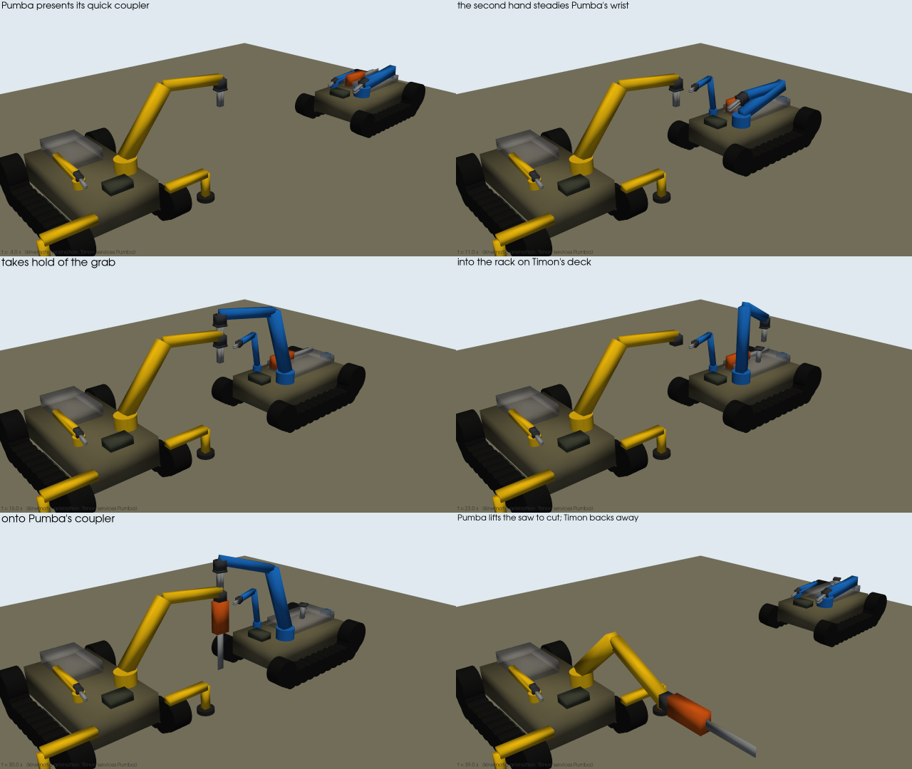

# Timon — the fleet's servicing rover

Timon keeps the other robots working in the field. It does three jobs:
- swaps their battery modules
- changes the tools on their quick couplers
- recovers a robot that has failed, by towing it or by winching it on a slope

It is a Pekari-family tracked machine (`labs/land/designs/timon_robot.py`, CAD `timon.Timon`). **Its size and layout
come from the servicing job, not from a choice.** Each candidate hull is checked against the service requirements,
and the lightest one that meets them all is Timon.

## How it services

- **Docking:** Timon drives up nose-on to the side of the robot to service and docks 0.15 m from its tracks,
  guided by fiducials on the target.
- **Main arm** (front left): Pumba's 6-DOF arm with the two-jaw grab. It reaches across to the battery hatch on
  the target's centre line, lifts the module out (26 kg for a Pumba module) and swings it onto Timon's deck. Then it
  brings a charged one back. Tool changes use the same arm on the target's quick coupler.
- **Second hand** (front right): Pekari-2M's light 5-DOF arm with a parallel gripper. It works the near half of
  the target: the hatch lid, the connector, steadying a module.
  - This is where the Perseus investigation found a second hand pays off: close to the machine, not out at a
    saw's cut (`docs/perseus_options.md`).
  - Both arms are existing family modules; no new arm was designed.
- **Deck** (behind the arms): a cradle for two spare modules and a tool rack (the grab, the 2 kW saw, a gripper).
  The nominal load is 66 kg.
- **Recovery:**
  - A tow hitch and a 4.5 kN electric winch with 15 m of line at the rear.
  - A **rear earth anchor**: a spade on an 8 kN leg, pressed into the ground behind the tracks. It anchors the
    winch and backs up the rear support.
- **Power:** Timon runs on the fleet's 60 Ah module, the same one it carries spares of.

## How it is sized

`timon_robot.check(platform)` judges a candidate against the requirements, and `sweep()` tries hull lengths
1.10–1.30 m and widths 0.56–0.68 m (25 candidates). **9 pass; the lightest is 1200 × 620 mm.**

| requirement | Timon | needed |
|---|---|---|
| main arm reaches the hatch of the widest fleet robot docked ahead | 1.17 m (arm reaches 1.58 m) | ✔ |
| second hand reaches 0.3 m into the target | 0.90 m (arm reaches 0.97 m) | ✔ |
| lifts a 26 kg module at the hatch (min of arm, 75 % tipping), no stabilizers | 28.3 kg | 26 kg |
| swings it sideways to the deck at 0.8 m | 33.6 kg | 26 kg |
| deck fits two modules + tool rack | 0.73 × 0.40 m | 0.70 × 0.40 m |
| tows a failed Pumba with its deck loaded (386 kg, drives declutched) on flat gravel | 1270 N drawbar | 420 N |
| holds it on the winch on a 15° slope | 3950 N (braked tracks + spade) | 1385 N |
| 20° climb loaded | 3680 N peak | 1190 N |
| no wider than Pumba (goes where Pumba goes) | 1.02 m | ≤ 1.08 m |
| folded height | 0.74 m | ≤ 0.8 m |

**What decides the size: the deck.** Every hull that fails, fails on the deck. A shorter or narrower roof cannot
take two modules beside the tool rack behind the arm pedestals. Lifting a module at the hatch passes at every size
in the sweep, so stability does not bind, and Timon needs no side stabilizers.

**What decides the spade: the winch.** On braked tracks alone, Timon would hold a failed Pumba on a 15° slope only
if it weighed about 440 kg. The rear earth anchor does it at 236 kg. Its hold in the ground (3 kN) is assumed and is
the first thing to test.

## The numbers

| | |
|---|---|
| mass empty / with the deck load | 236 kg / 301 kg (171 kg without arms and spade) |
| envelope, arms folded | 1.52 × 1.02 × 0.68–0.74 m |
| tracks, drives | 160 mm rubber band on six road wheels a side; Pumba's 2.5 kW drives, 8 km/h |
| battery, endurance (mixed profile) | 2.9 kWh, ~3.2 h |
| arms | 6-DOF (1.58 m, 30 kg at 1.0 m) + 5-DOF (0.97 m, 5 kg at 0.5 m) |
| parts cost (class estimate) | €43–95 k, without spare modules |

Timon sits between Perseus (181 kg, 0.87 m wide) and Pumba (236 kg, 1.08 m wide) in
[`land_comparison.md`](land_comparison.md).

## In the fleet

- **New capability tags:** `service` and `tow`, from `Platform.roles`.
- **New tasks in `fleet.py`,** raised only when a servicing robot is in the fleet:
  - **`swap_battery`:** for any robot below 20 % charge. The robot waits where it is instead of driving home, and
    the task follows it.
  - **`recover`:** for a failed robot. Timon hooks it up and tows it home at half speed.
  - A service task no capable robot can reach is cancelled and logged, not retried for ever.
- **In the response scenario** (`fleet_scenario.build(with_timon=True)`), Pekari-2M P2 has its drive fault in the
  hall at 15 s, and P1's battery drops to 15 % at 60 s:
  - Timon swaps P1's module where P1 waits (447 s).
  - Timon tows P2 home (655 s).
  - Between jobs, the auction gives Timon operator tasks it is able to do (first aid, the debris), as it does
    for any robot.
- **What Timon cannot do:** a robot that fails under the 0.55 m pipe rack is out of its reach. In the original
  scenario P2 fails in the control room, and that recovery would be cancelled as unreachable. Recovery from
  confined spaces needs a Pekari-2M-size machine with a tow line.

## The tool change, animated

`sims/timon_tool_change_movie.py` (`designs/timon_tool_change.py`): Timon docks beside Pumba, steadies its wrist with
the second hand, takes the grab off Pumba's coupler into its rack and fits the chainsaw. It is a kinematic animation
of both Chiron models (IK, then MuJoCo forward kinematics). The latch, the contacts and the masses during the handover
are not simulated.

**In physics** (`--physics`, `designs/timon_service_sim.py`): both robots in one MuJoCo world under gravity, servos
limited by their torque curves, the tools as free bodies (grab 7.2 kg, chainsaw 8 kg). The coupler latch and Timon's
grip are welds that switch on only within tolerance. The tools ride in a **basket** on Timon's rear (two slots),
held only by contact: the chainsaw stands in it at the start, and Timon drops the removed grab into its slot.
The saw latches 2.9 mm, 0.05° off (allowed 5 mm, 3°).

## Open

- **Not measured:** the spade's hold in soil, the band track's mass, the docking accuracy, and the modules'
  latches and connectors.
- **Simulation:** a MuJoCo swap — a module as a free body in a cradle on a target robot, lifted out by the grab.
- **Tool changes:** a tool-change task in the fleet.
- **Deck charger:** charging the spare modules on Timon's deck from its own pack, against swapping at base.
