# Strato — feasibility of a solar-electric stratospheric airship (HAPS)

Generated by `labs/aero/campaigns/strato/run.py` from the result files in this folder. Stage V8 of `todo.md`; assumptions and sources in `labs/aero/designs/STRATO.md`.

## Findings

- **summer (Jun–Aug, ≥ 90 % of days on station, ≥ 60 days of gas)**: the smallest optimised ship that meets it is **50 m**; the best payload found is **712.8 kg** on the 120 m ship (fineness 5.03, 18.2 km).
- **year-round (Mar/Jun/Sep/Dec, ≥ 50 % of days in the worst month, ≥ 60 days of gas)**: the smallest optimised ship that meets it is **80 m**; the best payload found is **1,923.1 kg** on the 120 m ship (fineness 2.55, 18.1 km).
- **The 15 m demonstrator has no design that meets its July requirements** at any altitude in 6–22 km. The best found floats at 6.4 km but on station only 20 % of days (needs 50 %): down there the wind is too strong for its propulsion and battery.
  At 20 km a 15 m hull of fineness 2.56 lifts 24.1 kg in all; its envelope alone weighs 29.9 kg.
- **What limits the reference ship** (hull fixed, battery and payload re-sized; base 537.6 kg): payload power ×0.5/×2 → 618/354 kg; laminate areal mass ×0.7/×1.3 → 635/420 kg; helium leak rate ×0.5/×2 → 549/429 kg; battery specific energy ×0.8/×1.2 → 438/549 kg.
- **Optimiser noise**: the base case repeated with three seeds gives 537.8, 600.8, 506.3 kg (spread 94.5 kg); sensitivities smaller than that are not resolved.
- **Re-optimised (noisy) sensitivity** for the 80 m reference ship, largest swing: **payload power**: ×0.5 → 745.2 kg, ×2 → 219.5 kg (base 537.8 kg of maximum payload).
- **GaAs vs CIGS** (80 m, summer): 537.8 kg vs 452.9 kg payload (meets: yes / yes); year-round 389.8 kg vs 292.5 kg (meets: yes / yes).
- **Sealed vs vented** (reference ship, July): sealed holds 18.24 km or more for 30 days (100 % of the time on station, 64.4 kg of ballast left); the vented variant of the same ship does not float (does not float at 18.2 km: lift 2371.9 kg < mass 2449.4 kg): its ballonet is extra mass.
- **Strato-Sigma, the smallest imaging Strato** (daylight EO camera on a small gimbal (~3 kg, 25 W) + S/X-band downlink to a ground station (~1.5 kg, 25 W), both off at night; no relay to aircraft (estimates)) for the summer scenario is **34.4 m** long (13.4 m diameter, 2,829 m³, 279 kg at 18.1 km); the envelope is 156 kg of it.
- **Zeppelin-Micro**, a maritime imaging airship at 200 m: the cheapest is **tethered**, tpu-nylon, **6.2 m × 2.1 m** (12 m³, 6.5 kg), about **€7.4k** in its first year (estimate) for a 12 m/s design wind (~65 % of hours at sea).

## The 15–120 m family (optimised)

Each ship is the differential-evolution optimum of its length: the highest payload that passes the feasibility gate and meets the scenario; where nothing meets it, the least-bad design found is shown ("meets" = no) with the reasons.

The optimiser does not reliably find the true optimum: three seeds of the 80 m summer search spread by 94 kg of payload. Read the payloads as "at least this much", ±47 kg or so; where a larger ship shows less payload than a smaller one, or summer less than year-round, the search fell short, not the physics. Which lengths meet a scenario is robust (the margins are large); the payload numbers are not.

| scenario | L [m] | D [m] | V [m³] | alt [km] | payload [kg] | mass [kg] | net lift [kg] | battery [kWh] | prop [kW] | array [m²] | avail. | gas life [d] | meets | problems |
|---|---:|---:|---:|---:|---:|---:|---:|---:|---:|---:|---:|---:|---|---|
| summer | 15 | 5.9 | 238 | 18.1 | 0.5 | 65 | 24 | 1.3 | 0.5 | 22 | 80 % | 0 | no | does not float at 18.1 km: lift 24.1 kg < mass 64.9 kg |
| summer | 30 | 11.3 | 1,773 | 18.0 | 1.4 | 209 | 181 | 3.9 | 0.5 | 95 | 90 % | 0 | no | does not float at 18.0 km: lift 181.4 kg < mass 209.3 kg |
| summer | 50 | 19.5 | 8,761 | 18.1 | 139.5 | 856 | 881 | 26.8 | 3.5 | 272 | 91 % | 61 | yes |  |
| summer | 80 | 25.5 | 24,011 | 18.2 | 537.8 | 2,260 | 2,371 | 81.1 | 24.3 | 645 | 92 % | 60 | yes |  |
| summer | 100 | 26.6 | 32,561 | 18.3 | 702.0 | 2,903 | 3,172 | 100.9 | 42.6 | 815 | 90 % | 112 | yes |  |
| summer | 120 | 23.9 | 31,485 | 18.2 | 712.8 | 3,043 | 3,093 | 115.2 | 45.9 | 753 | 96 % | 60 | yes |  |
| year | 15 | 5.9 | 240 | 18.0 | 0.3 | 66 | 24 | 1.6 | 1.4 | 20 | 8 % | 0 | no | does not float at 18.0 km: lift 24.3 kg < mass 66.1 kg |
| year | 30 | 11.4 | 1,801 | 18.1 | 1.4 | 213 | 180 | 4.9 | 1.0 | 83 | 18 % | 0 | no | does not float at 18.1 km: lift 179.9 kg < mass 212.8 kg |
| year | 50 | 19.7 | 8,907 | 18.3 | 5.4 | 838 | 865 | 46.0 | 3.0 | 365 | 47 % | 81 | no |  |
| year | 80 | 31.6 | 36,798 | 18.6 | 389.8 | 3,108 | 3,453 | 203.0 | 29.5 | 690 | 50 % | 122 | yes |  |
| year | 100 | 39.7 | 72,764 | 18.1 | 730.0 | 7,295 | 7,296 | 389.7 | 72.2 | 2,198 | 59 % | 60 | yes |  |
| year | 120 | 47.0 | 122,052 | 18.1 | 1,923.1 | 11,746 | 12,226 | 662.2 | 43.5 | 1,975 | 50 % | 62 | yes |  |

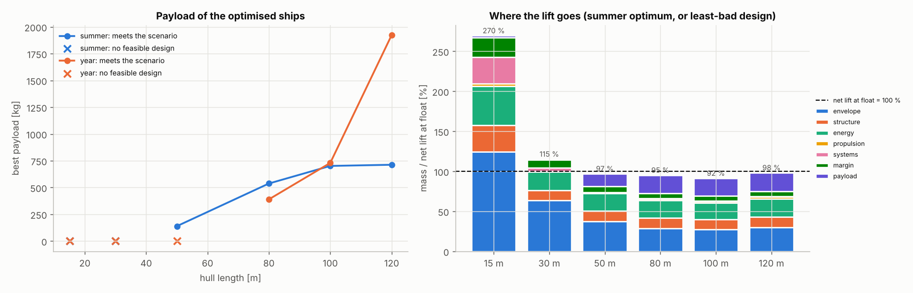

Optimised ships (CAD, STEP files in `results/cad/`):

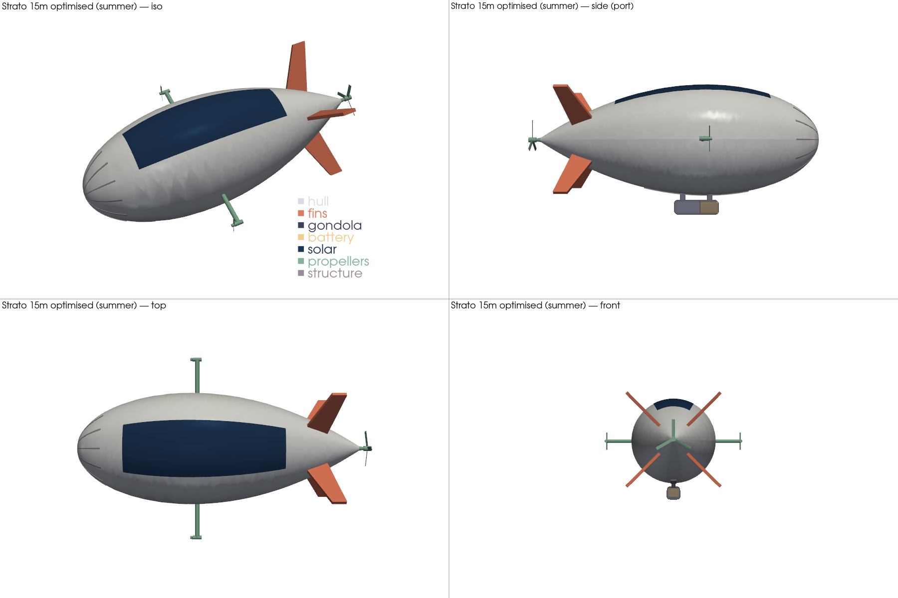

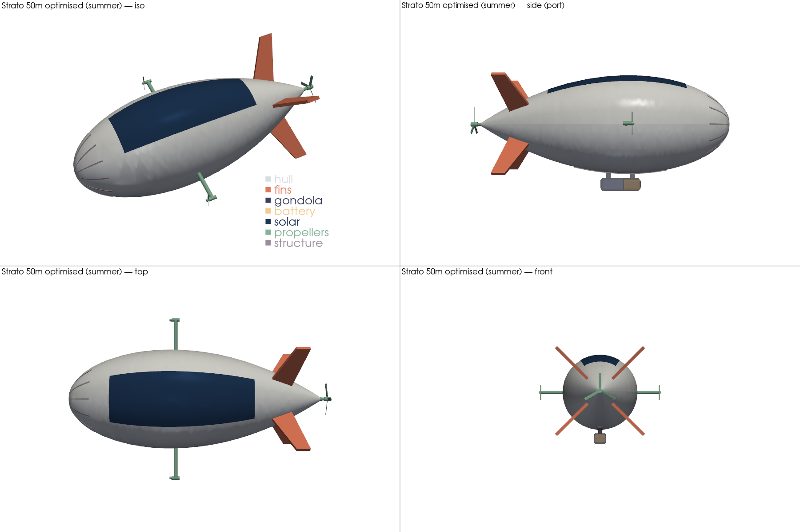

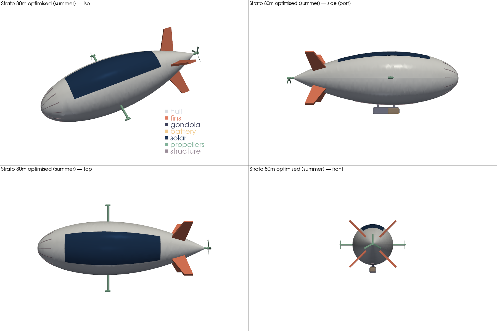

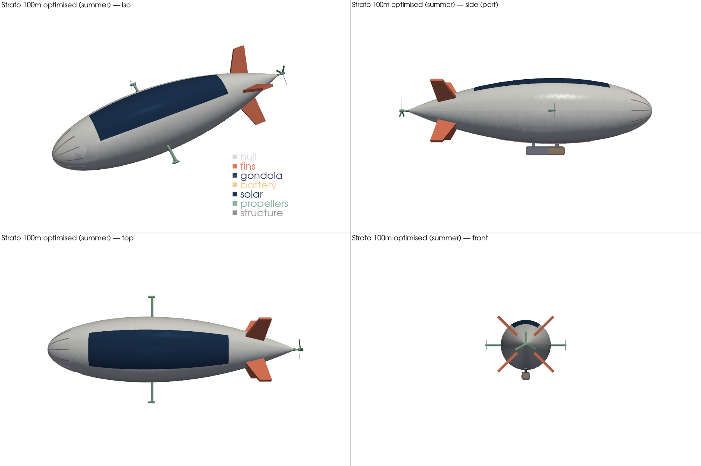

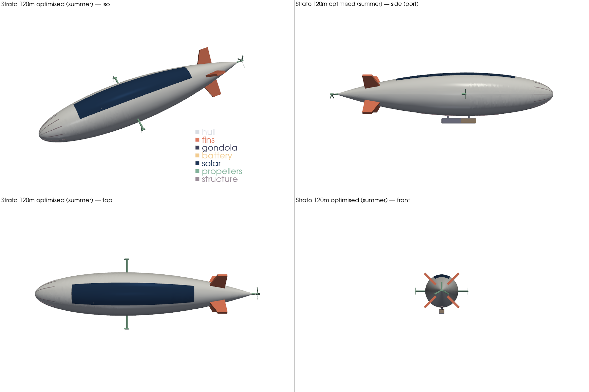

## Reference ship: day and night, endurance, ascent

| month | array [kWh/day] | loads at p90 wind [kWh/day] | battery low [% usable] | held all day | noon superheat [K] | superpressure [Pa] |
|---|---:|---:|---:|---|---:|---:|
| Jul | 1,580 | 161 | 28 | yes | 41.3 | 37 – 1,483 |
| Dec | 406 | 561 | 10 | no | 18.5 | 39 – 705 |

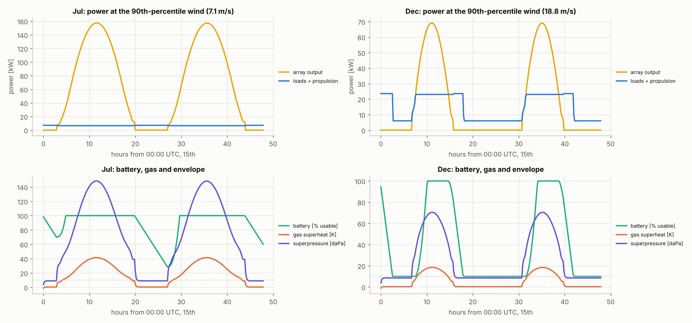

Not simulated, because the configuration does not float: vented/Jul, vented/Jan.

| case | days | on station | lowest [km] | farthest [km] | He lost [kg] | vented [kg] | ballast left [kg] | lost after [d] |
|---|---:|---:|---:|---:|---:|---:|---:|---:|
| sealed/Jul | 30.0 | 100 % | 18.24 | 0.0 | 13.1 | 0.0 | 64.4 | — |
| sealed/Jan | 30.0 | 10 % | 18.24 | 2,425.1 | 13.1 | 0.0 | 64.3 | — |

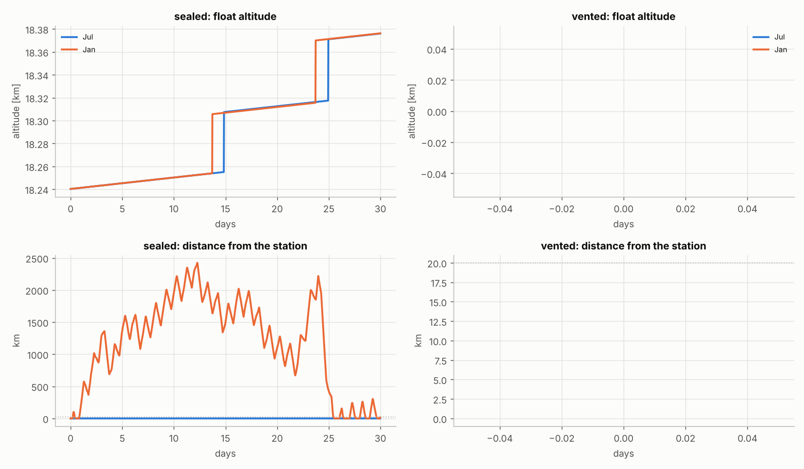

| gas system | float [km] | to 99 % [h] | max rate [m/s] | drift [km] | superpressure at top [Pa] | vented [kg] |
|---|---:|---:|---:|---:|---:|---:|
| sealed | 18.50 | 3.26 | 1.90 | 90 | 242 | 0.0 |
| vented | 16.88 | — | 1.19 | 182 | 0 | 0.0 |

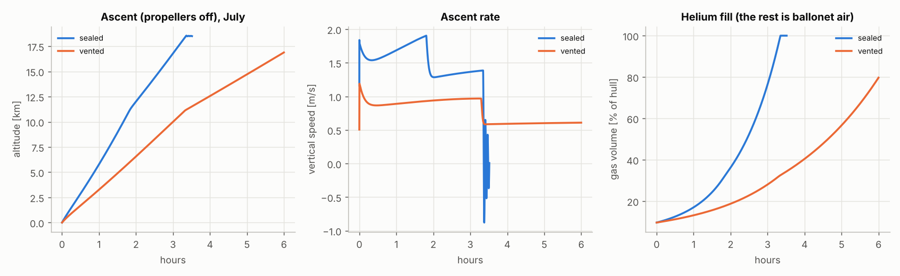

## Strato-Sigma: the smallest ship for imaging (summer)

Payload: daylight EO camera on a small gimbal (~3 kg, 25 W) + S/X-band downlink to a ground station (~1.5 kg, 25 W), both off at night; no relay to aircraft (estimates): 4.5 kg, 50 W by day, 0 W at night. Found by bisection on the length with an optimisation of everything else at each step (`strato_study.smallest_length`); "impossible" below means the search found no design within the bounds, not a proof that none exists.

| length [m] | meets | surplus lift [kg] | problems |
|---:|---|---:|---|
| 30.00 | no | -26.0 | does not float at 18.0 km: lift 197.9 kg < mass 223.9 kg |
| 32.50 | no | -9.3 | does not float at 18.1 km: lift 253.1 kg < mass 262.4 kg |
| 33.75 | no | -12.5 | does not float at 18.1 km: lift 275.1 kg < mass 287.6 kg |
| 34.38 | yes | 5.2 |  |
| 35.00 | yes | 6.2 |  |
| 40.00 | yes | 53.6 |  |
| 50.00 | yes | 283.8 |  |

|  |  |
|---|---:|
| length × diameter [m] | 34.4 × 13.36 (fineness 2.57) |
| volume [m³] | 2,829 |
| float altitude [km] | 18.11 |
| system mass / net lift [kg] | 278.7 / 283.9 |
| battery [kWh] | 5.88 |
| propulsion [kW] | 0.65 |
| array [m²] | 104 |
| envelope plies | 1 |
| superpressure night–noon [Pa] | 279 – 1,743 |
| days on station (worst of Jun–Aug) | 93 % |
| gas life [days] | 62 |

| month | feasible | days on station | surplus [kg] | noon superheat [K] | problems |
|---|---|---:|---:|---:|---|
| May | yes | 84 % | 5.2 | 38.3 |  |
| Jun | yes | 96 % | 5.2 | 40.9 |  |
| Jul | yes | 97 % | 5.2 | 41.1 |  |
| Aug | yes | 92 % | 5.2 | 39.0 |  |
| Sep | yes | 75 % | 5.2 | 34.5 |  |

30 days in July: 100 % of the time on station, lowest 18.11 km, 1.61 kg of helium lost. Ascent: 2.8 h to float, drift 76 km.

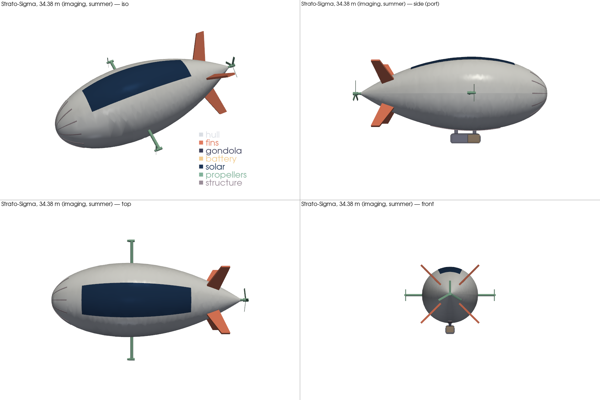

### Strato-Sigma with and without a thermal camera

Thermal variant: daylight EO + thermal (LWIR) cameras on a gimbal, imaging day and night, + S/X-band downlink to a ground station: ~6 kg, 60 W continuous; no relay to aircraft (estimates).

| camera | length [m] | D [m] | V [m³] | payload [kg / W day / W night] | mass [kg] | envelope [kg] | battery [kWh] | days on station, Jun–Aug worst |
|---|---:|---:|---:|---:|---:|---:|---:|---:|
| daylight only | 34.38 | 13.36 | 2,829 | 4.5 / 50 / 0 | 278.7 | 156.2 | 5.9 | 93 % |
| daylight + thermal, day and night | 35.62 | 13.71 | 3,083 | 6.0 / 60 / 60 | 303.5 | 165.8 | 6.1 | 91 % |

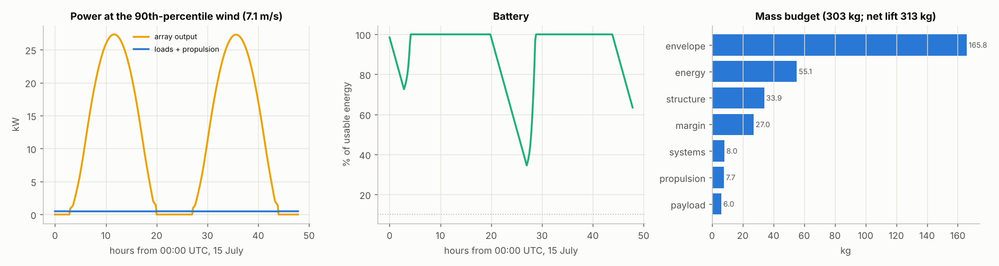

## Zeppelin-Micro: the cheapest maritime imaging airship

It stays in the troposphere, so it is a Zeppelin; the Strato name is kept for ships that float in the stratosphere.

A daylight camera with a video link lifted to 200 m above the sea for 4 h per deployment, working in winds up to 12 m/s at that height. Tethered aerostat (no propulsion; camera on a small battery, video by radio, an unpowered Dyneema line) against a free-flying micro blimp (electric propellers that out-fly the design wind by 3 m/s, a battery for the hours). Masses, prices and the sea-wind statistics are estimates (`designs/zeppelin_micro.py`); the costs compare options, they do not price a product.

| concept | envelope | fin scale | L × D [m] | V [m³] | mass [kg] | propulsion [W] | battery [Wh] | build [€] | ground [€] | helium/yr [€] | first year [€] |
|---|---|---:|---:|---:|---:|---:|---:|---:|---:|---:|---:|
| tethered | tpu-nylon | 1.4 | 6.44 × 2.15 | 13.7 | 7.5 | 0 | 85 | 5,329 | 1,087 | 1,559 | 7,975 |
| tethered | tpu-nylon | 1.0 | 6.20 × 2.07 | 12.2 | 6.5 | 0 | 85 | 4,948 | 1,087 | 1,390 | 7,424 |
| tethered | pe-film | 1.4 | 5.92 × 1.97 | 10.6 | 4.8 | 0 | 85 | 3,847 | 1,087 | 3,119 | 8,052 |
| tethered | pe-film | 1.0 | 5.71 × 1.90 | 9.5 | 4.2 | 0 | 85 | 3,609 | 1,087 | 2,797 | 7,493 |
| free | tpu-nylon | 1.0 | 7.26 × 2.42 | 19.6 | 19.9 | 965 | 2,057 | 7,652 | 300 | 2,236 | 10,188 |
| free | tpu-nylon | 0.7 | 6.87 × 2.29 | 16.6 | 16.8 | 793 | 1,711 | 6,925 | 300 | 1,894 | 9,119 |
| free | pe-film | 1.0 | 6.54 × 2.18 | 14.3 | 14.5 | 797 | 1,722 | 5,476 | 300 | 4,202 | 9,978 |
| free | pe-film | 0.7 | 6.16 × 2.05 | 12.0 | 12.2 | 650 | 1,426 | 5,013 | 300 | 3,520 | 8,833 |

With and without a thermal camera (each the cheapest sized option):

| camera | concept | L × D [m] | V [m³] | mass [kg] | payload power [W] | build [€] | helium/yr [€] | first year [€] |
|---|---|---:|---:|---:|---:|---:|---:|---:|
| daylight | tethered | 6.20 × 2.07 | 12.2 | 6.5 | 18 | 4,948 | 1,390 | 7,424 |
| daylight + thermal | tethered | 6.57 × 2.19 | 14.5 | 8.6 | 31 | 8,982 | 1,658 | 11,726 |

| altitude [m] | length [m] | volume [m³] | mass [kg] | build [€] |
|---:|---:|---:|---:|---:|
| 100 | 5.66 | 9.3 | 5.8 | 4,630 |
| 200 | 6.20 | 12.2 | 6.5 | 4,948 |
| 300 | 6.64 | 15.0 | 7.2 | 5,232 |

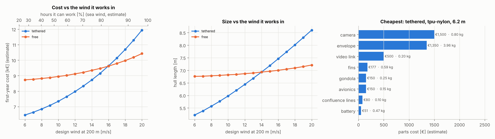

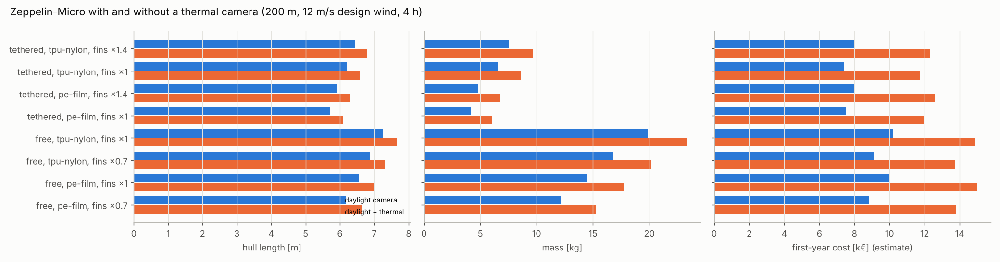

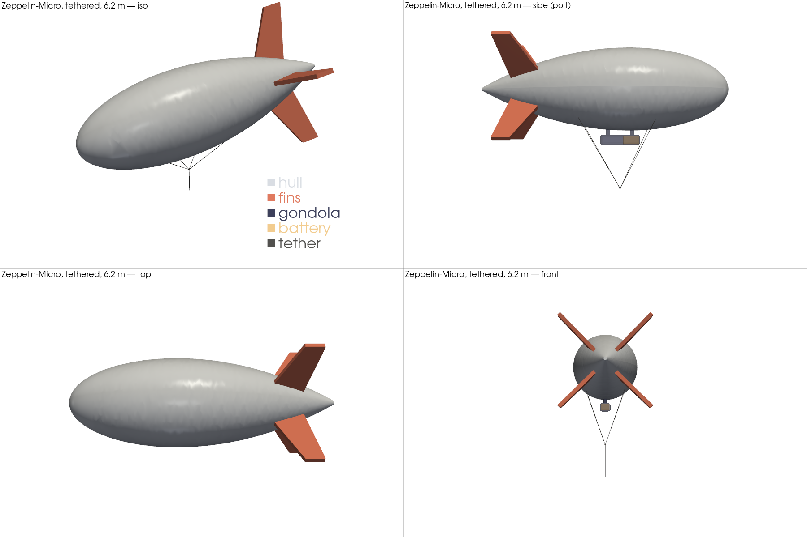

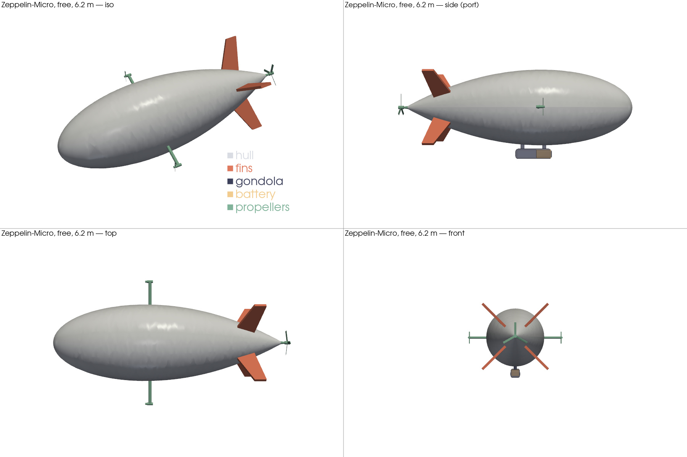

## Payload and altitude sensitivity

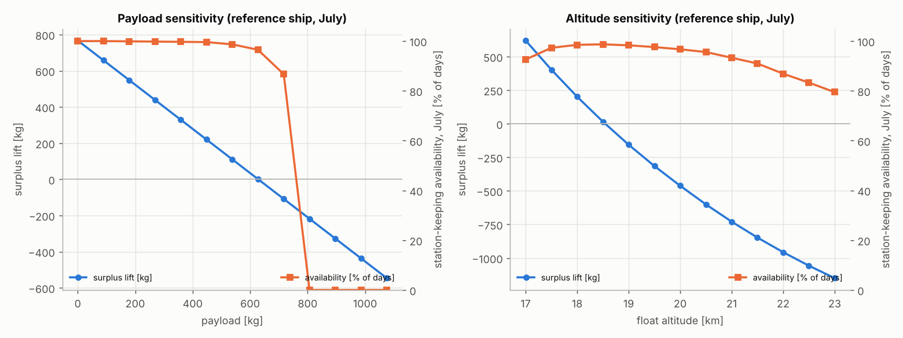

## Sensitivity to the estimates (deterministic)

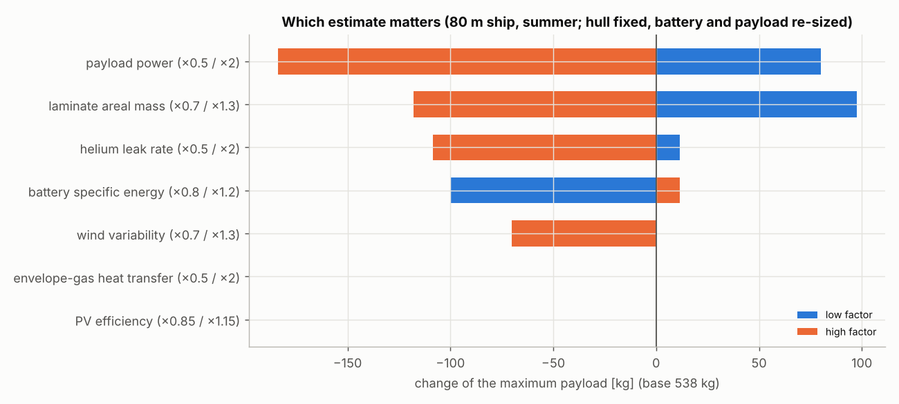

## Sensitivity to the estimates (re-optimised; optimiser noise shown)

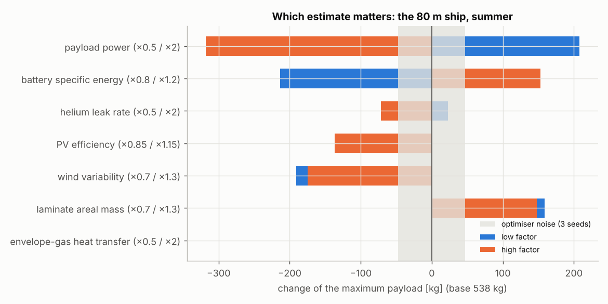

## Pareto fronts

512 Sobol designs of the reference ship, 13 pass the gate, 9 meet the summer scenario. Fronts are drawn over the feasible set.

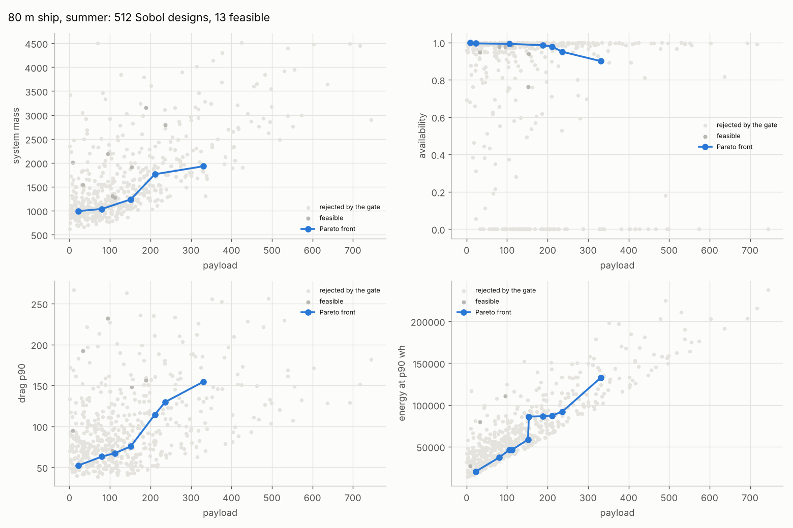

## Seasonal operation at European latitudes

— = rejected by the gate in that month (does not close its energy, or does not float)

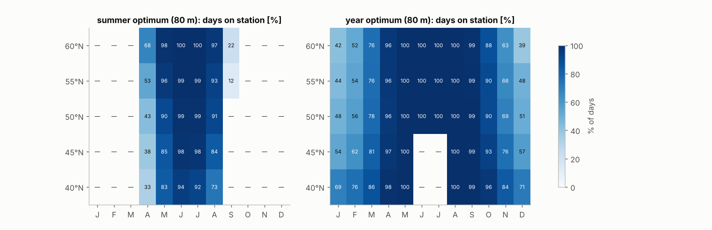

## Structural and thermal constraints

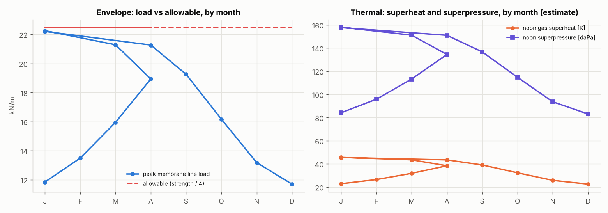

## Atmosphere

The troposphere-only `og.atmosphere` is 7.2 % off in density at 20 km; the studies use `og.stratosphere`.

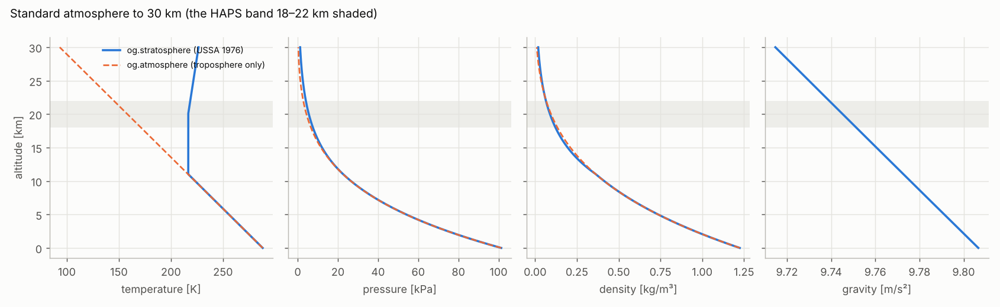

## Winds

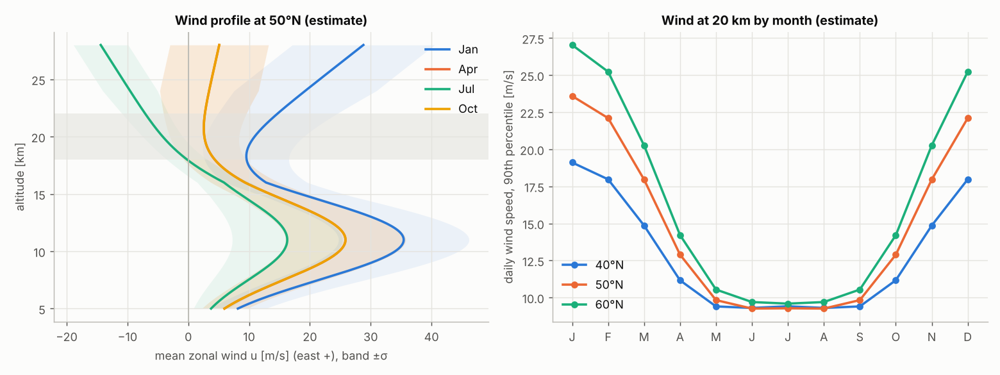

## What is verified and what is estimated

| model | where | status |
|---|---|---|
| Standard atmosphere 0–86 km, gravity vs altitude | `og.stratosphere` | verified: USSA-1976 tables (tests) |
| Buoyancy, gas laws, sealed vs vented cells | `og.lifting_gas` | verified: ideal gas, Archimedes (tests) |
| Sun position, day length, horizon dip | `og.solar` | verified: NOAA algorithm (tests) |
| Membrane forces, bending, wrinkling | `og.envelope` | verified: membrane theory (tests) |
| Hull volume, area, centre of buoyancy | `strato_geometry` | verified: analytic profile = CAD solid within 0.01 % |
| Added mass, Munk moment | `strato_aero.lamb_k` | verified: Lamb's coefficients (tests) |
| Clear-sky beam above the clouds | `og.solar.beam_normal` | estimate: Meinel relation, pressure-scaled air mass |
| Hull and appendage drag | `strato_aero.drag` | estimate: Hoerner build-up; C_DV plausibility band only |
| Fin effectiveness, stability margin | `strato_aero.stability` | estimate: low-AR lift slope, wake factor |
| Propeller efficiency | `strato_aero.propeller_efficiency` | physics (actuator disc) × estimated profile factor |
| Gas superheat, cell temperature | `strato_thermal` | estimate: two-node lumped model, assumed coefficients |
| Stratospheric winds over Europe | `strato_wind` | estimate: parametric climatology, not ERA5 data |
| Component masses, efficiencies, strengths | `strato_catalogue` | estimate: technology-class values, not datasheets |
| Sea wind, cheap-part masses and prices (Zeppelin-Micro) | `zeppelin_micro` | estimate: Weibull sea wind, retail order of magnitude |
| CFD of the hull, FEM of the fins | `Aeromant / Talos` | NOT RUN (OpenFOAM and CalculiX not installed here) |

