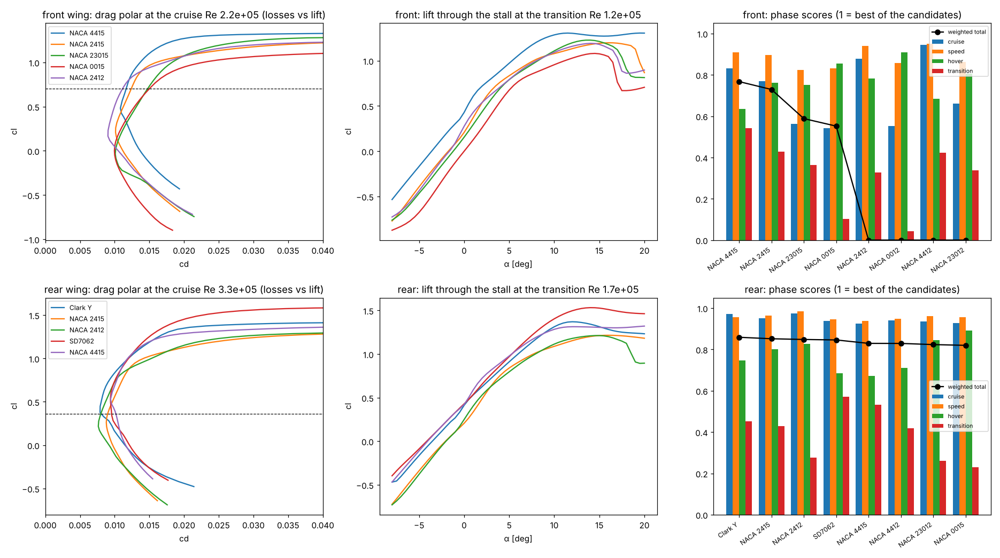

# K4TQ — the wing section by flight phase (NeuralFoil)

Generated by `labs/aero/designs/k4tq_sections.py`. Polars: NeuralFoil through `vegeta.zephyr` (n_crit 6), **CALC** (a surrogate, its confidence in the table), cached in `sections_neuralfoil.json`. The CFD check of the leaders is in `exp/K4TQ_airfoils.ipynb`.

## The conditions (K4TQ-A, Cathy)

| wing | chord | cruise V / Re / cl | speed V / Re / cl | hover slipstream V / Re | transition Re |
|---|---|---|---|---|---|
| front | 141 mm | 23 m/s, 2.2e+05, 0.70 | 27 m/s, 2.6e+05, 0.51 | 11.1 m/s, 1.1e+05 | 1.2e+05 |
| rear | 211 mm | 23 m/s, 3.3e+05, 0.36 | 27 m/s, 3.9e+05, 0.26 | 11.1 m/s, 1.6e+05 | 1.7e+05 |

Weights: cruise 60%, speed 10%, hover 15%, transition 15%; a section whose spar depth at 30 % of the tip chord is under 18 mm, or that cannot reach the cruise cl, scores 0.

## Front wing — recommendation: **NACA 4415**

| section | cruise cd | cruise L/D | speed cd | hover cd (α 0) | hover cl (α 0) | transition cl_max | stall α [deg] | lift kept 4° past the stall | cruise cm | t/c at 30 % | spar depth on the tip [mm] | least confidence | total |
|---|---|---|---|---|---|---|---|---|---|---|---|---|---|
| NACA 4415 | 0.01167 | 60.39 | 0.01024 | 0.01538 | 0.4296 | 1.306 | 19.5 | 0.9995 | -0.1012 | 0.1502 | 18.02 | 0.9769 | 0.7672 |
| NACA 2415 | 0.01241 | 56.8 | 0.01061 | 0.01477 | 0.2094 | 1.198 | 16 | 0.9831 | -0.05662 | 0.1501 | 18.01 | 0.9689 | 0.7289 |
| NACA 23015 | 0.01478 | 47.7 | 0.0125 | 0.01527 | 0.1662 | 1.227 | 14 | 0.9607 | -0.01279 | 0.15 | 18.01 | 0.9676 | 0.5881 |
| NACA 0015 | 0.01504 | 46.88 | 0.01227 | 0.01464 | 1.665e-16 | 1.081 | 14.5 | 0.9088 | -0.005179 | 0.15 | 18 | 0.9711 | 0.5517 |
| NACA 2412 | 0.01116 | 63.16 | 0.009448 | 0.01381 | 0.2808 | 1.192 | 14 | 0.956 | -0.05663 | 0.12 | 14.41 | 0.967 | 0 |
| NACA 0012 | 0.0149 | 47.32 | 0.01162 | 0.01363 | 1.063e-15 | 1.038 | 12 | 0.8987 | -0.009137 | 0.12 | 14.4 | 0.9703 | 0 |
| NACA 4412 | 0.01038 | 67.92 | 0.009182 | 0.01419 | 0.4656 | 1.317 | 16.5 | 0.9639 | -0.1024 | 0.1202 | 14.42 | 0.9735 | 0 |
| NACA 23012 | 0.01365 | 51.65 | 0.01149 | 0.01371 | 0.2385 | 1.233 | 13 | 0.9522 | -0.01873 | 0.12 | 14.4 | 0.9682 | 0 |
| SD7062 | 0.01126 | 62.59 | 0.0101 | 0.01459 | 0.4128 | 1.515 | 13.5 | 0.9827 | -0.07814 | 0.1394 | 16.72 | 0.9812 | 0 |
| E387 | 0.01002 | 70.38 | 0.008602 | 0.01239 | 0.4038 | 1.25 | 12.5 | 0.9216 | -0.0789 | 0.09049 | 10.86 | 0.4801 | 0 |
| S1223 | 0.02129 | 33.11 | 0.03428 | 0.02129 | 1.191 | 2.164 | 11 | 0.973 | -0.237 | 0.1118 | 13.42 | 0.6465 | 0 |
| Clark Y | 0.0102 | 69.14 | 0.008883 | 0.01399 | 0.4187 | 1.36 | 12 | 0.9643 | -0.0829 | 0.117 | 14.04 | 0.9485 | 0 |
| MH32 | 0.009926 | 71.01 | 0.007848 | 0.01195 | 0.3001 | 1.181 | 11.5 | 0.8862 | -0.05424 | 0.08696 | 10.43 | 0.3093 | 0 |
| SD7037 | 0.009736 | 72.4 | 0.007941 | 0.01226 | 0.3635 | 1.265 | 11 | 0.9953 | -0.07191 | 0.09195 | 11.03 | 0.5527 | 0 |

## Rear wing — recommendation: **NACA 2415**

| section | cruise cd | cruise L/D | speed cd | hover cd (α 0) | hover cl (α 0) | transition cl_max | stall α [deg] | lift kept 4° past the stall | cruise cm | t/c at 30 % | spar depth on the tip [mm] | least confidence | total |
|---|---|---|---|---|---|---|---|---|---|---|---|---|---|
| Clark Y | 0.008053 | 45.05 | 0.008897 | 0.01111 | 0.4154 | 1.371 | 12 | 0.9798 | -0.07981 | 0.117 | 21.06 | 0.9778 | 0.8588 |
| NACA 2415 | 0.008993 | 40.34 | 0.008422 | 0.01173 | 0.2062 | 1.216 | 16 | 0.9916 | -0.03822 | 0.1501 | 27.01 | 0.9698 | 0.8517 |
| NACA 2412 | 0.008012 | 45.28 | 0.007273 | 0.01083 | 0.2543 | 1.212 | 15 | 0.9632 | -0.04903 | 0.12 | 21.61 | 0.9676 | 0.8482 |
| SD7062 | 0.009568 | 37.92 | 0.009546 | 0.01219 | 0.4265 | 1.533 | 14 | 0.986 | -0.08374 | 0.1394 | 25.09 | 0.9738 | 0.8459 |
| NACA 4415 | 0.01017 | 35.68 | 0.009984 | 0.01243 | 0.4227 | 1.321 | 20 | 1 | -0.09328 | 0.1502 | 27.04 | 0.9716 | 0.8293 |
| NACA 4412 | 0.009447 | 38.4 | 0.009286 | 0.01134 | 0.4693 | 1.331 | 17.5 | 0.9777 | -0.09825 | 0.1202 | 21.63 | 0.9737 | 0.8291 |
| NACA 23012 | 0.009703 | 37.39 | 0.008545 | 0.01116 | 0.1717 | 1.262 | 13.5 | 0.9552 | -0.00744 | 0.12 | 21.61 | 0.9658 | 0.8235 |
| NACA 0015 | 0.01008 | 35.99 | 0.00894 | 0.01163 | -5.274e-16 | 1.102 | 15.5 | 0.9654 | 0.01215 | 0.15 | 27 | 0.9667 | 0.8197 |
| NACA 23015 | 0.01043 | 34.79 | 0.009244 | 0.01226 | 0.1284 | 1.257 | 14.5 | 0.9722 | 0.005013 | 0.15 | 27.01 | 0.9645 | 0.8194 |
| NACA 0012 | 0.009446 | 38.41 | 0.008212 | 0.01059 | -4.302e-16 | 1.078 | 13 | 0.9357 | 0.001935 | 0.12 | 21.6 | 0.9675 | 0.8123 |
| S1223 | 0.05128 | 7.075 | 0.06527 | 0.01892 | 1.201 | 2.185 | 11.5 | 0.9762 | -0.155 | 0.1118 | 20.13 | 0.6537 | 0.1311 |
| E387 | 0.007801 | 46.51 | 0.00896 | 0.01033 | 0.4046 | 1.264 | 12.5 | 0.9383 | -0.07775 | 0.09049 | 16.29 | 0.4673 | 0 |
| MH32 | 0.006828 | 53.13 | 0.006315 | 0.009602 | 0.3147 | 1.198 | 11.5 | 0.9246 | -0.06045 | 0.08696 | 15.65 | 0.3695 | 0 |
| SD7037 | 0.006973 | 52.02 | 0.007195 | 0.009777 | 0.3768 | 1.289 | 11.5 | 0.9941 | -0.07479 | 0.09195 | 16.55 | 0.5777 | 0 |

