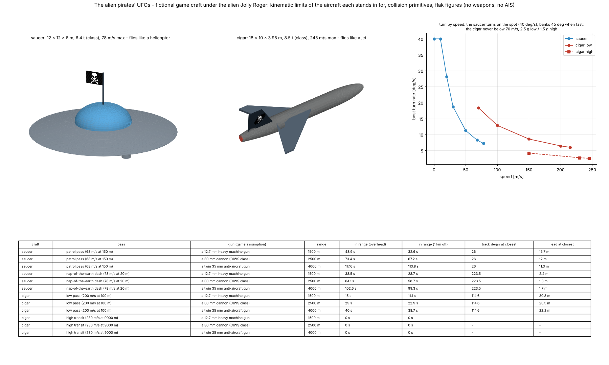

# UFOs — the alien pirates' saucer and winged cigar (v0)

Two **fictional game craft** for the sea game, flying the owner's **alien Jolly Roger**. By the owner's direction they
have **no flight physics**: no lift, rotor or engine model. What they do have is the correct speed, turn and collisions,
so they *move like* a helicopter (the saucer) and a jet (the cigar). Each limit is a class value of the real aircraft it
stands in for (`ufo.BASIS`, and `basis` on each card). **No weapons, no AIS.**

- Design: `ufo.py` (kinematics, collision, signatures, flak, CAD, flag mesh).
- Flag: `ufo_flag.py` → `data/alien_jolly_roger.png`, redrawn from the owner's image at 1536 × 1024.
- Render: `ufo_3d.png` (`ufo_draw3d.py`; the flags are drawn through their exported UVs).
- Rigid bodies: `ufo_robots.py`, registered in `machines.py`.
- Cards: `exports/ketos/{saucer,cigar}.card.json` (kind `ufo`), with the meshes and the texture.
- Yax files: `exports/{saucer,cigar}.yx2`.

## The craft

| | saucer | winged cigar |
|---|---|---|
| shape | 12 m lens-shaped disc, glass dome, 3 landing pads, mast and flag on the dome | 18 m spindle (2 m diameter), 10 m swept wings (50° leading edge) from mid-body, dorsal fin, one nozzle (after the 1952 "winged cigar-shape" sketch) |
| size L × W × H | 12 × 12 × 6 m | 18 × 10 × 3.95 m |
| mass (class) | 6.4 t: a medium twin helicopter with a 13–14 m rotor | 8.5 t: a light-to-midsize business jet |
| moves like | a **helicopter**: hovers, flies sideways and backwards, turns on the spot | a **jet**: never below 70 m/s, turns by banking |
| speeds | max 78 m/s, cruise 68; sideways 18, backwards 15 | 70–215 m/s low (cruise 200), up to 245 above 3000 m (cruise 230) |
| accel / decel | 3 / 4 m/s² (0 → 78 m/s in 26 s, nose 17° down) | 2.5 / 4 m/s² |
| climb / descent | 10 / 10 m/s | 25 / 40 m/s, pitch ≤ 25° |
| turning | yaw 40°/s on the spot (180° in 4.5 s); bank ≤ 45°, roll 40°/s | load factor 2.5 g low / 1.5 g high (bank 66.4° / 48.2°), roll 90°/s |
| altitude bands | nap of the earth 10–30 m, patrol 100–500 m, transit 500–1500 m; ceiling 6000 m | low pass 30–300 m, high 7000–12000 m; ceiling 13000 m |
| RCS (m²) | front 4, side 6, rear 4, top 30, bottom 40 | front 1.5, side 10, rear 3, top 30, bottom 25 |
| IR | belly drive ring ~520 K over 0.8 m², hull +8 K | nozzle ~700 K over 0.6 m², skin +20.5 K at 215 m/s (aerodynamic heating) |
| lights / sound | a ring of 24 cyan lights round the rim, a white light on the mast; can go dark; a low hum, about a medium helicopter's level at a distance (no rotor slap) | a red glow at the nozzle, no navigation lights; a jet's roar on a low pass, heard after it has gone by |
| collision | disc (ellipsoid), dome (ellipsoid), mast (capsule), pad_0 (cylinder), pad_1 (cylinder), pad_2 (cylinder); bounding sphere 6.71 m | body (capsule), tail (cylinder), fin (box), wing_port (box), wing_starboard (box); bounding sphere 9.47 m |
| flag | on the mast, 1.5 × 1.0 m, flying aft | painted on both sides of the fin, 1.5 × 1.0 m |

**Turn by speed.** Saucer: 0 m/s: 40°/s, r 0 m · 10 m/s: 40°/s, r 14.3 m · 20 m/s: 28.1°/s, r 40.8 m · 30 m/s: 18.74°/s, r 91.7 m · 50 m/s: 11.24°/s, r 254.8 m · 68 m/s: 8.27°/s, r 471.4 m · 78 m/s: 7.21°/s, r 620.2 m. Cigar: 70 m/s low: 18.4°/s, r 218 m · 100 m/s low: 12.88°/s, r 444.9 m · 150 m/s low: 8.59°/s, r 1001 m · 200 m/s low: 6.44°/s, r 1779.6 m · 215 m/s low: 5.99°/s, r 2056.5 m · 150 m/s high: 4.19°/s, r 2051.4 m · 230 m/s high: 2.73°/s, r 4823.2 m · 245 m/s high: 2.56°/s, r 5472.8 m.

## How they move (`ufo.step`)

`step(name, state, command, dt)` is a kinematic model. It moves a craft toward a command, within its limits:

- **Saucer (helicopter).** The command is body velocities `u`, `v`, `w` and a `heading_deg` or `yaw_rate_deg_s`.
  - Each velocity approaches its target at the acceleration or deceleration limit, clipped to the forward, sideways and backward speeds.
  - The heading turns at the yaw rate when the saucer is slow. When it is fast, the heading turns at the banked turn's rate, `g tan(45°) / v`.
  - Pitch follows the acceleration (nose down to speed up) and roll follows the turn and any sideways acceleration.
- **Cigar (jet).** The command is `speed`, `heading_deg` and `alt_m`.
  - Speed stays between its minimum and the maximum for its altitude.
  - Bank rolls in at the roll rate, up to the bank its load factor allows, and the turn rate is `g tan(bank) / v`.
  - Climb follows the height error, within the climb and descent rates and the pitch limit.

Attitude uses the aviation convention: roll is positive with the right wing down, pitch is positive with the nose up.
It is only for drawing, not dynamics. Frame: x forward, y left, z up. The saucer's z = 0 is the feet of its pads; the
cigar's z = 0 is its axis.

## Collisions

The cards carry `collision` primitives in the craft frame, using MJCF sizes:

- **Saucer:** ellipsoids for the disc and the dome, a capsule for the mast, cylinders for the pads.
- **Cigar:** a capsule for the body, a cylinder for the tail, a box for the fin, and one turned box per swept wing (`quat`).

They hold every vertex of the CAD to within 5 cm (the tests check this). The Yax rigid body's geoms are the same
primitives, with the mass spread over them by volume. `bounding_radius_m` gives the broad-phase test. The CAD meshes are
there for exact checks. The flag is visual only.

## Hunting them with flak

The guns are **game assumptions** (class envelopes), not any vessel's fit in this repo. Each pass is a straight, level
line whose ground track misses the gun by 0 m (overhead) or 1 km. The table gives:

- the time inside the gun's slant range;
- the tracking rate and the lead at the closest point (with the shell's mean speed);
- the rounds a gun fires while the craft is in range (overhead).

| craft | pass | gun | in range, overhead | in range, 1 km off | track °/s at closest | lead at closest | rounds |
|---|---|---|---|---|---|---|---|
| saucer | patrol pass, 68 m/s at 150 m | a 12.7 mm heavy machine gun (1500 m) | 43.9 s | 32.6 s | 26.0 | 15.7 m | 439 |
| saucer | patrol pass, 68 m/s at 150 m | a 30 mm cannon (CIWS class) (2500 m) | 73.4 s | 67.2 s | 26.0 | 12.0 m | 734 |
| saucer | patrol pass, 68 m/s at 150 m | a twin 35 mm anti-aircraft gun (4000 m) | 117.6 s | 113.8 s | 26.0 | 11.3 m | 2155 |
| saucer | nap-of-the-earth dash, 78 m/s at 20 m | a 12.7 mm heavy machine gun (1500 m) | 38.5 s | 28.7 s | 223.5 | 2.4 m | 385 |
| saucer | nap-of-the-earth dash, 78 m/s at 20 m | a 30 mm cannon (CIWS class) (2500 m) | 64.1 s | 58.7 s | 223.5 | 1.8 m | 641 |
| saucer | nap-of-the-earth dash, 78 m/s at 20 m | a twin 35 mm anti-aircraft gun (4000 m) | 102.6 s | 99.3 s | 223.5 | 1.7 m | 1880 |
| cigar | low pass, 200 m/s at 100 m | a 12.7 mm heavy machine gun (1500 m) | 15 s | 11.1 s | 114.6 | 30.8 m | 150 |
| cigar | low pass, 200 m/s at 100 m | a 30 mm cannon (CIWS class) (2500 m) | 25 s | 22.9 s | 114.6 | 23.5 m | 250 |
| cigar | low pass, 200 m/s at 100 m | a twin 35 mm anti-aircraft gun (4000 m) | 40 s | 38.7 s | 114.6 | 22.2 m | 733 |
| cigar | high transit, 230 m/s at 9000 m | a 12.7 mm heavy machine gun (1500 m) | 0 s | 0 s | – | – | – |
| cigar | high transit, 230 m/s at 9000 m | a 30 mm cannon (CIWS class) (2500 m) | 0 s | 0 s | – | – | – |
| cigar | high transit, 230 m/s at 9000 m | a twin 35 mm anti-aircraft gun (4000 m) | 0 s | 0 s | – | – | – |

- **Saucer.** A hovering saucer stays in range for as long as it stays, with no tracking and no lead: the hover is where it is
  vulnerable. A nap-of-the-earth dash at 20 m passes overhead at over 200°/s, faster than any gun can track, so it is
  safest to engage it while it is still approaching.
- **Cigar.** A low pass gives a 35 mm gun about 40 s, but a 12.7 mm gun only 15 s, and the shot needs a lead of about 30 m.
  In its high band (9000 m) it is out of every gun's reach.
