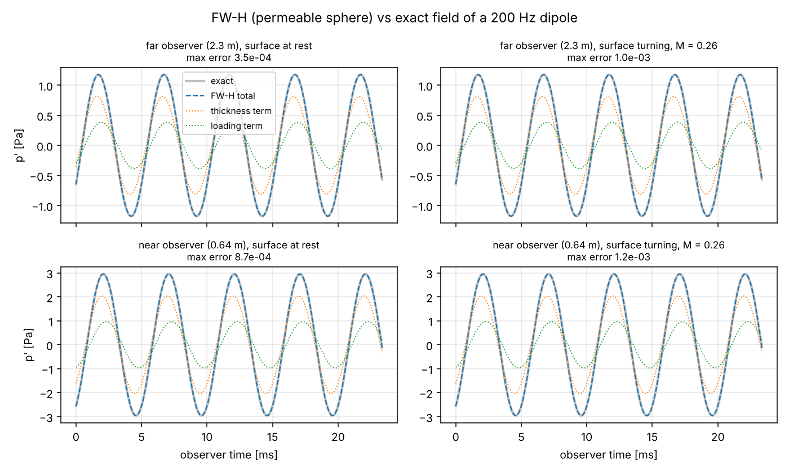
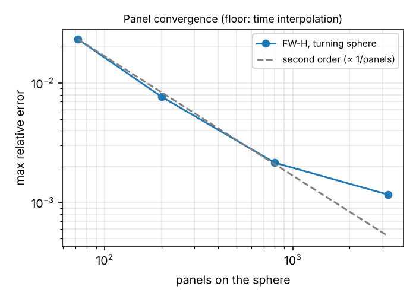
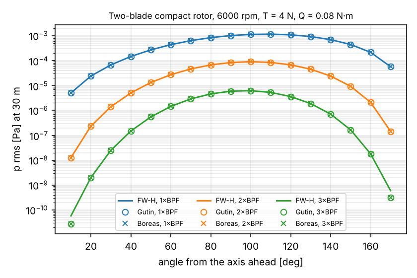

# Acoustics: FW-H post-processing

`mancha.acoustics` predicts sound from surface data with the Ffowcs Williams–Hawkings analogy in Farassat's
time-domain formulation 1A — outside the solver, so it works on Mancha output, OpenFOAM output, or analytic
sources alike.

```python
from mancha.acoustics import SourceSurface, fwh, harmonics, rigid_rotation, rotate_x

kin = rigid_rotation(link_positions, None, omega, tau, centre)          # a rotor's links turning at Ω
loads = rotate_x(-link_forces_on_body, omega * tau)                     # force on the fluid, in the lab
src = SourceSurface("forces", tau, kin["y"], kin["v"], np.ones(n), force=loads, vdot=kin["vdot"])
res = fwh(src, observers, c=1 / 3 ** 0.5, rho0=1.0, translation=(-U, 0, 0))
tones = harmonics(res["t"], res["total"], blade_passing_frequency, 3)  # RMS of 1×, 2×, 3× BPF
```

| Piece | What it does |
|---|---|
| `SourceSurface(kind=...)` | `"solid"` (gauge pressure on an impenetrable surface: thickness + loading), `"permeable"` (ρ, u, p on any closed surface around the sources), `"forces"` (compact point forces: loading only) |
| `fwh(surface, observers, c, rho0, translation)` | Farassat 1A, source-time dominant; thickness and loading parts and their sum; sources and observers may share a uniform translation (flight, or a wind tunnel with stream −V) |
| `harmonics(t, p, f, n)` | RMS of the first n multiples of f over whole periods |
| `gutin(T, Q, Ω, B, R_e, r, θ, c)` | Gutin's steady-loading tones (the same formula as `vegeta.boreas.noise.gutin_harmonics`) |
| `rigid_rotation`, `rotate_x` | kinematics of bodies turning about the x axis (Mancha's rotating frame) |
| `acoustic_field`, `monopole_potential`, `dipole_potential`, `sphere_panels` | exact fields and surfaces for verification |
| `Simulation.solid_links(part)`, `diagnostics.solid_faces(mask)` | Mancha's per-link wall forces (loading) and voxel faces (thickness) |

Not included: the quadrupole (volume) term — enclose nonlinear regions with a permeable surface instead;
supersonic sources; frequency-domain formulations; broadband models.

## Verification

Records: [`records/verify_fwh.json`](records/verify_fwh.json); script: `benchmarks/acoustics/verify_fwh.py`;
regression tests: `tests/test_acoustics.py`.

**Exact fields.** A 200 Hz dipole (and monopole) inside a permeable sphere of radius 0.3 m (40 × 80 panels),
observers at 2.3 m and 0.64 m: maximum error of the pressure history 3.5e-4 and 8.7e-4 with the sphere at rest,
1.0e-3 and 1.2e-3 with the sphere turning at Mach 0.26 (all four terms with surface motion exercised).



**Convergence.** Second order in the panel size (error ∝ 1/panels) down to ~1e-3, where the linear
interpolation of arrival times sets the floor at 30 samples per acoustic period.



**Gutin.** Two compact forces turning at 6000 rpm (T = 4 N, Q = 0.08 N·m, R_e = 0.096 m), observers at 30 m:
FW-H and Gutin's formula agree within 0.6 % for the first three harmonics at every angle, and Vegeta's
`boreas.noise.gutin_harmonics` gives the same numbers — Gutin's formula is the far-field, compact limit of the
loading term, so this checks the moving-source terms, the sign conventions for thrust and torque, and Boreas.
Near the axis the third harmonic (~1e-10 Pa) reaches the FW-H interpolation floor.



## Mancha rotor: FW-H against Mancha's own pressure, and against Gutin

See the section below (filled in from `benchmarks/acoustics/rotor_fwh.py`).
