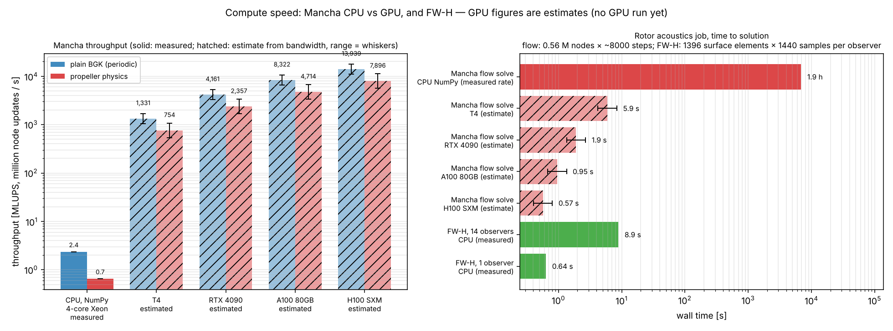

# The Triton backend

`Simulation(..., backend="triton")` keeps the populations in PyTorch tensors on the GPU and advances them with
one kernel launch per step (`mancha/backends/triton_kernels.py`).

## Kernel design

* **Fused step.** `stream_collide_bgk` pulls the 19 populations of `BLOCK` consecutive nodes, applies the
  boundary rules, computes the moments, collides (BGK + Guo force) and stores — one read and one write per
  population, no intermediate arrays. The Python loop runs over time steps only, never over cells.
* **Specialisation.** The six face kinds, "has solids", "has a pressure face", "has a force" and "needs 64-bit
  indices" are compile-time constants: an all-periodic run compiles to a kernel without any boundary code.
  Each boundary configuration compiles once (Triton caches the binaries on disk).
* **Boundaries in the kernel.** For each direction the source coordinates are computed; a boundary "key"
  (`kind·4 + axis rank`) picks the winning face exactly as the NumPy reference does. Populations that are
  replaced are not loaded from the source (masked loads), and the opposite population at the node is loaded only
  where needed. The pressure outlet needs the node's own velocity: its 19 local populations are loaded only on
  pressure-face nodes (a masked load that whole warps skip elsewhere).
* **Solids.** A per-node 32-bit mask, bit `i` = "source of direction `i` is solid", bit 19 = "node is solid":
  one 4-byte load per node instead of 19 mask lookups.
* **Macroscopic fields** (`macroscopic` kernel) are computed on the GPU into a `[4, N]` buffer; only what is
  asked for is copied to the host. The health check (finite, max |u|) also runs on the GPU and synchronises
  once per `check_interval`.
* **Rotating frame, LES, regularized collision** are compile-time switches of the same kernel. WALE reads the
  previous step's velocity at the node and its six neighbours from a double-buffered `[3, N]` field (12 more
  bytes stored, 84 read per node — mostly cache hits) and writes the new one.
* **Generated code.** `triton_kernels.py` is generated by `benchmarks/tools/gen_triton_kernels.py` (the 19
  directions are unrolled); edit the generator and regenerate.
* **Block size.** `block_size` (power of two ≥ 16, default 128) — one node per thread with Triton's default 4
  warps. Registers on sm_80 (`ptxas -v`), no spills in any configuration (`tests/test_triton_compile.py`
  checks sm_80 and sm_90): 48 for periodic BGK; 152 for BGK + frame + LES + all boundary kinds + solids; 161 with
  the regularized collision as well (146 for a 64-bit-index configuration at block 256). The full-physics
  kernel's register count limits occupancy to about a fifth of the SM — the first thing to tune on a GPU
  (split the LES gradient into its own pass, or reduce live values).
* **Precision.** FP32 only (`dtype=float64` is refused on this backend).
* **Large grids.** Above 2³¹ population indices (≈ 480³) the kernel switches to 64-bit indices.

## Memory

`2 · 19 · 4 · N` bytes for the two population buffers, `16 · N` for the macroscopic buffer and `4 · N` for the
solid mask (172 bytes per node in all; LES adds `24 · N` for the two velocity fields): 0.04 GiB at 64³, 0.34 GiB at 128³, 2.7 GiB at 256³. The backend
estimates this before allocating
and raises `InsufficientMemoryError` (with the GPU's free and total memory) if it exceeds 90 % of the free
memory; an out-of-memory during allocation is re-raised as the same error.

## Running without a GPU

The kernels run under Triton's interpreter on CPU tensors when `TRITON_INTERPRET=1` is set before Triton is
imported (`./test.sh --interpret`). It is very slow (~1000 node updates per second) and only meant to test the
kernels: the agreement tests in `tests/test_triton.py` run this way in CI. `tests/test_triton_compile.py`
compiles the kernels for sm_80 and sm_90 without a GPU.

## Benchmarking and profiling

```bash
python benchmarks/performance.py --sizes 64 128 256 --steps 500             # periodic box
python benchmarks/performance.py --case sphere --sizes 128 256              # boundaries + solids
python benchmarks/performance.py --block 64   # block-size sweep: repeat with 64, 128, 256
```

It reports MLUPS (million node updates per second), wall time, solver memory, peak allocated memory and an
effective bandwidth `MLUPS · 152 B` (`156 B` with solids), and writes a JSON with the GPU name. Compare the
bandwidth with the card's peak: an LBM step is memory-bound, so that ratio is the figure of merit (published
hand-tuned D3Q19 codes commonly report well over half of peak; Mancha has no measured figure yet).

Profiling with Nsight (on a machine with a GPU):

```bash
nsys profile -o mancha --trace=cuda python benchmarks/performance.py --sizes 128 --steps 200
ncu --kernel-name stream_collide_bgk --launch-skip 30 --launch-count 1 --set full \
    -o mancha_kernel python benchmarks/performance.py --sizes 128 --steps 50
```

Look at DRAM throughput (target: near peak), achieved occupancy (register-limited at 145 registers with
`BLOCK=256`, hence the default 128) and L2 hit rate of the shifted loads.

## Measured CPU throughput and GPU estimates (2026-10-28)

Measured, NumPy backend (float64) on the development container (4-core Intel Xeon), `benchmarks/performance.py`
with 20 timed steps:

| case | 32³ | 64³ |
|---|---|---|
| periodic BGK | 3.6 MLUPS | 2.4 MLUPS |
| channel (inlet, outlet, walls) | 3.3 | 2.3 |
| sphere (+ solids) | 3.1 | 2.1 |
| propeller physics (frame + regularized BGK + WALE + sponge + solids) | 0.9 | 0.7 |

NumPy is the readable reference, not a fast CPU code; a compiled multi-core CPU backend would likely reach tens to
~150 MLUPS here (an expectation, not measured).

**GPU: estimates only.** MLUPS ≈ achieved bandwidth / bytes per node and step: 152 B (periodic), 156 B (solids),
≈ 180 B (propeller physics, assuming WALE's neighbour reads mostly hit cache). Assumed achieved fraction of peak
bandwidth: 50–80 % for plain BGK (48 registers), 30–60 % for the propeller physics (161 registers limit
occupancy).

| GPU (peak bandwidth, memory) | periodic BGK | propeller physics | nodes that fit (propeller physics) |
|---|---|---|---|
| T4 (320 GB/s, 16 GB) | 1 000–1 700 MLUPS | 500–1 100 | ~70 M |
| RTX 4090 (1.0 TB/s, 24 GB) | 3 300–5 300 | 1 700–3 400 | ~110 M |
| A100 80 GB (2.0 TB/s) | 6 700–10 700 | 3 400–6 800 | ~400 M |
| H100 SXM (3.35 TB/s, 80 GB) | 11 000–17 600 | 5 600–11 000 | ~400 M |



FW-H post-processing (CPU, measured): 0.64 s per observer for the D = 16 rotor (1 396 surface elements × 1 440 source samples), about 3 million element-samples per second (`records/fwh_speed.json`).

**Measured GPU results: none yet.** The backend was developed in a container without a GPU; no GPU timings exist
and none are quoted. Record them in [validation.md](validation.md#performance) with the GPU named when measured.
