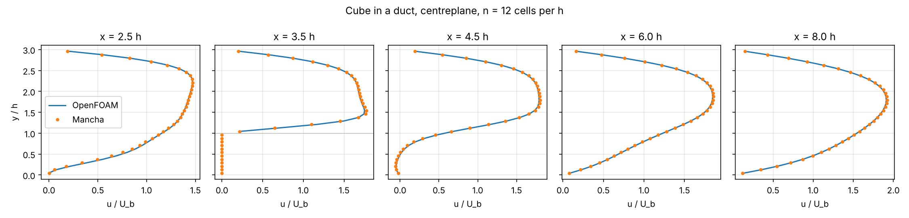

# Mancha against OpenFOAM: a wall-mounted cube in a duct

An independent check of the solver on a three-dimensional flow with separation, against OpenFOAM's steady
incompressible solver. Script: `benchmarks/openfoam/cube_in_duct.py`; record: [`records/cube_in_duct.json`](records/cube_in_duct.json).

## The case

Lengths in cube heights h. A duct 12 h long, 3 h high (y) and 3 h wide (z), no-slip walls on all four sides,
uniform inflow at x = 0, fixed pressure at x = 12 h. A cube of side h stands on the floor, upstream face at
x = 3 h, centred in z. Re = U_b h / ν ≈ 39 (U_b the bulk velocity): steady, with a recirculation zone
behind the cube, a horseshoe-shaped flow around it and a corner vortex at its base — all of it three-dimensional.

Both codes see the same geometry exactly: every surface is on the grid. OpenFOAM uses uniform cubic hexahedra
(blockMesh, n cells per h); Mancha uses n lattice cells per h with halfway bounce-back walls. OpenFOAM's cell
centres then coincide with Mancha's nodes, so fields are compared point by point with no interpolation.

| | Mancha | OpenFOAM v1912 (openfoam.com, Ubuntu package) |
|---|---|---|
| method | D3Q19 BGK, NumPy backend (float64) | simpleFoam, laminar, SIMPLEC, `Gauss linear` for every term |
| inlet | velocity bounce-back, u_in = 0.05 (Ma 0.09) | uniform fixed value = Mancha's measured U_b |
| outlet | anti-bounce-back, ρ = 1 | p = 0, `inletOutlet` velocity |
| converged when | relative velocity change over 500 steps < 1e-6 | initial residuals < 1e-7 (p), 1e-8 (U) |
| drag | momentum exchange on the solid voxels | pressure + viscous stress on the cube faces |

Mancha runs first: the Reynolds number is built from its measured bulk velocity (its inlet delivers 2.8 %
(n = 8) and 1.9 % (n = 12) less flux than u_in times the inlet area — the inlet edges are walls), and OpenFOAM
runs at that Reynolds number. OpenFOAM's forces are integrated from the converged fields by the script
(zero-gradient pressure on the faces, wall shear ν u_t/(Δ/2)), which is what OpenFOAM's `forces` function object
computes on this mesh — function objects abort with an IOstream error in this OpenFOAM build.

## Results

Coefficients use ½ ρ U_b² h². Lift is gauge (Mancha's momentum exchange sees the absolute pressure; the
reference pressure acting on the top face is removed).

| n (cells per h) | Re | Cd Mancha | Cd OpenFOAM | Cl Mancha | Cl OpenFOAM | reattachment Mancha | reattachment OpenFOAM | Δp Mancha | Δp OpenFOAM |
|---|---|---|---|---|---|---|---|---|---|
| 8 | 38.89 | 4.292 | 3.908 | −0.541 | −0.718 | 0.879 h | 0.896 h | 1.533 | 1.515 |
| 12 | 39.26 | 4.217 | 3.940 | −0.517 | −0.626 | 0.932 h | 0.951 h | 1.535 | 1.515 |
| 16 | 39.26 | — | 3.972 | — | −0.590 | — | 0.972 h | — | 1.521 |
| 24 | 39.26 | — | 4.017 | — | −0.557 | — | 0.989 h | — | 1.527 |

Reattachment: end of the reversed flow behind the cube on the floor line through its centre, from the cube's
downstream face. Δp: difference of the plane-averaged pressure between x = h and x = 11 h, in units of
U_b² (kinematic).

Velocity fields (|u_Mancha − u_OpenFOAM| / U_b over all fluid points):

| n | RMS | max | RMS beyond x = h | max beyond x = h |
|---|---|---|---|---|
| 8 | 0.045 | 0.58 | 0.028 | 0.41 |
| 12 | 0.025 | 0.51 | 0.015 | 0.33 |



## Reading the numbers

* **Flow field.** The centreplane profiles (above, n = 12) agree everywhere — upstream, over the cube, in the
  recirculation and in the recovering wake. The whole-field RMS difference halves from n = 8 to n = 12
  (0.045 → 0.025 U_b; 0.028 → 0.015 beyond the first h), i.e. the codes converge towards each other at about
  first-to-second order. The maxima sit at the inlet corners, where the inlet conditions differ by
  construction (OpenFOAM imposes U_b on every inlet face; Mancha's walls take the inlet edges and the corner
  cells start slow), and next to the cube's edges.
* **Pressure drop.** Within 1.2–1.4 %; OpenFOAM's own value moves by 0.8 % between n = 12 and n = 24.
* **Reattachment.** Mancha is 2 % shorter than OpenFOAM at the same grid; both lengthen with resolution and
  OpenFOAM is not converged at n = 24 (0.951 → 0.972 → 0.989 h). Mancha at n = 12 is 6 % below OpenFOAM at
  n = 24.
* **Drag.** The largest difference: Mancha is 9.8 % (n = 8) and 7.0 % (n = 12) above OpenFOAM at the same grid,
  but the two move towards each other — Mancha falls (4.29 → 4.22), OpenFOAM rises (3.91 → 3.94 → 3.97 →
  4.02) — and Mancha at n = 12 is 5.0 % above OpenFOAM's finest grid. OpenFOAM's drag is not in its asymptotic
  range by n = 24 (the increments do not shrink: the cube's sharp edges are singular and its first-order wall
  shear estimate converges slowly), so the converged value is bracketed between about 4.02 and 4.22 by these
  data, not determined. Lift follows the same pattern (Mancha −0.52, OpenFOAM −0.72 → −0.56).

What this supports: Mancha's three-dimensional separated flow agrees with an established finite-volume solver to
within the discretisation uncertainty of either code at these resolutions, with the integral force the least
converged quantity in both. It does not establish the drag of this configuration to better than about ±5 %.
A finer Mancha series (n = 16, 24: a GPU job) and a graded OpenFOAM mesh would narrow the bracket.

## Running it

```bash
sudo apt install openfoam        # or any openfoam.com build; pass --openfoam-bashrc .../etc/bashrc
python benchmarks/openfoam/cube_in_duct.py --n 8 12 --reference-n 16 24 --procs 4 --out results/openfoam
```

Mancha's runs are cached in `results/openfoam/mancha_n*.npz` (rerunning only redoes OpenFOAM). With the NumPy
backend the n = 12 Mancha run took 18 min on the development container's CPU (4 cores, shared); OpenFOAM took 18 s at
n = 12 and 4.3 min at n = 24 on 4 MPI ranks. `tests/test_openfoam_comparison.py` checks the force and
reattachment post-processing and, where OpenFOAM is installed, runs the case at n = 4.

## What the comparison found

* An under-resolved run (n = 4, τ = 0.515) never reached a steady state: the pressure outlet oscillated in the
  walled duct. Documented in [boundaries.md](boundaries.md#limitations) with the measured threshold; the
  comparison uses n ≥ 8 (τ ≥ 0.53).
